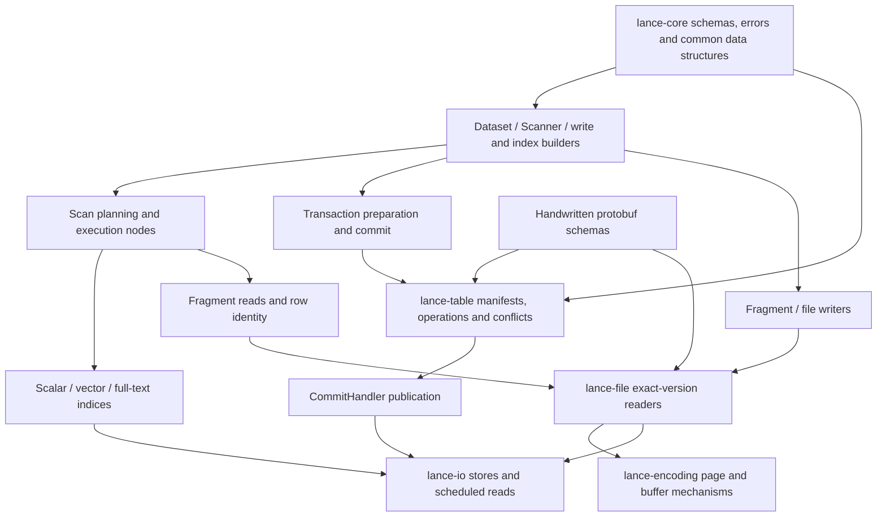

# Lance engine orientation

> Refresh 2026-10-12, `011953c22097b67b699595adbe99e7f0155d83e4`: source coordinates updated. [Changed contracts](L3-symbols/refresh-2026-10-12.md) supersede pre-refresh claims only for the listed changes. Unchanged analysis is retained.

> Refresh 2026-10-11, `4ac2f7c88be1ea2ab2c0fbb61d02238883fc18b9`: source coordinates updated. [Changed contracts](L3-symbols/refresh-2026-10-11.md) supersede pre-refresh claims only for the listed changes. Unchanged analysis is retained.

> Refresh 2026-10-09, `db684d1f0726c00b6defb7963a604a7719e82b5a`: source coordinates updated. [Changed contracts](L3-symbols/refresh-2026-10-09.md) supersede pre-refresh claims only for the listed changes. Unchanged analysis is retained.

> Refresh 2026-10-07, `84d1681e07af565837f2d97e72ff1b8b040cd15c`: source coordinates updated. [Changed contracts](L3-symbols/refresh-2026-10-07.md) supersede pre-refresh claims only for the listed changes. Unchanged analysis is retained.

**Navigation and contracts; source access is expected.** Start here, choose a path, and open its ordered source set. Deep format details live in the [format contract](L3-symbols/format-spec.md), terminology in the [engine glossary](L0-glossary.md), and exact retained declarations in the [frozen symbol snapshot](L3-symbols/symbol-index.md). [Scope and trust](V21-PROTOCOL.md).

## Architecture and state ownership

Lance presents a versioned Dataset over immutable data files and versioned metadata. A fragment groups physical columns for the same rows; its manifest entry carries deletion, overlay and lineage metadata. A Dataset handle owns a manifest snapshot plus stores, commit handler and session/cache handles. Publishing a new manifest makes a mutation visible; finishing a data file alone does not publish a dataset. (protos/fragment_metadata.proto:8-87; rust/lance/src/dataset/write/commit.rs:469-582; rust/lance-table/src/transaction/operation.rs:1-264)

The arrows identify ownership/call boundaries rather than a claim that every request crosses every box. Scanner creates a physical plan; the DataFusion adapter executes it and returns a RecordBatch stream. Encoding describes pages and schedules their bytes through an I/O seam; it does not commit Dataset versions. Index creation writes index state before committing CreateIndex metadata. (rust/lance/src/dataset/scanner.rs:2999-3015; rust/lance-datafusion/src/exec.rs:721-761; rust/lance-encoding/src/lib.rs:33-134; rust/lance/src/index/create.rs:696-743)

## Read path

**Entry:** `dataset.scan().try_into_stream().await?`. The stream must be consumed to execute reads. This is a trace of the public Rust path; it is not a command that was run during KB work.

1. `Dataset::scan` clones the snapshot into `Scanner`. Configure projection/filter/vector/limit before planning. (rust/lance/src/dataset.rs:1688-1705)
2. `Scanner::create_plan_impl` validates options, resolves full-text/query filters, chooses vector, full-text, MinHash or filtered read source, and adds filtering, ordering, limit and final projection. Scalar index use is conditioned on prefiltering or absence of nearest search. Conflicting search modes error. (rust/lance/src/dataset/scanner.rs:3633-3801)
3. `try_into_stream` passes the plan, batch size and statistics callback to `execute_plan`. Multiple output partitions are merged with order preservation when ordering exists; execution starts at partition 0 of that final plan. (rust/lance/src/dataset/scanner.rs:2999-3015; rust/lance-datafusion/src/exec.rs:721-761)
4. The selected source reads fragment metadata/deletions/lineage and reaches exact-version file readers. File open loads footer/global/column metadata; prepared reads schedule pages, decode selected values and materialize batches. The local contract is in the [frozen shared-reader record](L2-files/rust/lance-file/src/reader.rs.md); source ranges are rust/lance-file/src/reader.rs:732-1020. No guarantee is made that every query reads every column or uses an index.

**Ordered initial read set (4 files):** `rust/lance/src/dataset.rs:1688-1705` → `rust/lance/src/dataset/scanner.rs:2999-3042,3633-3801` → `rust/lance-datafusion/src/exec.rs:721-761` → `rust/lance-file/src/reader.rs:732-1020`. For a particular scan operator, follow the scanner's selected source rather than opening all execution nodes.

## Write path

**Entry:** `Dataset::write(reader, destination, Some(params)).await?`.

1. `Dataset::write` constructs `InsertBuilder`, applies params and calls `execute_stream`; the input reader is converted into stream/schema. (rust/lance/src/dataset.rs:951-980; rust/lance/src/dataset/write/insert.rs:108-130)
2. Resolve destination/store/version, validate the write, resolve target bases and write fragments. A fixed data filename combined with target bases is rejected. `execute_uncommitted` stops after building a transaction: data objects may exist, but no manifest has been published. (rust/lance/src/dataset/write/insert.rs:154-270)
3. Create and overwrite produce `Operation::Overwrite`; append produces `Operation::Append`. The transaction's read version comes from the destination snapshot or 0 for a new destination. File assembly/flush belongs to the fragment writer, and its exact bytes to the selected file-version writer. (rust/lance/src/dataset/write/insert.rs:272-320; rust/lance/src/dataset/write.rs:1734-1816)
4. `do_commit` configures `CommitBuilder`. Existing datasets use the retrying transaction path (or the explicitly selected detached path); new datasets use `commit_new_dataset`. Detached new-dataset creation is rejected; detached commit cannot use V1 manifest naming. (rust/lance/src/dataset/write/insert.rs:158-183; rust/lance/src/dataset/write/commit.rs:469-524)
5. Successful publication returns a Dataset carrying the committed manifest/location and caches. Data-file existence is not commit evidence; error/outcome recovery belongs to `io/commit.rs`. (rust/lance/src/dataset/write/commit.rs:526-582; rust/lance/src/io/commit.rs:273-301)

**Ordered initial read set (5 files):** `rust/lance/src/dataset.rs:951-980` → `rust/lance/src/dataset/write/insert.rs:108-320` → `rust/lance/src/dataset/write.rs:1734-1816` → `rust/lance/src/dataset/write/commit.rs:310-582` → `rust/lance/src/io/commit.rs:1691-1950`. The exact persisted manifest contract is already available through the [frozen table I/O record](L2-files/rust/lance-table/src/io/manifest.rs.md).

## Compaction path

**Entry:** `compact_files(&mut dataset, options, remap_options).await?`.

1. Construct and run the compaction planner. Reject eager index remapping on a tagged fragment-reuse history. No planned tasks means no new committed version. Execute planned rewrites with bounded concurrency and collect successful results. (rust/lance/src/dataset/optimize.rs:1028-1152)
2. Each rewrite validates its target exact file version, refreshes required fragment statistics and chooses binary-copy or scan/re-encode. A forced binary-copy request cannot silently fall back. Capture old physical row addresses only when a consumer needs remapping; stable row IDs use their own lineage. (rust/lance/src/dataset/optimize.rs:2494-2569; rust/lance/src/dataset/optimize.rs:2693-2789)
3. `commit_compaction` validates tagged-history/remap requirements and takes the **minimum RewriteResult.read_version**, so conflicts since task planning remain visible even if the caller opened a newer Dataset handle. Address-style outputs reserve fragment IDs; remap indices now or produce deferred fragment-reuse metadata according to the selected protocol. (rust/lance/src/dataset/optimize.rs:3227-3337)
4. Commit a Rewrite operation through Dataset's normal commit boundary. Old files are not made safe to delete merely by writing replacements; retain manifest/version retention policy. (rust/lance/src/dataset/optimize.rs:3662-3693; rust/lance-table/src/transaction/operation.rs:74-123)

**Ordered initial read set (4 files):** `rust/lance/src/dataset/optimize.rs:1028-1152,2494-2789,3227-3337,3662-3693` → `rust/lance/src/io/commit.rs:1691-1950` → `rust/lance/src/io/commit/conflict_resolver.rs:1546-1813,2973-3229` → [frozen manifest application](L2-files/rust/lance-table/src/transaction/manifest_build.rs.md). Split copy mechanics or a specific index remapper into a separate task instead of expanding this read set without bound.

## Index build and query path

**Entry:** `DatasetIndexExt::create_index` / `create_index_builder`; query through Scanner.

1. The Dataset extension constructs `CreateIndexBuilder`; optional name and replace settings are applied before awaiting it. The builder validates one-column admission and reserves names against all stored indices, including unsupported ones. (rust/lance/src/index.rs:2456-2490; rust/lance/src/index/create.rs:176-225)
2. Build/train through the selected scalar/vector index implementation; `execute_uncommitted` yields metadata without publication. Multi-segment FM-Index construction has a separate atomic multi-index path. (rust/lance/src/index/create.rs:176-225; rust/lance/src/index/create.rs:696-713)
3. On replacement, collect same-name metadata to remove, then commit CreateIndex with newly built metadata. Reload the committed index by UUID so the return value reflects commit-time changes; missing UUID after commit errors. (rust/lance/src/index/create.rs:706-743)
4. Scanner later selects index-backed or scan-backed sources from query/filter options. Data not covered by an index must be accounted for by that query path; never equate a stored index bitmap with all current rows. The distinctions are in the [frozen index metadata contract](L2-files/rust/lance-table/src/format/index.rs.md). (rust/lance/src/dataset/scanner.rs:3716-3801)

**Ordered initial read set (4 files):** `rust/lance/src/index.rs:2456-2490` → `rust/lance/src/index/create.rs:176-225,696-743` → `rust/lance/src/dataset/scanner.rs:3716-3801` → [frozen index metadata](L2-files/rust/lance-table/src/format/index.rs.md). Concrete scalar/IVF-PQ implementation choices belong to the M2 index Module Map, not an assumed universal build pipeline.

## Essential distinctions

- File format version, Dataset manifest version, per-row creation/update version and index version are different domains. Never compare them interchangeably. [Exact version matrix](L3-symbols/format-spec.md); [glossary](L0-glossary.md).
- Stable logical row IDs differ from physical `(fragment_id, offset)` addresses; compaction changes physical addresses. (rust/lance-core/src/utils/address.rs:6-79; protos/fragment_metadata.proto:34-81)
- Declaration in a protobuf union does not establish acceptance in every exact file version. Reader grammar and writer selection are independent checks. (rust/lance-file/src/versions/v2_1/reader.rs:99-119; rust/lance-file/src/versions/v2_2/reader.rs:99-127)
- Stable format compatibility is durable; unstable formats may change; frozen legacy paths are not new-feature extension points. (AGENTS.md:5-20)

This orientation completes M1's architecture and four public paths. Detailed subsystem/API contracts and navigation tests remain independently tracked in M2–M4; no build or runtime execution is claimed.

## Development entry

Choose a task in the [ordered navigation index](L4-crosscutting/navigation-index.md), then read its contract and bounded implementation set. API-only questions start at [public contracts and bindings](L3-symbols/public-api.md).
