> Historical cross-layer wording before M3 consolidation.

> **V2.1 navigation and contract layer.** Source reading is permitted. Production contracts retained from iteration 85 remain valid at the recorded snapshot. Historical line-count/test-coverage statements are provenance, not completeness requirements. Use [V2.1 protocol](../../V21-PROTOCOL.md) and CORE-MANIFEST.json for current scope.

# Behavior contracts

**M3 synthesis in progress.** The [Dataset commit and conflict protocol](../../L3-symbols/protocol-commit.md) now covers orchestration, directional operation conflicts, retries and ambiguous outcomes. Existing verified production contracts below remain canonical for their local mechanisms. [I/O scheduling](../../L3-symbols/protocol-io.md) and [encoding/version admission](../../L3-symbols/protocol-encoding.md) now provide canonical decision contracts. [Index build/update](../../L3-symbols/protocol-index.md) now covers plugin, vector and segment-maintenance contracts. [Public API family contracts and declaration routes](../../L3-symbols/public-api.md) cover the new subsystem surfaces. Final recipe/scenario navigation and milestone acceptance are being completed.

[Module](../../L1-modules/protos.md) · [Symbol index](../../L3-symbols/symbol-index.md) · [Format](../../L3-symbols/format-spec.md) · [Scenarios](../../L4-crosscutting/scenarios.md)

| Operation or interpretation | Required behavior | What breaks if changed | Evidence |
|---|---|---|---|
| Materialize covering columns | Absent means all declared, present-empty none, selected list exactly those | Remote execution output schema can diverge from planner | protos/ann.proto:28-41; protos/ann.proto:64-70 |
| RQ query approximation | Normal all bits/u8, Fast one bit, Accurate all bits/u16 | Scoring policy no longer matches serialized request | protos/ann.proto:12-26 |
| Blob materialization admission | Ordered admission; one oversized batch allowed only with no other reservation | Treating budget as unconditional cap can prevent the documented oversized case | protos/filtered_read.proto:65-71 |
| Decode per-fragment filters | Map values index the deduplicated filter byte array | Treating values as independent IDs selects the wrong predicate | protos/filtered_read.proto:79-97 |
| Resolve missing fragment column | All rows of the missing schema column are null | Historical fragments produce wrong values after schema evolution | protos/fragment_metadata.proto:8-12 |
| Resolve overlay cell | Greater committed version, then later list entry; deletion wins | Reads, retries, and index reevaluation can expose stale/deleted values | protos/fragment_metadata.proto:185-237 |
| Resolve sparse NULL | Covered bit plus null value overrides; absent bit falls through | UPDATE-to-NULL behaves like no update | protos/fragment_metadata.proto:240-248 |
| Locate overlay value | Rank of offset below target within that field's bitmap | Sparse columns become misaligned | protos/fragment_metadata.proto:196-200 |
| Interpret file-size zero | Unknown, not necessarily empty | Footer location may be calculated incorrectly | protos/fragment_metadata.proto:171-177 |
| Map v2 field to column | Use column_indices; allow -1 for no own column, prohibit other duplicate mappings | Packed/nested fields point to wrong physical columns | protos/fragment_metadata.proto:116-161 |
| Decode hidden lineage | Exactly one reserved-field match, v2 mapping, physical-length non-null u64 | Identity/version rows become absent or misaligned | protos/fragment_metadata.proto:288-305 |
| Replace data file in tree action | Replace first path match, retain mapping and file version | Replacing all matches or resetting mappings mutates unrelated state | protos/fragment_metadata.proto:443-455 |
| Remove data file in tree action | Remove every matching path; keep survivor order | A duplicate match survives if first-match semantics are reused | protos/fragment_metadata.proto:428-432 |
| Interpret row-ID bitmap | Implementation LSB first, set means present; schema comment says MSB first | Reversing bits changes selected IDs; comment is inconsistent with current byte-exact fixture | protos/rowids.proto:45-60; rust/lance-table/src/rowids/bitmap.rs:67-77; rust/lance-table/src/rowids/serde.rs:436-451 |
| Decode zone-map seed presence | Absent disabled; use creation defaults only at creation | Old files can be assumed to contain nonexistent seed buffers | protos/index_old.proto:29-45 |
| Interpret zone-map null support | Absent/false approximate; true exact null bitmap | Approximate filtering could be treated as exact | protos/index_old.proto:46-52 |
| Decode absent posting block size | Legacy 128, not a current creation preference | Posting-block boundaries become wrong | protos/index_old.proto:99-104 |
| Read unknown runtime hint | Ignore it; hints do not change structure | New optional hints make otherwise compatible metadata fail | protos/index.proto:228-232 |
| Compare MinHash signatures | Identical details and supported signature procedure | Different signatures can be compared as if equivalent | protos/index.proto:268-310 |

The failure consequences in the third column are direct inferences from the cited contracts, not runtime reproductions. No build, test, or historical fixture has yet validated implementation compliance.

## Reviewed core runtime contracts

| Operation | Exact local behavior | Consequence of changing it | Evidence |
|---|---|---|---|
| Match lineage field identity | Exact names map to -3/-4/-5; address and offset are not lineage IDs | Schema projection/internal physical-lineage matching changes | rust/lance-core/src/lib.rs:54-98 |
| Pack physical address | Upper32 fragment, lower32 offset; raw constructors do not reject sentinels | Stored/taken physical row identities change | rust/lance-core/src/utils/address.rs:26-79 |
| Format sidecar blob name | Reverse all u32 bits, binary width32, .blob suffix under base/key | Existing path lookups change | rust/lance-core/src/utils/blob.rs:6-15 |
| Select AVX2 tier | Requires both AVX2 and FMA; AVX2 without FMA falls to AVX if present | A kernel selected using FMA assumptions may receive an unsupported host | rust/lance-core/src/utils/cpu.rs:182-206 |
| Report SIMD capabilities | Cached dispatch tier plus x86 diagnostic subset, empty elsewhere | Empty raw vector must not be reinterpreted as no SIMD | rust/lance-core/src/utils/cpu.rs:90-164 |
| Size CPU pool | Explicit >=1 override or available CPUs less cached >=0 IO reservation, at least one worker | Configuration validation/defaults and concurrency change | rust/lance-core/src/utils/tokio.rs:12-87 |
| Submit CPU closure | Submit at call time; enter current trace span; preserve Result<E> | Making submission lazy alters timing, lifetime and resource admission | rust/lance-core/src/utils/tokio.rs:180-193 |
| Propagate closure panic | Resume original join panic payload; panic separately on other join errors | Replacing with a result channel can lose original panic identity | rust/lance-core/src/utils/tokio.rs:194-208 |
| Share stream | One original to poller, one clone buffered only for live peer | Dropped peers must not retain clones or consumed permits | rust/lance-core/src/utils/futures.rs:196-224 |
| Recover from peer drop | Release unread permits; relinquish owned poll; wake parked peer after unlock | Survivor can otherwise remain blocked indefinitely | rust/lance-core/src/utils/futures.rs:82-125 |
| Run EOF callback | FinallyStream invokes FnOnce on first observed None only | Reusing it for early cancellation cleanup misses destruction before EOF | rust/lance-core/src/utils/futures.rs:277-322 |
| Run destruction callback | OnDropStream invokes FnOnce in PinnedDrop, including never-polled state | Moving it to EOF leaves early-drop resources unhandled | rust/lance-core/src/utils/futures.rs:324-370 |
| Parse set-but-invalid boolean env | False, even if default is true; default only on env read error | Replacing with Option parser/default changes existing configuration semantics | rust/lance-core/src/utils/parse.rs:33-43 |
| Check assume macros | assert!/assert_eq! remain checked in release | Unchecked replacement violates the stated safe-Rust contract | rust/lance-core/src/utils/assume.rs:4-28 |

These consequences are local source-derived reasoning. Complete external call graphs and runtime reproductions remain pending; the corresponding [core module](../../L1-modules/rust-lance-core.md) and L2 documents retain the full code needed to evaluate the reasoning.

## SharedStream state transitions

The queue belongs to whichever side lags; the other side must have zero buffered count. A bounded permit is forgotten when a clone is enqueued and restored when that clone is consumed or discarded on dead-side drop. Polling upstream happens with the mutex released, but ownership prevents the peer from polling concurrently. Ready clears ownership; Pending keeps it. (rust/lance-core/src/utils/futures.rs:28-45; rust/lance-core/src/utils/futures.rs:82-247)

```mermaid
stateDiagram-v2
    [*] --> Idle
    Idle --> Owned: obtain permit and claim side
    Owned --> Owned: upstream Pending
    Owned --> Idle: item ready; clone for live peer
    Owned --> Exhausted: upstream None
    Owned --> Idle: owning handle dropped
    Exhausted --> Exhausted: drain own buffer, then repeat None
```

This diagram omits per-side queue and permit substates; the transition implementation and ordering are given above, including capacity acquisition before poll-owner arbitration. Bounded(0) cannot reach Owned; upstream panic can remove inner without restoration; clone panic poisons the mutex. These are not recoverable states implemented by the diagram. (rust/lance-core/src/utils/futures.rs:47-80; rust/lance-core/src/utils/futures.rs:127-247)

## CPU runtime publication and child reset

The first caller sets the installation-election flag, optionally registers the child hook, allocates/leaks a Runtime, then publishes its pointer. Other callers yield until non-null publication. The pointer lifetime comments justify unsafe shared references because allocation is never reclaimed; SeqCst is used throughout publication/reset. Child reset clears pointer and election flag without reclaiming the inherited runtime, while retaining the hook-installed flag. Initialization panic and ignored registration errors are limitations, not successful recovery paths. (rust/lance-core/src/utils/tokio.rs:89-134)

## Error identity, classification and cloning

The full [error API/conversion matrix](../../L1-modules/rust-lance-core-errors.md) is part of the core contract. An unknown commit outcome is Wrapped(CommitStatusUnknownError), keeping version and source while preserving the exhaustive Error enum. is_not_found explicitly vetoes that wrapper even if its source says a manifest was missing. Treating it as ordinary absence could drive a retry without establishing whether the first commit applied; the error itself instructs checking table state. (rust/lance-core/src/error.rs:94-127; rust/lance-core/src/error.rs:601-615; rust/lance-core/src/error.rs:748-761)

Not-found traversal is narrower than arbitrary source walking: direct NotFound, IO and Wrapped chains are recognized; an encountered Lance Error delegates to its own predicate and can stop traversal. Other typed accessors match direct variants/sources only. Thus maintaining an inspectable source chain does not automatically preserve top-level fence/backpressure/unknown-commit predicates. (rust/lance-core/src/error.rs:541-565; rust/lance-core/src/error.rs:601-615; rust/lance-core/src/error.rs:753-821)

Owned Arrow external and direct std IO boxed-Lance conversions attempt to recover the exact original Error. Borrowed Arrow and serde_json conversion stringify; Schema crosses Arrow through SchemaError and returns as Lance Arrow. DataFusion Context/Diagnostic wrappers are consumed, Collection keeps the first failure, and multi-owner Shared remains boxed External rather than recursively reclassified. Consumers modifying these mappings must preserve intended user-input categories and explicitly decide whether type/metadata loss is acceptable. (rust/lance-core/src/error.rs:843-955; rust/lance-core/src/error.rs:981-1039)

CloneableError selectively preserves not-found semantics, Timeout/IO categories, fence reason, backpressure and unknown-commit version. Its other cases become Cloned(text), including External; it does not promise retained original source types, locations or traces. CloneableResult derives cloning only for cloneable success T. (rust/lance-core/src/error.rs:1058-1147)

Field-not-found suggestions are computed only when formatting, but every candidate participates; the ten-name display cap does not bound search work. Distance counts Unicode scalars, threshold is floor(input scalar length/3), equal-distance ties preserve input option order, and exact short inputs can qualify. Changing any of these alters user-visible diagnostic text and potentially formatting cost. (rust/lance-core/src/error.rs:57-88; rust/lance-core/src/levenshtein.rs:17-89)

## Field representation and tree operations

A Field is publicly mutable, but data_type() indexes required children and unwraps logical parsing. Fallible Arrow import checks only its explicit guards. Changes to child retention or logical grammar must preserve reconstructibility, or this apparently infallible accessor can panic. View types intentionally normalize, and reverse Arrow conversion does not restore field-ID metadata. (rust/lance-core/src/datatypes/field.rs:134-195; rust/lance-core/src/datatypes/field.rs:1204-1348; rust/lance-core/src/datatypes/field.rs:1531-1546)

Default comparison ignores dictionaries/metadata/field IDs; strict nullability remains checked. OneWay's expected/actual direction is expected || !actual. Two recognized logical blob forms compare only their shared prefix, so minimal-vs-complete can match while complete-vs-complete exposes range differences. Altering that distinction changes schema compatibility and diagnostics together. (rust/lance-core/src/datatypes/field.rs:72-103; rust/lance-core/src/datatypes/field.rs:312-440; rust/lance-core/src/datatypes/field.rs:613-621; rust/lance-core/src/datatypes/field.rs:1371-1437)

Projection/intersection helpers are not interchangeable. apply_projection makes maps/blobs atomic by selected parent ID; project(path) can return an empty nested field on missing path; project_by_field errors on primitive/binary-like mismatches before TakeSelf fallback; intersection preserves blobs atomically (compatible-blob ID choice, or Self unchanged in the matching-container branch) and otherwise silently drops failed nested child intersections. The exact behavior matrix and public signatures are in the [datatype supplement](../../L1-modules/rust-lance-core-datatypes.md). A new validation/error policy changes existing helper behavior and needs caller review, not just a local rename. (rust/lance-core/src/datatypes/field.rs:274-310; rust/lance-core/src/datatypes/field.rs:697-725; rust/lance-core/src/datatypes/field.rs:786-867; rust/lance-core/src/datatypes/field.rs:913-999)

Dictionary equality intentionally ignores placement only when both values are loaded; unloaded dictionaries use placement equality and mixed states differ. The logical dictionary encoder rejects types whose string cannot be parsed back, avoiding a later reconstruction panic. These are independent contracts: array equality does not establish logical-string support, and the string guard does not populate dictionary values. (rust/lance-core/src/datatypes.rs:354-370; rust/lance-core/src/datatypes.rs:561-593; rust/lance-core/src/datatypes/field.rs:455-522)

## Schema import, IDs and Projection

Arrow Schema import converts fields, assigns missing IDs, validates top-level names/all IDs/fixed-list dimensions, then verifies primary-key structure. Cloning an existing Schema through TryFrom<&Self> skips these checks. validate alone does not verify primary keys or all Field invariants. merge returns new fields with unassigned IDs; extend mutates before its duplicate-name error and does not assign IDs. (rust/lance-core/src/datatypes/schema.rs:328-383; rust/lance-core/src/datatypes/schema.rs:688-766; rust/lance-core/src/datatypes/schema.rs:835-928)

Projection's raw set operations do not check base compatibility or repair parent/child closure. Schema union/subtraction accepts nonnegative IDs without the membership checks promised by its docs. to_schema appends metadata fields through extend().unwrap(), exposing duplicate-name panic and unassigned appended IDs. These local contracts constrain changes to planner selection and schema materialization; actual callers remain to be traced. (rust/lance-core/src/datatypes/schema.rs:1333-1402; rust/lance-core/src/datatypes/schema.rs:1458-1564)

BlobHandling::returns_description can report true for ordinary binary under AllDescriptions while Field::unloaded_mut leaves it unchanged. Preserve this distinction between policy predicate and actual transformation in any materialization analysis; downstream reader behavior is not inferred here. (rust/lance-core/src/datatypes/schema.rs:1144-1188; rust/lance-core/src/datatypes/field.rs:648-658)
## Core containers, memory and small utilities

[API and exact declarations](../../L1-modules/rust-lance-core-storage.md) · [File analyses](../../L2-files/rust/lance-core/src/container/list.rs.md).

| Operation | Current invariant/edge behavior | Change impact or required review | Evidence |
|---|---|---|---|
| List push/pop | Stored len counts values; empty Vec can remain after last pop | Do not infer len==0 implies no blocks; consumers pending | rust/lance-core/src/container/list.rs:50-108 |
| List equality | all(zip(left,right)) without length check | Adding length check changes equality for all unequal-length equal-prefix inputs; existing tests lack regression | rust/lance-core/src/container/list.rs:157-167; rust/lance-core/src/container/list.rs:252-306 |
| Iterator hint | Fixed initial len in borrowed and owned iterators | A remaining-count correction must cover both types and EOF; not tested here | rust/lance-core/src/container/list.rs:168-242 |
| Memory estimate | Inline bytes and children are separate ownership boundaries | Double-counting inline members or resetting Context per child changes totals/dedup | rust/lance-core/src/deepsize.rs:38-44; rust/lance-core/src/deepsize.rs:111-199 |
| Pointer dedup | Exact start address; first visit wins | Allocation-owner dedup would change shared/sliced view accounting and needs dependency evidence | rust/lance-core/src/deepsize.rs:89-98; rust/lance-core/src/deepsize.rs:243-299 |
| Locked estimate | Blocking read/lock; poison returns zero | Replacing zero with failure requires an API design change because trait returns usize | rust/lance-core/src/deepsize.rs:38-44; rust/lance-core/src/deepsize.rs:130-145 |
| Padding/width | Nonzero power-of-two alignment prerequisite; log_2_ceil is positive bit width | Preserve call-site meaning before renaming or substituting mathematical ceil | rust/lance-core/src/utils/bit.rs:15-110 |
| Retry delay | Duration generation only; Backoff config unvalidated, SlotBackoff counter saturated | Retry termination/cancellation are caller responsibilities and remain unreviewed | rust/lance-core/src/utils/backoff.rs:39-78; rust/lance-core/src/utils/backoff.rs:139-160 |
| Span propagation | Per-poll guard entered then dropped | Holding the guard across Pending would alter context lifetime | rust/lance-core/src/utils/tracing.rs:14-26 |
| TempObjFile | No opened leaf; parent handle retained | Substituting TempFile introduces an open file and changes Windows rename constraints | rust/lance-core/src/utils/tempfile.rs:197-213; rust/lance-core/src/utils/tempfile.rs:270-305 |

These modification implications are deductions from current code, not patches, executed regressions or a complete consumer audit. The five repository-wide self-sufficiency questions remain unanswered.
## Deletion vectors and single-rewrite mapping

[Exact declarations and local contracts](../../L1-modules/rust-lance-core-deletion-mapping.md).

| Surface | Preserved behavior / modification concern | Evidence |
|---|---|---|
| Representation threshold | Iterator count bounds and unique cardinality use different >=5000 versus >5000 branches; do not assume one canonical representation per set | rust/lance-core/src/utils/deletion.rs:209-251 |
| Empty equality | NoDeletions differs from empty stored variants; From<RoaringBitmap> may normalize first | rust/lance-core/src/utils/deletion.rs:194-208; rust/lance-core/src/utils/deletion.rs:285-293 |
| Predicate | true retains rows; high32 ignored; None only for NoDeletions | rust/lance-core/src/utils/deletion.rs:104-124 |
| OffsetMapper | Cached bounds/difference expect ascending ordinals; no row-count/error boundary; Set cardinality scans ranges | rust/lance-core/src/utils/deletion.rs:63-69; rust/lance-core/src/utils/deletion.rs:125-183 |
| MappingReader | Deleted result is Ok(None); out-of-domain input is Err(InvalidInput); valid batch preserves duplicates/order | rust/lance-core/src/utils/fragment_reuse.rs:14-33 |
| Adapter | Preserve nested Option meaning and error-message row ID; batch override has no internal awaits | rust/lance-core/src/utils/fragment_reuse.rs:47-73 |

Legacy FRI reader/writer behavior is expressly outside this adapter's change scope; a new implementation must not infer permission to retrofit that frozen path from the adapter name. (rust/lance-core/src/utils/fragment_reuse.rs:35-36; AGENTS.md:13-17)
## Ordered and stable-partition row mapping

[Full API supplement](../../L1-modules/rust-lance-core-row-mapping.md).

| Contract | Change hazard | Evidence |
|---|---|---|
| Caller fragment order is load-bearing | Sorting old/new IDs can silently change mapped row identities | rust/lance-core/src/utils/row_addr_remap.rs:391-485; rust/lance-core/src/utils/row_addr_remap.rs:1074-1084 |
| Three lookup states | Unaffected differs from deleted; MappingReader converts only unaffected into input error | rust/lance-core/src/utils/row_addr_remap.rs:606-625; rust/lance-core/src/utils/fragment_reuse.rs:47-73 |
| Physical bounds require layout | Plain compact reports any unretained offset in a covered fragment as deleted | rust/lance-core/src/utils/row_addr_remap.rs:367-389; rust/lance-core/src/utils/row_addr_remap.rs:606-625 |
| Fixed sequential chain | Deletion terminates; mapped address feeds later steps; affected sets include intermediate sources | rust/lance-core/src/utils/row_addr_remap.rs:738-787 |
| Stable per-label order | Counts cannot express arbitrary order changes within one destination | rust/lance-core/src/utils/stable_partition.rs:18-32 |
| End-inclusive stored counts | Point/sweep seeds use the preceding block, then exclusive within-block rank | rust/lance-core/src/utils/stable_partition.rs:88-159; rust/lance-core/src/utils/stable_partition.rs:387-482 |
| Decode and validate are separate | A structurally decoded grid can still violate monotonicity or row budgets | rust/lance-core/src/utils/stable_partition.rs:191-290; rust/lance-core/src/utils/stable_partition.rs:624-631 |
| Caller-owned translation bounds | Block/validity/matrix-label correspondence and sweep stream length are not fully checked | rust/lance-core/src/utils/stable_partition.rs:125-190; rust/lance-core/src/utils/stable_partition.rs:387-482 |

These local contracts do not establish which on-disk mapping formats current dataset writers emit.
## AIMD control and object-store test instrumentation

| Surface | Required interpretation | Evidence |
|---|---|---|
| AIMD boundary | Evaluate old nonempty window before adding the incoming outcome; equality with threshold increases | rust/lance-core/src/utils/aimd.rs:238-284 |
| AIMD idle/read | No catch-up per missed window; current_rate has no update side effect | rust/lance-core/src/utils/aimd.rs:253-289 |
| AIMD config | Builders do not validate; new rejects nonfinite/out-of-range values rather than clamping configuration | rust/lance-core/src/utils/aimd.rs:58-185; rust/lance-core/src/utils/aimd.rs:222-236 |
| Proxy policies | HashMap ordering unspecified; callback runs under synchronous lock; source-only copy/rename policy | rust/lance-core/src/utils/testing.rs:105-120; rust/lance-core/src/utils/testing.rs:242-250 |
| Metadata failures | Head transform returns error; list transform unwraps and panics | rust/lance-core/src/utils/testing.rs:186-194; rust/lance-core/src/utils/testing.rs:221-235 |
| Listing counts | list counts at call; async delimiter counts when polled; neither counts returned objects | rust/lance-core/src/utils/testing.rs:287-295 |

[Exact declarations](../../L1-modules/rust-lance-core-control-testing.md).
## Generic split-block Bloom filters

| Surface | Contract/edge | Evidence |
|---|---|---|
| Canonical bytes | No float/Unicode normalization or type tag; insertion and query must agree | rust/lance-core/src/utils/bloomfilter/as_bytes.rs:15-92 |
| Raw parse | Accepts empty/multiple32 sizes; empty membership panics | rust/lance-core/src/utils/bloomfilter/sbbf.rs:243-269; rust/lance-core/src/utils/bloomfilter/sbbf.rs:290-317 |
| Sizing | Explicit exponent clamps5..27; probability accepts0 but cannot guarantee arbitrarily low target at cap | rust/lance-core/src/utils/bloomfilter/sbbf.rs:271-287 |
| Builder | Explicit size takes precedence, ignoring simultaneous/invalid probability settings | rust/lance-core/src/utils/bloomfilter/sbbf.rs:462-473 |
| Intersection | Any one overlapping bit suffices; raw comparison only checks equal length | rust/lance-core/src/utils/bloomfilter/sbbf.rs:354-416 |
| Output error | Writer can be partially written before WriteError; no flush/rollback | rust/lance-core/src/utils/bloomfilter/sbbf.rs:320-328 |

[Complete API](../../L1-modules/rust-lance-core-bloom.md).

## Cache configuration and interface contracts

| Operation | Local contract | Evidence |
|---|---|---|
| Register custom kind | Normalize; reject duplicate non-built-ins, allow built-in replacement | rust/lance-core/src/cache/registry.rs:126-148 |
| Build configured backend | Ensure defaults, normalize kind, clone options, copy constructor under lock, invoke after unlock | rust/lance-core/src/cache/registry.rs:153-193 |
| Parse URI options | Decode key/value UTF-8, preserve plus, reject duplicates including path conflict | rust/lance-core/src/cache/backend_uri.rs:59-104; rust/lance-core/src/cache/backend_uri.rs:137-171 |
| Build config fluently | Same key overwrites; no option validation | rust/lance-core/src/cache/registry.rs:45-49 |
| Compute key | Type-tagged fields, schema/type/domain separation, first16 digest bytes | rust/lance-core/src/cache/key.rs:168-314 |
| Backend loading | Trait expects deduplication except disabled cache; actual backend behavior still pending | rust/lance-core/src/cache/backend.rs:78-93 |
| Deep memory traversal | Shared Context and key footprint; callback None uses declared size; default unavailable | rust/lance-core/src/cache/backend.rs:127-145 |

Changing key framing under the same physical namespace risks stale-cache interpretation; the documented format identifier/versioning is the intended cold-miss boundary. This consequence follows from identity construction, not a reproduced runtime failure. (rust/lance-core/src/cache/key.rs:19-28; rust/lance-core/src/cache/key.rs:168-179)

## Cache decode state and cursor contracts

| Stage | Outcome/state | Evidence |
|---|---|---|
| Envelope malformed/unknown | InvalidEnvelope before any body callback | rust/lance-core/src/cache/codec.rs:330-334 |
| Exact type-id differs | TypeMismatch before version/body | rust/lance-core/src/cache/codec.rs:336-343 |
| Body version>current | VersionTooNew, no decoder invoked | rust/lance-core/src/cache/codec.rs:345-356 |
| Body returns Err | Debug log then BodyError; details omitted from outcome | rust/lance-core/src/cache/codec.rs:358-369 |
| Body returns Ok | Hit even if bytes remain; panic not intercepted | rust/lance-core/src/cache/codec.rs:358-369 |
| Header read fails | Checked arithmetic/bounds/decode; offset assigned only after success | rust/lance-core/src/cache/entry_io.rs:154-171 |
| raw_writer writes | Section position stays stale; IPC interleaving prohibited by docs | rust/lance-core/src/cache/entry_io.rs:100-114 |

Error-to-Miss is a recoverability policy, not an untrusted-code sandbox or proof malformed inputs can never panic in a concrete codec. Production implementations and backend handling remain pending.

## Concrete backend loader and accounting contracts

Moka nonzero get_or_insert wraps loader errors in CloneableError for dependency sharing and returns was_cached according to whether this caller's initializer actually ran; a waiter can report true even when its request initially arrived during a miss. Zero capacity bypasses that machinery and always runs its own loader. Quick returns true from value branch, false from owner branch even if insertion is refused, and returns loader errors directly while dropping guard. These differences affect hit metrics and failure retry behavior; exact dependency scheduling remains pending. (rust/lance-core/src/cache/moka.rs:124-155; rust/lance-core/src/cache/quick.rs:173-190)

Changing Quick shard count changes per-shard capacity and admission independent of total configured bytes. The fixture places660 weighted bytes in one of two500-byte shares and observes expected reloads, while Single retains all660. Single does not admit weights above the documented hot target. These are expected source-test outcomes, not executed measurements. (rust/lance-core/src/cache/quick.rs:343-411)

Both deep traversals pass one Context through callbacks and add key footprint separately; weights do not automatically deduplicate shared buffers. Moka synchronous statistics may remain stale until asynchronous maintenance runs. Consumers must choose the metric matching their purpose. (rust/lance-core/src/cache/moka.rs:157-199; rust/lance-core/src/cache/quick.rs:192-229)

## Typed cache identity, counters and lifetime

Both sized/unsized keys hash namespace,stable type,schema,fields identically; no runtime type discriminator rescues duplicate author-assigned identities. get wrong-type returns a warned miss; get_or_insert wrong-type returns IO error after one miss. No automatic invalidation or second loader exists. Backends/codec authors own concrete type coherence. (rust/lance-core/src/cache/mod.rs:104-183; rust/lance-core/src/cache/mod.rs:375-401; rust/lance-core/src/cache/mod.rs:459-465; rust/lance-core/src/cache/mod.rs:509-550; rust/lance-core/src/cache/mod.rs:553-563)

Loader/backend errors propagate before counter increments. Weak expiry invokes sized loader independently and returns false flag; weak insertion true only reports successful delegation. Clear affects all namespaces and resets counters after awaiting backend, without erasing memory callbacks. A caller requiring coherent metrics or namespace-only eviction cannot obtain those guarantees from these methods. (rust/lance-core/src/cache/mod.rs:343-358; rust/lance-core/src/cache/mod.rs:446-458; rust/lance-core/src/cache/mod.rs:607-659)

Memory traversal releases accessor locks before custom DeepSizeOf callbacks and marks shared state/entry allocations to prevent repeated traversal in one Context. The resulting figure intentionally omits some state/allocator/Arc metadata. This fixes neither reference cycles nor their eventual deallocation. (rust/lance-core/src/cache/mod.rs:189-248; rust/lance-core/src/cache/mod.rs:273-294; rust/lance-core/src/cache/mod.rs:824-844; rust/lance-core/src/cache/mod.rs:1247-1268)

## Allocation/performance evidence contract

A zero-allocation assertion after warmup does not cover namespace setup or full cache methods: the integration fixture calls only KeyBuilder through prepare_key. Its global allocator counts attempts and lacks panic/nested/concurrent measurement isolation. Criterion operation comparisons include legacy baseline boxing/ownership/weigher differences; raw timings, if later measured, must be interpreted against those workload definitions. No measurements were run for this KB. (rust/lance-core/tests/cache_key_allocations.rs:20-63; rust/lance-core/tests/cache_key_allocations.rs:125-166; rust/lance-core/benches/cache_keys.rs:69-207; rust/lance-core/benches/cache_keys.rs:275-357)

## Table capability state transitions

[Detailed module matrix](../../L1-modules/rust-lance-table.md) and [full flag source analysis](../../L2-files/rust/lance-table/src/feature_flags.rs.md) are authoritative for this slice.

1. apply_feature_flags captures covered bit7 from reader OR writer, validates paired8/10, then resets both words. Invalid pairing returns CorruptFile before writes. (rust/lance-table/src/feature_flags.rs:127-145; rust/lance-table/src/feature_flags.rs:353-378)
2. Derive deletion and stable identity; all fragments must carry row IDs if any does or caller enables them. Empty fragments satisfy all. Missing IDs return InvalidInput after mutation may have occurred. Derive config writer-only, nonempty base-map both, overlays both, spilled-lineage both and disable-transaction writer-only. (rust/lance-table/src/feature_flags.rs:146-207)
3. Restore covered bit into both and sticky8/10 into both. This is not general incoming-bit preservation and does not enforce the current support mask. (rust/lance-table/src/feature_flags.rs:209-215)
4. ensure_can_read_manifest / ensure_can_write_manifest validate paired10 then8, then reject unsupported bits in only their selected word. A raw can_read/write_dataset call lacks pairing validation. Unsupported error text includes the decimal word; inconsistent pairing takes CorruptFile precedence. (rust/lance-table/src/feature_flags.rs:301-378)

There are no async operations or storage writes in these bodies. Importing the Manifest type does not establish thread-safe commit behavior. External caller order remains pending. (rust/lance-table/src/feature_flags.rs:127-378)

ExactSize correctness depends on the supplied size matching the underlying remaining length; None leaves it unchanged and Some decrements. The wrapper does not repair a bad count. UUID decoding has only the16-byte length guard. Neither utility substitutes for higher-level metadata validation. (rust/lance-table/src/utils.rs:12-49; rust/lance-table/src/format.rs:57-78)

## Shared inline row-ID memo and transaction classification

InlineRowIds construction pairs immutable Bytes with empty OnceLock in an Arc. First digest() hashes exactly those bytes; clones share the completed memo, equality short-circuits Arc identity or compares bytes, and serialization ignores memo state. Deserialize creates a fresh memo. Deep-size accounting is deduplicated by Arc/data start pointers and is not a retained-allocation measurement. The source comment's one-allocation phrasing describes shared ownership of handle/memo; the Bytes backing buffer can be separate. (rust/lance-table/src/format/row_ids.rs:49-139; rust/lance-core/src/deepsize.rs:90-98; rust/lance-core/src/deepsize.rs:182-189)

RowIdMeta::try_from always succeeds for the two recognized generated arms, with no raw-byte decode or hidden-file validation. An absent oneof is outside its enum input and requires caller handling. (rust/lance-table/src/format/row_ids.rs:157-166)

format::Transaction classification ignores read_version/UUID/tag/properties and payload size. Only operation variant matters, with the UpdateConfig exception examining two field-metadata containers. Unknown/absent operation is conservative true; the ten explicit data/maintenance variants are false. This boolean does not certify payload validity, conflict freedom or successful commit. (rust/lance-table/src/format/transaction.rs:42-69)

## Metadata construction is not validation

DataFile and Fragment constructors, serde and protobuf conversion do not run DataFile::validate or Fragment::validate_row_lineage_carriers. Ordinary Fragment decode sorts overlays and normalizes zero physical count to unknown; manifest decoding additionally interns base field/column lists and inline row-version bytes. Reader stable-row flag only enforces row-ID metadata presence in this converter. Feature support/pairing, column validity and bytes remain separate responsibilities. (rust/lance-table/src/format/fragment.rs:63-169; rust/lance-table/src/format/fragment.rs:253-310; rust/lance-table/src/format/fragment.rs:424-461; rust/lance-table/src/format/fragment.rs:831-909; rust/lance-table/src/format/manifest.rs:987-1004)

Interner sharing is scoped to a decoder-owned instance. Small caches compare contents until the17th unique insertion, then retain all Arcs as HashMap keys. There is no capacity bound/eviction; distinct columns and fields never share their separate cache entries through this mechanism. The one u8 cache can share equal created/updated bytes. Inline row-ID content hashing remains a separate wrapper mechanism. (rust/lance-table/src/format/fragment.rs:323-409; rust/lance-table/src/format/fragment.rs:411-461; rust/lance-table/src/format/row_ids.rs:49-90)

Manifest mutation boundaries: new_from_previous preserves sticky bits separately without validation, shallow_clone also retains covered-index bits, and direct metadata-map mutations perform no feature recomputation. max-fragment high water never decreases when explicitly updated, but conversion from a u64 fragment ID above u32::MAX panics. fragments_since uses increasing IDs and is unsuitable for detecting rewritten/recycled content. (rust/lance-table/src/format/manifest.rs:206-308; rust/lance-table/src/format/manifest.rs:326-389; rust/lance-table/src/format/manifest.rs:421-503)

Logical-offset cache uses known live counts and treats unknown as0; range lookup searches this cache and stops on a nonoverlapping candidate. Duplicate offsets/zero-length candidates and replacement of public fragments can violate assumptions; there is no recomputation/validation in the lookup. Metadata counts use ordinary integer arithmetic. (rust/lance-table/src/format/manifest.rs:117-128; rust/lance-table/src/format/manifest.rs:505-540; rust/lance-table/src/format/fragment.rs:573-586)

BasePath sizing is literally name children +2*path children +bool size; do not present it as actual retained heap. Sparse inline-row detachment uses visible byte totals and caller buffer length, copies below1/4, and can clone shared fragments first; external owners may continue retaining the original allocation. (rust/lance-table/src/format/manifest.rs:391-419; rust/lance-table/src/format/manifest.rs:670-676)

## Index and overlay validation boundaries

Index protobuf decoding is stricter than direct Rust construction: it requires UUID, parses bitmap bytes, defaults absent index version, converts optional timestamp with a possible panic, and validates covering suffixes. Encoding does not validate. Cache body decode calls the same conversion; core catches Result errors as misses but does not catch panics. IndexMetadata heap estimation omits Any payload storage. (rust/lance-table/src/format/index.rs:245-369; rust/lance-table/src/format/index.rs:385-415; rust/lance-core/src/cache/codec.rs:330-370)

Overlay decoding requires file and coverage and treats malformed Roaring bytes as CorruptFile. It does not require per-field bitmap count to equal file field count or validate physical offsets/ranks. Shared coverage_for_field accepts any index; PerField rejects only beyond its bitmap list. Sorting normalizes versions without validating content. tombstoning preserves slots and drops all-2 or empty lists; any other negative ID survives its retention predicate. (rust/lance-table/src/format/overlay.rs:88-95; rust/lance-table/src/format/overlay.rs:199-240; rust/lance-table/src/format/overlay.rs:252-327)

Index coverage and overlay coverage use different serialization-failure behavior: the former logs and clears output to unknown coverage, while the latter unwraps Vec serialization. Both clone then optimize before writing and leave the original bitmap untouched. (rust/lance-table/src/format/index.rs:319-336; rust/lance-table/src/format/overlay.rs:97-104)

## Conflict filters compare representations

KeyValue byte encoding has no variant tags or escaped delimiters. For example Composite[String("a\0"),String("b")] and Composite[String("a"),String("\0b")] both yield bytes61 00 00 62 00 in hexadecimal; String and Binary with identical bytes also coincide. This is a deduction from the encoder, not an executed fixture. ExactSet's false-positive flag false refers to exact u64 hash overlap, not a mathematical guarantee of original-key equality. (rust/lance-table/src/format/key_existence.rs:30-65; rust/lance-table/src/format/key_existence.rs:177-185)

Comparing filters does not validate field IDs, num_bits, hash provenance or original keys. Mixed representations always conservatively intersect. Bloom probability comparison uses absolute epsilon and does not reject NaN; protobuf decode substitutes defaults for zero only. Core byte overlap accepts equal lengths without requiring valid32-byte block structure. Consumer conflict policy remains untraced. (rust/lance-table/src/format/key_existence.rs:187-212; rust/lance-table/src/format/key_existence.rs:246-279; rust/lance-core/src/utils/bloomfilter/sbbf.rs:399-417)

## File-version and staleness boundaries

Changing stable policy changes selector resolution and table default/no-file fallback, but default LanceFileVersion is separately fixed by its #[default] attribute. Serde of a selector preserves stable/next; ConcreteFileVersion cannot represent either and strict manifest decoding rejects aliases. Numeric decoders normalize historical V1 and V2_0 pairs. There is no release-order comparison capability. (rust/lance-file/src/version.rs:19-75; rust/lance-file/src/version.rs:109-262; rust/lance-table/src/format/manifest.rs:708-722; rust/lance-table/src/format/manifest.rs:1006-1021)

determine_file_version trusts known_size, otherwise checked-converts store size; size<8/magic mismatch are InvalidInput. It awaits a tail read and does not validate the full file. Unknown pair errors identify only numbers, not path. Fewer than4 returned bytes would panic at slicing; correctness assumes the reader fulfills its range contract. (rust/lance-file/src/lib.rs:25-60; rust/lance-file/src/version.rs:230-239; rust/lance-file/src/version.rs:270-272)

Overlay staleness is monotonic union into caller state, with partial mutation possible before error. Unknown coverage means all candidates; full dependency fields include carried values. Exact field-ID equality bypasses schema existence, and no explicit tombstone exclusion exists. The map builder truncates u64 IDs to u32 and later collectors trust map keys. Validated upstream metadata is needed to exclude those malformed cases; caller validation has not yet been traced. (rust/lance-table/src/format/overlay/staleness.rs:46-158)

## Row-version alignment, errors and mutation

Run span lengths define positional versions. version_at skips zero lengths, the range cursor skips arbitrary empty runs, but VersionsIter can emit one value for an empty run it advances into. Direct mutable runs and protobuf decoding admit those shapes locally. Changing iterator behavior can affect zipped threshold filtering and partial refresh; tests currently cover empty runs only through the cursor. (rust/lance-table/src/rowids/version.rs:272-390; rust/lance-table/src/rowids/version.rs:537-559; rust/lance-table/src/rowids/version.rs:774-775; rust/lance-table/src/rowids/version.rs:998-1034)

mask expects ascending positional offsets implicitly, ignores excess trailing positions, delegates duplicates and can underflow for later backwards positions. Rechunk does not rebase or merge spans itself and rejects any leftover run, including empty. Selection/length mismatches are not universally errors: zip truncates, partial refresh truncates/pads, and out-of-range updated offsets are ignored. (rust/lance-table/src/rowids/version.rs:301-341; rust/lance-table/src/rowids/version.rs:561-652; rust/lance-table/src/rowids/version.rs:750-812)

Partial refresh silently defaults corrupt inline version bytes through .ok(), while column metadata without preloaded last_updated_at returns NotSupported. Both full/partial helpers unwrap inline row-ID decoding when physical count is missing. build_version_meta panics on missing row-ID metadata and does not enforce its comment about existing version metadata. Preserve these observed distinctions in audits; changing them requires caller/released-contract analysis, not an assumption that all Result APIs are panic-free or equally strict. (rust/lance-table/src/rowids/version.rs:654-781)

HoleRuns constructor enforces maximal disjoint bounded holes, enabling prefix arithmetic without underflow for valid state. Bitmap conversion relies on an unchecked u32-size precondition; value expansion silently clips selection and uses unchecked base/endpoint arithmetic. Its8-byte/run rationale excludes extra terminal prefix, Vec capacities and allocation overhead. (rust/lance-table/src/rowids/runs.rs:14-130; rust/lance-table/src/rowids/runs.rs:192-215)

## Row-ID low-level invariants and serialization asymmetry

Bitmap::count_ones counts storage, iteration stops at logical len, and get/set/clear enforce only backing byte bounds. Malformed direct state can therefore disagree across APIs or underflow count_zeros. Only constructors and validated wire decoder establish padding/length invariants. Slices do not validate coordinates until backing access. Preserve bit numbering independently of the conflicting schema prose. (rust/lance-table/src/rowids/bitmap.rs:33-105; rust/lance-table/src/rowids/bitmap.rs:119-179; rust/lance-table/src/rowids/serde.rs:132-155; protos/rowids.proto:51-58)

EncodedU64Array::min returns base for nonempty compressed arrays, even if every offset is positive; legal protobuf decoding permits that case. max/iteration still decode actual offsets. Vec conversion rebases and inclusive thresholds differ from strict length thresholds of Range conversion. Changing these choices affects structural equality, memory use and downstream range assumptions; segment Array::range delegates to these extrema, while SortedArray::range uses endpoints. (rust/lance-table/src/rowids/segment.rs:360-376) (rust/lance-table/src/rowids/encoded_array.rs:69-107; rust/lance-table/src/rowids/encoded_array.rs:175-238; rust/lance-table/src/rowids/serde.rs:174-214)

read_row_ids can normalize segmentation while preserving values. Its writer clones full input and flattening builds protobuf collections; decoded compact state is not byte-identity canonicalization. Standalone Ranges conversion panics, including an externally constructed version run reaching write_dataset_versions; from_sequence returning Result does not catch that panic. General Array duplicate IDs and cross-segment overlap are not rejected here. (rust/lance-table/src/rowids/serde.rs:60-172; rust/lance-table/src/rowids/serde.rs:232-344; rust/lance-table/src/rowids/version.rs:463-469; rust/lance-table/src/rowids/version.rs:520-535)

## Segment invariants, mutation and complexity

U64Segment assumes distinct values but compute_stats only detects descent. Equal values can produce incorrect contiguous reconstruction or hole-count underflow; there is no error-returning distinctness validator in from_slice. Direct variants also permit inconsistent bounds/bitmap lengths, unsorted holes or noncanonical arrays. Wire validation establishes many payload invariants but general Array and cross-segment uniqueness remain unchecked. (rust/lance-table/src/rowids/segment.rs:97-239; rust/lance-table/src/rowids/serde.rs:98-230)

range reports enclosing bounds for Range/holes/bitmap/Ranges, rather than present extrema. Thus an empty-presence nonempty-bounds segment can be is_empty while range is Some. with_new_high tests against those bounds and consumes self on error. Its range-backed append computes val+1 unchecked; its array/Ranges reconstruction paths can represent u64MAX. Do not infer append safety from constructor boundary tests. (rust/lance-table/src/rowids/segment.rs:330-376; rust/lance-table/src/rowids/segment.rs:507-668; rust/lance-table/src/rowids/segment.rs:1137-1194)

| Query | Cost from source for valid state |
|---|---|
| Holes len | Constant backing length arithmetic |
| Holes get/position | Binary search in hole array |
| Holes contains | Linear scan of holes |
| Holes full iter | Numeric span visited, binary search per slot |
| Bitmap len | Byte popcount scan |
| Bitmap position | Prefix-byte popcount after bit check |
| Bitmap get | New select cursor each call; scans bytes to ordinal |
| Ranges get/position | HoleRuns prefix binary search |
| Slice | Iterates skipped/emitted values and copies selected values again for reconstruction |

These are algorithmic observations, not timings or allocation benchmarks. Array searches/iteration use the corresponding encoded-array methods. (rust/lance-table/src/rowids/segment.rs:301-505; rust/lance-table/src/rowids/encoded_array.rs:29-191; rust/lance-table/src/rowids/runs.rs:132-215)

delete filters by ordered requested values twice, with debug-only bounding checks. mask trusts list cardinality and ordered unique positions; cardinality equal to len clears all without checking entries. Successful rebuilding changes representation and drops Ranges. A mask mutation assigns only after reconstruction, but no panic-recovery contract is provided. Version masking delegates here, so its own Result does not supply validation for these invariants. (rust/lance-table/src/rowids/segment.rs:670-746; rust/lance-table/src/rowids/version.rs:314-341)

Bitmap cursor state counts only completed bytes. Requests within the current byte rescan its bits; requests before ones_before rewind. Nonbitmap calls do not clear it, so reusing state across distinct bitmaps requires caller reset. Dense full-byte expansion and sparse per-set-bit selection both trust zero padding; direct public mutation can violate it despite decoder checks. (rust/lance-table/src/rowids/segment.rs:749-954; rust/lance-table/src/rowids/serde.rs:132-155)

## Row-ID sequence contracts and change hazards

Do not substitute structural is_empty for len==0: the former checks the Vec only. From(empty), delete-all and new have different representations and equality/empty outcomes. Changing normalization can affect callers relying on exact representation tests and serde folding. Checked construction validates local uniqueness; infallible conversions and extend retain the uniqueness precondition. (rust/lance-table/src/rowids.rs:209-277; rust/lance-table/src/rowids.rs:302-365; rust/lance-table/src/rowids.rs:1191-1232; rust/lance-table/src/rowids.rs:1524-1533)

delete and mask have different input domains and cleanup: delete takes IDs, finds/sorts positions without deduplication and retains empty segments; mask takes assumed sorted unique u32 ordinals, mutates incrementally and removes empties. Neither validates malformed ordering/duplication fully. A new validation rule must decide rollback behavior, since panic during mutation can leave partial state. (rust/lance-table/src/rowids.rs:340-454; rust/lance-table/src/rowids/segment.rs:670-746)

Public select checks nondecreasing offsets lazily and drops missing values; internal select_with_cursor allows decreases through reset. Range cursors clip, while positive out-of-bounds slice panics and select_row_ids returns InvalidInput for several, but not all, invalid bounds. Preserve these distinct contracts or introduce explicit API amendments with tests. (rust/lance-table/src/rowids.rs:75-170; rust/lance-table/src/rowids.rs:456-591; rust/lance-table/src/rowids.rs:1055-1127)

Mask output ranges stay split at segment boundaries even when adjacent. Fast bitmap selection relies on ordered finite tree-map IDs and zero-padded valid bitmap state; its offset accounting differs from fallback on malformed storage. Do not benchmark or claim equivalence using only one representation or shared GroupingIterator oracle. (rust/lance-table/src/rowids.rs:609-798; rust/lance-table/src/rowids.rs:843-863; rust/lance-table/src/rowids.rs:1880-1899; rust/lance-table/src/rowids.rs:2072-2117)

rechunk_sequences copies/re-encodes selected values and rejects leftover empty segments after requested chunks, even with allow_incomplete. Its returned Vec and collected sizes are additional memory. New streaming/reuse designs must preserve order, zero-chunk behavior, adjacency merge and exact error policy explicitly. (rust/lance-table/src/rowids.rs:959-1052; rust/lance-table/src/rowids/segment.rs:378-387)

## Transaction lineage resolution and allocation contracts

Keep source-found fallback1 distinct from INSERT new_version. An absent row-ID source is classified as new, whereas a found source with missing/corrupt/out-of-range creation uses1. Ignoring corrupt source row-ID bytes can change that classification; ignoring corrupt creation bytes alone preserves source membership. Changing either permissive path to an error changes currently tested fallback behavior for creation bytes. (rust/lance-table/src/transaction/row_version.rs:39-52; rust/lance-table/src/transaction/row_version.rs:134-150; rust/lance-table/src/transaction/row_version.rs:173-205; rust/lance-table/src/transaction/row_version.rs:258-274; rust/lance-table/src/transaction/row_version.rs:1180-1215)

Writer-placed creation is an asymmetric trust boundary. Creation Column is kept without validation; row-ID Column plus creation Inline is strictly decoded/count-checked; inline/inline creation is discarded and recomputed. last-update is always recomputed through the physical-count helper, and Column alone does not prove carrier or writer provenance. Any redesign must test each combination, empty/unknown counts, malformed bytes and retry stamping separately. (rust/lance-table/src/transaction/row_version.rs:54-79; rust/lance-table/src/transaction/row_version.rs:206-295)

Source preload errors occur before new-fragment mutation, but later new-fragment errors/panics preserve mutations already applied to earlier entries. assign_row_ids similarly commits each fragment/counter update before processing the next. Treat these as incremental in-memory helpers, not atomic transactions; caller clone/rollback behavior must be established separately. (rust/lance-table/src/transaction/row_version.rs:112-205; rust/lance-table/src/transaction/row_version.rs:206-295; rust/lance-table/src/transaction/row_version.rs:332-405)

ID allocation trusts next_row_id and uses unchecked sums. It preserves supplied complete IDs even when their numeric values exceed or overlap the counter, and fills partial IDs through infallible From rather than the duplicate-checking constructor. Global ID uniqueness must be enforced by upstream protocol; this file supplies no such validation. The cardinality-only pure-rewrite filter is not a row-origin proof, especially after allocation. (rust/lance-table/src/transaction/row_version.rs:300-405; rust/lance-table/src/rowids.rs:209-265; rust/lance-table/src/transaction/manifest_build.rs:945-965)

## Transaction definition contracts

- Builder is unchecked: supplied UUID strings survive verbatim, absent UUID generates lazily, setters replace options and public Transaction fields can be changed afterward. Constructors do not validate or commit. (rust/lance-table/src/transaction/builder.rs:12-90)
- PreparedIndices stores version/original/prepared/reuse data. Its accessors do not mutate; into_parts drops version from returned values. Contextually build_manifest_prepared checks optional version equality before consuming, then repeats the tagged gate. Same numeric version is not a dataset identity proof. (rust/lance-table/src/transaction/prepare.rs:60-100; rust/lance-table/src/transaction/manifest_build.rs:593-611)
- reordered_sources accepts every mapping kind, unions source IDs only, rejects u64 IDs above u32MAX and otherwise deduplicates. TaggedRewriteAssembly::new performs this limited validation; its public fields permit direct bypass. (rust/lance-table/src/transaction/operation.rs:302-361)
- Replacement map updates clear then ignore None; incremental updates apply None as deletion in sequence. Changing that distinction changes duplicate-key behavior and legacy translator effects. Config translation deliberately appends deletes after all upserts. (rust/lance-table/src/transaction/update_map.rs:58-128)
- RewriteGroup equality uses length+left membership, not sorted vectors or multiplicity counts. It is quadratic and can be asymmetric for duplicate-bearing inputs; complete producer validation must be inspected before classifying production impact. (rust/lance-table/src/transaction/operation.rs:383-397)

## Operation equality and metadata collision rules

| Variant | Same-kind equality |
|---|---|
| Append | Unordered-membership fragment comparison |
| Delete | Unordered updated fragments/deleted IDs; exact predicate |
| Overwrite | Unordered fragments; exact Schema/config; ordered optional initial_bases |
| CreateIndex | Unordered new/removed complete index entries |
| Rewrite | Unordered groups/rewritten indices; exact optional in-memory reuse entry |
| Merge | Unordered fragments; exact Schema/nullability assertion |
| Restore / ReserveFragments | Version / reserved count respectively |
| Update | Six vectors unordered; exact mode, inserted filter, offset map |
| Project | Exact Schema/nullability assertion |
| UpdateConfig | Exact three optional UpdateMaps and field map, including entry order/replace |
| DataReplacement | Unordered tuple membership |
| UpdateMemWalState / UpdateBases | Unordered compacted pointers / bases respectively |
| Clone | All five fields exact |
| DataOverlay | Unordered groups, but inner overlay list remains ordered |

This table follows rust/lance-table/src/transaction/conflicts.rs:18-203, rust/lance-table/src/transaction/conflicts.rs:726-777 and rust/lance-table/src/transaction/conflicts.rs:863-867. Every different-kind pair is false (rust/lance-table/src/transaction/conflicts.rs:207-725; rust/lance-table/src/transaction/conflicts.rs:734-864). Unordered-membership means equal length plus every left value contained in right, not a multiset comparison; duplicates can break symmetry. The16x16 kind matrix is equality, not commit compatibility.

| Local predicate | True condition | Not considered |
|---|---|---|
| modifies_same_metadata: table maps | Both Some and either replace, or explicit key overlap | Values, prior actual map |
| modifies_same_metadata: schema maps | Both Some | Entries, replace flags, disjointness |
| modifies_same_metadata: fields | Common field ID | Inner map contents |
| upsert_key_conflict: config | Shared explicit key with an upsert on at least one side | Delete/delete, implicit replacement clears, values, metadata categories |

Metadata predicate returns false for non-UpdateConfig pairs; config extraction supports Overwrite and UpdateConfig. Config tests allocate owned key vectors; table conflict uses a borrowed-key HashSet. Neither is a complete commit decision. Changing replacement/key-extraction semantics must be coordinated with apply_update_map, which ignores None in replacement mode even though the conflict extractor labels it a delete. (rust/lance-table/src/transaction/conflicts.rs:869-989; rust/lance-table/src/transaction/update_map.rs:58-81)

## Validation is a staged metadata contract

| Dataset / operation | Checks in order |
|---|---|
| Absent / Overwrite | No deletion metadata, then modern base-file nonempty-fields check |
| Absent / Clone | Immediate success at this helper |
| Absent / all others | InvalidInput naming operation |
| Present / Append | Current schema + current manifest format helper |
| Present / Project | Proposed schema + existing fragments + current manifest format helper |
| Present / Merge | Fragment inclusion/counts, schema binding rules, format-selected schema helper |
| Present / Overwrite | No deletion metadata; modern helper independent of old manifest format |
| Present / Update | Updated then new fragments; RewriteColumns-only offset-key membership |
| Present / remaining variants | Success through wildcard |

This is the local dispatch matrix, not complete commit admissibility. InvalidInput errors stop at first failing stage and borrowed inputs remain unchanged. Clone can pass this helper yet fail an earlier caller guard: execute_inner rejects deep Clone unless deep_clone_files_copied is set. (rust/lance-table/src/transaction/validate.rs:18-99; rust/lance/src/dataset/write/commit.rs:320-334)

Overwrite rejects any attached deletion descriptor before schema checks because deletion names embed fragment IDs, which overwrite reassigns by documented intent. Formatting produces _deletions/{fragment_id}-{read_version}-{id}.{suffix}; this guard neither reads nor relocates the file. RewriteColumns offsets may name only updated_fragments, but bitmap values, completeness and row bounds are not checked here. Other Update modes skip that membership check. (rust/lance-table/src/transaction/validate.rs:67-118; rust/lance-table/src/io/deletion.rs:25-25; rust/lance-table/src/io/deletion.rs:50-59)

Merge rejection precedence is proposed fragment count, existing physical-row equality/missing IDs, shared-ID path or semantic rewrite, new-ID maximum, fresh-ID existing-path materialization, then format helper. Proposed-ID maps take last duplicate; physical_rows compares Option exactly. The shared semantic proof only visits original fragments and compares field-bearing old/new base/overlay identities by base_id+path. Empty original manifest makes that proof vacuous; metadata-only identity does not verify bytes. Field metadata changes are excluded from the four semantic comparisons. (rust/lance-table/src/transaction/validate.rs:51-56; rust/lance-table/src/transaction/validate.rs:202-416)

## Transaction object codec normalizations

| Rust/protobuf input | Conversion result |
|---|---|
| Empty tag / properties / Overwrite config or bases / RewrittenIndex file list | Decode None |
| Rewrite groups empty | Decode one group from old flat lists, even both empty |
| Rewrite transient frag_reuse_index | Never encoded; decode None |
| Update mode None | Encode0; decode Some(RewriteRows) |
| Unknown update mode integer | Decode Some(RewriteRows) |
| Update empty bitmap entries | Encoder omits them; resulting empty map decodes None |
| Nonempty field10 map with only zero-byte values | Select field10, discard entries, decode None; field9 ignored |
| Valid encoded empty Roaring bitmap in field10 | Decode retains keyed empty bitmap, unlike encoder |
| Overwrite/Merge schema_metadata | Encoder emits empty; decoder ignores supplied map |
| UpdateMap | Entry order, duplicates, optional values and replace preserved |

These are object-conversion rules, not a claim of byte-canonical protobuf encoding or complete operation identity. Their source is rust/lance-table/src/transaction/proto.rs:121-184, rust/lance-table/src/transaction/proto.rs:244-283, rust/lance-table/src/transaction/proto.rs:410-469, rust/lance-table/src/transaction/proto.rs:525-640 and rust/lance-table/src/transaction/proto.rs:711-797. Fields excludes schema-level metadata for Project as well (rust/lance-file/src/datatypes.rs:240-243; rust/lance-file/src/datatypes.rs:292-300; rust/lance-table/src/transaction/proto.rs:285-293; rust/lance-table/src/transaction/proto.rs:642-647).

Field10 offsets are selected by outer map presence, not successful decoded contents; old field9 is an all-or-nothing fallback. Old config data cannot coexist with new-style presence. Group/entry/vector order generally survives conversion, while HashMap iteration order is unspecified; converters allocate owned nested collections and clone borrowed strings/Any payloads. No commit, validation or canonicalization of equivalent edit effects occurs. (rust/lance-table/src/transaction/proto.rs:252-374; rust/lance-table/src/transaction/proto.rs:492-797)

## Index maintenance decision contracts

| Decision | Exact local rule | Evidence |
|---|---|---|
| Pure-row update coverage | Skip address-domain, changed-field, unknown, incompletely covering or overlay-stale index; insert new IDs otherwise | rust/lance-table/src/transaction/index_maintenance.rs:28-92 |
| Physical column classifier | Update fields_modified over updated fragments; Merge shared field path changes; Replacement projected+raw nonnegative IDs | rust/lance-table/src/transaction/index_maintenance.rs:106-139 |
| Tagged withdrawal | Expand descendants, remove direct and reaching retired IDs; unknown lineage removes all retired candidates | rust/lance-table/src/transaction/index_maintenance.rs:155-348 |
| Live-only fallback | After retired withdrawal, clear remaining live IDs only when known history mentions none | rust/lance-table/src/transaction/index_maintenance.rs:302-348 |
| Empty segment retirement | Remove emptied UUID only with different same-name covered/unknown sibling; multiple all-empty siblings remain | rust/lance-table/src/transaction/index_maintenance.rs:355-393 |
| No-lineage wrapper | Direct exact-field prune, no descendant expansion or retirement | rust/lance-table/src/transaction/index_maintenance.rs:155-179 |
| Overlay rewrite prune | Raw field-ID max overlay version strictly greater than index dataset_version removes every new group fragment | rust/lance-table/src/transaction/index_maintenance.rs:474-515 |
| Retention | Filter missing fields, then tagged keep-all or untagged effective-live partition with oldest empty fallback | rust/lance-table/src/transaction/index_maintenance.rs:517-625 |
| Rewritten index update | Require known bitmap, recalculate, replace UUID/files; leave details and index_version unchanged | rust/lance-table/src/transaction/index_maintenance.rs:691-729 |

Many helpers truncate u64 IDs to u32; direct field pruning and pure-row registration unwrap conversion of negative indexed fields, while tagged withdrawal filters negatives and skips overflowing fragment IDs. Do not generalize one helper's validation to the others. The recalculation helper operates on a clone, but multi-index/group mutators may leave earlier changes when later work errors. Fragment replacement assumes nonempty groups and in-bounds contiguous candidates; violating those assumptions can panic. These are source deductions, not runtime reproductions. (rust/lance-table/src/transaction/index_maintenance.rs:28-92; rust/lance-table/src/transaction/index_maintenance.rs:259-301; rust/lance-table/src/transaction/index_maintenance.rs:397-420; rust/lance-table/src/transaction/index_maintenance.rs:632-789)

Merge classification compares path strings only for shared field IDs. Physical validation compares broader file identity, including base_id and column/version metadata; a validation-approved physical rewrite is not necessarily a classifier-visible path change. Integration implications require complete manifest/resolver/reader traces. (rust/lance-table/src/transaction/index_maintenance.rs:425-465; rust/lance-table/src/transaction/validate.rs:184-200)

## Ordered tagged-history admission

The following order is semantically significant; later rules do not constrain an earlier return. All inputs are borrowed and no history is modified. (rust/lance-table/src/system_index/frag_reuse/gate.rs:46-224)

| Order | Condition | Result |
|---|---|---|
| 1 | Rewrite carries tagged transient entry without Rewrite assembly marker | InvalidInput, even without a current tagged entry |
| 2 | No current tagged entry | InvalidInput for replacement on sticky-tagged manifest; otherwise Untagged |
| 3 | Current tagged entry and Rewrite assembly marker | AppendsTransitions |
| 4 | Bare rewrite, no rewritten indices, nonempty groups, reserved-entry versions0/1, all known bitmaps disjoint from representable old IDs | RewritesUncoveredFragments |
| 5 | Remaining operation with migration marker Some | NotSupported |
| 6 | CreateIndex whose new/removed entries all avoid reserved name | MaintainsUserIndices |
| 7 | Append/Reserve/Delete/Update/Config/Overwrite/Project/Merge/Replacement | MovesNoRows |
| 8 | Restore | RestoresManifest |
| 9 | Remaining Rewrite/CreateIndex/MemWAL/Overlay/Clone/Bases | NotSupported |

Source for rows1-3: rust/lance-table/src/system_index/frag_reuse/gate.rs:61-115; row4: rust/lance-table/src/system_index/frag_reuse/gate.rs:128-154; rows5-9: rust/lance-table/src/system_index/frag_reuse/gate.rs:157-224.

The bare-rewrite escape rejects any unknown bitmap, including when collected IDs are empty. It drops overflowing u64 old IDs from the u32 bitmap, and tests only outer groups nonempty; empty old lists inside groups can therefore pass the gate if all bitmaps are known. The fragment-replacement helper separately assumes nonempty old lists and can panic. This is an input-contract gap between local helpers; complete callers may constrain it and no runtime exploit/failure is claimed. (rust/lance-table/src/system_index/frag_reuse/gate.rs:128-154; rust/lance-table/src/transaction/index_maintenance.rs:732-769)

is_tagged accepts any nonzero version by exact name, while is_frag_reuse_index_entry checks name plus Any type suffix. The gate never validates assembled ledger content. validate_flags enforces both bit10s only for tagged entries, while uses_tagged_fri and clone guard inspect reader bit only. Keep these distinct in tests and error precedence. (rust/lance-table/src/system_index/frag_reuse/metadata.rs:15-69; rust/lance-table/src/system_index/frag_reuse.rs:29-41; rust/lance-table/src/system_index/frag_reuse/gate.rs:61-115)

## Unified ledger validation and knowledge limits

1. Require supported version0/1 before interpreting Any or invoking external callback. Require exactly one content tag1/2 with exact case-sensitive final type URL component. decode_inline returns None for external without validating its descriptor; decode validates descriptor range and exact callback length. (rust/lance-table/src/system_index/frag_reuse/ledger.rs:99-169)
2. Lift each legacy group into ordered transition; ignore legacy dataset_version. Tagged tag2 requires version1. Multiple known mapping fields or malformed known wire error; any unknown outer transition field otherwise omits the whole transition and sets unsupported. Unknown envelope fields are ignored. (rust/lance-table/src/system_index/frag_reuse/ledger.rs:173-233)
3. Require nonempty sources, unique IDs per side below tombstone, bounded physical rows, valid deletion counts, deletion-free creation destinations and equal live-row sums. Ordered mappings additionally reject bitmap trailing bytes, enforce per-source survivor counts and use core layout checks. Stable mappings require parseable UUID and positive declared size; actual labels/base/path/file consistency remain unchecked here. (rust/lance-table/src/system_index/frag_reuse/ledger.rs:357-450)
4. Reject duplicate producers/consumers, inconsistent physical count at a lineage join and cycles. Preserve source/destination order and order transitions by FIFO topology. Original sources need no producer; intervening deletions are allowed. Unsupported omitted transitions are outside this graph. (rust/lance-table/src/system_index/frag_reuse/ledger.rs:452-515)

Fingerprint identity is BLAKE3 of generated known-transition protobuf bytes, not semantic normalization of arbitrary equivalent bitmap encodings. Legacy dataset_version is absent; nested unknown fields may already have been discarded by generated decoding. Ledger memory includes both lookup maps, retained transition/digest vectors and decoded mapping storage; topological assembly allocates additional temporary graph vectors. No benchmark was run. (rust/lance-table/src/system_index/frag_reuse/ledger.rs:185-193; rust/lance-table/src/system_index/frag_reuse/ledger.rs:227-229; rust/lance-table/src/system_index/frag_reuse/ledger.rs:294-313; rust/lance-table/src/system_index/frag_reuse/ledger.rs:397-428; rust/lance-table/src/system_index/frag_reuse/ledger.rs:452-515)

## Legacy remap adapter differences

Legacy details encoding sorts dataset versions and emits no tagged transitions; reverse conversion silently reads only legacy_versions. Compact construction follows supplied Vec order, ignores digest deletion counts and does not check bitmap trailing bytes, then delegates core layout validation. These existing read/serde behaviors are frozen compatibility boundaries, not a modern ledger substitute. (rust/lance-table/src/system_index/frag_reuse.rs:186-210; rust/lance-table/src/system_index/frag_reuse.rs:348-389; AGENTS.md:13-18)

Batch remapping asserts two columns, assumes UInt64 and ignores input row-ID validity, dropping rows only when remapping yields None. Array remapping preserves original nulls and turns deleted mappings into null slots without shortening. Tree-set remapping unwraps enumeration and panics on full-fragment selections. Legacy bitmap straddles remove covered old IDs, warn and withhold destinations while returning Ok; newer transaction recalculation instead rejects partial coverage. (rust/lance-table/src/system_index/frag_reuse.rs:280-304; rust/lance-table/src/system_index/frag_reuse.rs:412-547; rust/lance-select/src/mask.rs:493-514; rust/lance-table/src/transaction/index_maintenance.rs:657-689)

## MemWAL compaction-progress transaction boundary

Preserve validation order: empty update no-op; duplicate proposed shard rejection; first reserved-name index lookup; decode current metadata; strict greater-than validation for every existing marker; fresh metadata construction; one final in-place assignment. Earlier proposed advances stay local until all checks succeed. Equal generation is stale too, preventing a retry from attaching a second mutation to the same recorded generation. No-index input does not invent default MemWAL state. (rust/lance-table/src/system_index/mem_wal.rs:518-590)

Existing duplicate stored shard markers are not checked and first match wins. New shard markers including generation0 are accepted without verifying shard existence in snapshots/specs; num_shards and catchup do not change automatically. All other decoded details fields persist, but the outer metadata is regenerated: UUID, created_at and dataset_version change; fields/coverage/base/files become the constructor defaults. It is semantic known-field preservation, not byte-verbatim Any preservation. (rust/lance-table/src/system_index/mem_wal.rs:431-458; rust/lance-table/src/system_index/mem_wal.rs:569-618)

The local function is failure-atomic for returned errors over the caller slice. It provides no global concurrency synchronization or disk publication guarantee. Temporary metadata clone, decoded vectors/maps and encoded replacement bytes can coexist; stored-marker scanning costs grow with both existing/proposed counts. Cache identity rationale is supported by the contextual dataset key using MemWAL UUID plus optional fragment-reuse UUID. (rust/lance-table/src/system_index/mem_wal.rs:540-618; rust/lance/src/index.rs:3802-3832)

## MemWAL lookup and lifecycle limitations

All progress lookups select first exact name/UUID matches and return Option without sorting, max reduction or duplicate checks. ShardManifest next_version adds1 with unchecked ordinary arithmetic; gap-free CAS rationale is documentation, not allocation logic. Unknown protobuf ShardStatus values map to Active and reencode as0, while Sealed is exactly1. Treating unknown as rejected or preserved would misdescribe this decoder. (rust/lance-table/src/system_index/mem_wal.rs:157-164; rust/lance-table/src/system_index/mem_wal.rs:209-266; rust/lance-table/src/system_index/mem_wal.rs:472-488)

## Manifest builder invariants and non-invariants

Numeric prepared-version equality and tagged-assembly base-entry version equality are local consistency checks. Neither compares complete manifest/history identity, substitutes for operation validation or atomically publishes. Main builder consumes owned preparation, mutates local copies and returns errors without replacing caller's borrowed current manifest. Restore reads separate historical metadata and raises both high-water marks; it cannot turn stable IDs off. (rust/lance-table/src/transaction/manifest_build.rs:167-204; rust/lance-table/src/transaction/manifest_build.rs:580-611; rust/lance-table/src/transaction/manifest_build.rs:1111-1146; rust/lance-table/src/transaction/manifest_build.rs:1904-1919)

Preserve current overlay state during Delete and Update rebasing. Delete takes only staged deletion_file; Update takes staged post-image but current overlays, with RewriteColumns tombstoning touched fields. Merge supplies the whole fragment set. DataReplacement must retain concurrent overlays newer than transaction.read_version. A blanket replacement with stale post-image would discard newer metadata; these distinctions have local regression fixtures. (rust/lance-table/src/transaction/manifest_build.rs:776-860; rust/lance-table/src/transaction/manifest_build.rs:1183-1222; rust/lance-table/src/transaction/manifest_build.rs:1415-1441; rust/lance-table/src/transaction/manifest_build.rs:3297-3358; rust/lance-table/src/transaction/manifest_build.rs:4540-4579)

Do not infer ID uniqueness from sorting: placeholder allocation preserves nonzero IDs, Merge does not assign, duplicate DataReplacement targets can survive, and final sort does not deduplicate. Delete duplicate updates are last-wins; Update duplicates are first-wins. Exact DataReplacement layout comparison ignores replacement column_indices and swaps only path/size/base_id into all matching files. Partial V2 tombstoning preserves original column indices; partial legacy base files are rejected. New-file physical-row equality is an explicit unimplemented TODO. (rust/lance-table/src/transaction/manifest_build.rs:125-141; rust/lance-table/src/transaction/manifest_build.rs:776-823; rust/lance-table/src/transaction/manifest_build.rs:1183-1222; rust/lance-table/src/transaction/manifest_build.rs:1283-1475; rust/lance-table/src/transaction/manifest_build.rs:1571-1579)

MemWAL accounting compares logical segment UUIDs plus optional bitmaps, not complete IndexMetadata. Per current shard result=min(max(carried,proven read credit),committed). Carry only unchanged identities; credit only nonempty complete known coverage; omit all-zero names but retain zero shards beside positive ones. Missing read state still permits withdrawal; identical rebuilt catchup preserves system UUID. No explicit maintain_all_indexes or feature-mode check exists inside this helper despite its legacy-mode prose. First insertion of system metadata does not trigger the builder hook because it snapshots originals. (rust/lance-table/src/transaction/manifest_build.rs:207-415; rust/lance-table/src/transaction/manifest_build.rs:701-719; rust/lance-table/src/transaction/manifest_build.rs:1605-1616)

Post-build withdrawal trusts caller-provided names and only removes catchup. Contextual commit calls it after migrate_indices and before write_manifest_file in both normal/detached paths. Metadata-only edits need not invalidate row coverage. This hook does not itself detect narrowed bitmaps or rederive coverage. (rust/lance-table/src/transaction/manifest_build.rs:416-452; rust/lance/src/io/commit.rs:1282-1315; rust/lance/src/io/commit.rs:1750-1782; rust/lance-table/src/transaction/manifest_build.rs:5381-5420)

## Low-level manifest IO boundaries

Known-size fallback is narrow: read_manifest retries without size only on returned short/magic-invalid tail; index read retries only when known size and error text contains file size is too small. Do not broaden these descriptions to every corruption/IO error. Main reader ignores footer version pair, trusts unchecked offset arithmetic and only validates decoded-body length after slicing. Capability gates belong above it. (rust/lance-table/src/io/manifest.rs:32-175)

write_manifest mutates borrowed state as writes complete. It clears missing sections, emits present empty index section, and returns offset without footer/shutdown. Error or cancellation can leave output partially written and manifest offsets already changed; caller must manage retry/object lifetime. Canonical writer adds footer and shutdown before audit, but publication arbitration remains outside that local helper. (rust/lance-table/src/io/manifest.rs:177-230; rust/lance-table/src/io/commit.rs:213-230)

## Deletion object contracts

NoDeletions is the only no-write case. Set/Bitmap representation, including emptiness, determines encoding without normalization; random IDs avoid deterministic same-name writing by intent but have no collision check here. Reader returns deduplicated Set or Bitmap, with physical-row/count/base identity validation delegated. Whole Arrow file/batches and output serialization bytes may coexist in memory; this is not a streaming RecordBatch pipeline. (rust/lance-table/src/io/deletion.rs:61-216)

Arrow deletion schema equality is strict row_id:UInt32 nonnullable with matching metadata. Iteration rejects nulls even after schema check. Bitmap decode has no local trailing-byte exhaustion check. Successful object put precedes audit and returned metadata; a returned error does not prove the remote object was never created. Store guarantees and cancellation recovery remain separate unreviewed dependencies. (rust/lance-table/src/io/deletion.rs:85-129; rust/lance-table/src/io/deletion.rs:151-216)

## Commit visibility, failure and cancellation contracts

CommitHandler separates finding a candidate path, probing existence, publishing a version and interpreting an uncertain outcome. Default exact resolution can return a nonexistent V1/detached path; version_exists performs a separate HEAD. Defaults preserve custom errors after successful readback and treat NotFound conservatively. Those hooks do not implement verification themselves. (rust/lance-table/src/io/commit.rs:879-935; rust/lance-table/src/io/commit.rs:1057-1102)

ConditionalPut publishes serialized bytes with Create and maps AlreadyExists/Precondition to conflict. Rename maps only AlreadyExists and only that branch tries staging cleanup. Unsafe has no conflict check. Changing these mappings affects dataset retry/cleanup decisions; converting CommitConflict into core Error instead loses its discriminant as Internal. (rust/lance-table/src/io/commit.rs:1274-1296; rust/lance-table/src/io/commit.rs:1317-1350; rust/lance-table/src/io/commit.rs:1556-1603; rust/lance-table/src/io/commit.rs:1624-1676)

Lease release occurs before returning the original writer result, so release errors can dominate successful publication or failed writing. Retaining the lease across release await is necessary for cancellation recovery; clearing it earlier leaks that fallback. Background release(false) is best effort and must be tolerated after a partly completed explicit release. (rust/lance-table/src/io/commit.rs:1379-1438; rust/lance-table/src/io/commit.rs:1459-1491)

Hint correctness depends on contiguous attached history, not hint freshness alone. The hint can move backward, and upward probing stops on the first missing version. The 1,000 threshold does not cap all probes. Naming heuristics and scheme-specific fast paths do not uniformly reject malformed/mixed history. (rust/lance-table/src/io/commit.rs:355-571; rust/lance-table/src/io/commit.rs:573-721; rust/lance-table/src/io/commit.rs:781-866)

## MemWAL missing-progress comment discrepancy

The protobuf comment defines an absent shard catch-up entry as unknown and requires retained SSTables plus repair. The Rust getter comment calls absence fully caught up, while the method itself only returns None from a failed lookup. These are conflicting interpretations; the method provides no deletion or repair decision. Complete consumer analysis remains necessary before changing retention behavior. (protos/table.proto:624-634; rust/lance-table/src/system_index/mem_wal.rs:157-164)

## External manifest commit contracts

Generic reserve/copy and identity-conditioned publication are distinct protocols. Only selected immutable staging bytes may reach a generic canonical path; post-copy index update/deletion failures cannot undo canonical success. Conditioned reservation publishes its unique already-written object without COPY or finalization. Mixing those rules can expose an unselected object or overwrite a reused deterministic prefix. (rust/lance-table/src/io/commit/external_manifest.rs:35-102; rust/lance-table/src/io/commit/external_manifest.rs:117-161; rust/lance-table/src/io/commit/external_manifest.rs:1049-1121)

Generic final verification HEADs, rejects known-size mismatch and refreshes ETag, but record identity routes through recorded_as_final, which can skip IO entirely. Never promise that every returned location has just passed size/existence/ETag validation. Unknown-size missing staging also differs between latest refetch and exact-version failure. (rust/lance-table/src/io/commit/external_manifest.rs:568-622; rust/lance-table/src/io/commit/external_manifest.rs:734-893; rust/lance-table/src/io/commit/external_manifest.rs:1151-1162)

lose_or_retain always returns CommitConflict. Same-path reservation or readback error retains staging; a different path deletes it best effort. This classification includes lost successful reservation responses and failed copies, not only proven arbitration loss. PredecessorChanged uniquely maps to PrerequisiteFailed. The full Dataset retry/outcome layer must preserve these distinctions. (rust/lance-table/src/io/commit/external_manifest.rs:1091-1149; rust/lance-table/src/io/commit/external_manifest.rs:1780-1817; rust/lance-table/src/io/commit/external_manifest.rs:1934-2040)

Identity support requires never-reused record tokens, identified locations, atomic prerequisite check plus insertion, authoritative listing and conditional retirement. Support=true alone enforces none of them; default retirement refuses. Some(empty) external history must not merge stale physical manifests back in. (rust/lance-table/src/io/commit/external_manifest.rs:286-335; rust/lance-table/src/io/commit/external_manifest.rs:907-961; rust/lance-table/src/io/commit/external_manifest.rs:2475-2553)

## DynamoDB and row-ID index contracts

DynamoDB conditional failures are core IO at the SDK adapter and become CommitConflict only through the generic handler. Schema-check caching is by table name alone; local validation checks two key names/roles, not scalar types. Dataset-record delete processes one query response without pagination or identity conditions. Do not infer atomic complete cleanup from that function's successful return. (rust/lance-table/src/io/commit/dynamodb.rs:33-91; rust/lance-table/src/io/commit/dynamodb.rs:162-242; rust/lance-table/src/io/commit/dynamodb.rs:486-513; rust/lance-table/src/io/commit/external_manifest.rs:990-1011)

RowIdIndex filters supplied deletion offsets in both representations, preserves physical positions of survivors and allows an ID deleted in an old fragment to resolve in a new one. Duplicate-live detection timing differs: merged build versus requested probe lookup. Within-fragment duplicate validation is incomplete and must not be inferred from the cross-fragment error wording. (rust/lance-table/src/rowids/index.rs:185-243; rust/lance-table/src/rowids/index.rs:391-408; rust/lance-table/src/rowids/index.rs:535-593; rust/lance-table/src/rowids/index.rs:719-743; rust/lance-table/src/rowids/index.rs:1554-1610)

Changing the probe heuristic can move corruption detection from construction to lookup and change retained memory/latency. Sidecars are built before the choice; merged mode retains them. get_many must preserve input order and duplicates and fail on a requested duplicate-live ID, while its sorting cost remains explicit. (rust/lance-table/src/rowids/index.rs:62-183; rust/lance-table/src/rowids/index.rs:306-338; rust/lance-table/src/rowids/index.rs:411-500)

## Aligned task streams and materialized system columns

Preserve declared physical task counts until system-column assignment; filtering changes output lengths afterward. All column streams must share physical order, and merge stops at the shortest without equality validation. Split futures share one underlying result and wrap shared errors while unsplit whole tasks return original errors. (rust/lance-table/src/utils/stream.rs:64-216)

Cursor state advances during ordered stream pull, not future completion. Uniform-size read-ahead and schema reuse permanently stop at a nonfinal task-size change, with cached ID data drained first. A fitting slice is shared; a straddling output copies. Eager metadata errors are delivered only after successful input futures. Do not move mutable cursor advancement into concurrently polled futures. (rust/lance-table/src/utils/stream.rs:669-848)

One-run versions are repeated without run-bound validation, absent requested versions become 1, and deletion filtering acts after all requested arrays are built. Null mode affects only ID/address validity; it preserves payload/version values and physical row count. Direct and cached schema assembly have different explicit duplicate-name checks. (rust/lance-table/src/utils/stream.rs:218-315; rust/lance-table/src/utils/stream.rs:560-641; rust/lance-arrow/src/schema.rs:146-157)

## File schema, IO and writer interface contracts

Preserve schema duplicate-ID reconstruction tie-breaking independently of field validation: unique ID map lookup and ambiguous pre-order DFS intentionally differ from first occurrence in flat input. New parent references must point backward; field flattening preserves IDs rather than repairing them. Schema metadata conversion is lossy UTF-8 and Schema equality is not a metadata oracle. (rust/lance-file/src/datatypes.rs:11-25; rust/lance-file/src/datatypes.rs:123-245; rust/lance-file/src/datatypes.rs:273-314; rust/lance-core/src/datatypes/schema.rs:874-878)

The IO adapter must retain one output per original range, including empties, in order. A strict per-read size cap is not its current algorithm: balanced final chunks can exceed the target and scheduler coalescing can alter IOPs again. Count validation is explicit; byte-length validation is absent locally. Changing reassembly affects transient copies and buffer retention. (rust/lance-file/src/io.rs:51-148; rust/lance-io/src/scheduler.rs:1195-1313)

Exact dispatch has intentional asymmetries: V1 global-buffer validation succeeds while most current operations reject it; V2_0 skips indexed open and conditionally skips external-copy callback; V2_1/2/3 propagate indexed error rather than falling back. Preserve error category and callback invocation counts when changing this root. (rust/lance-file/src/versions/mod.rs:109-313)

ExpectedTypes validates schema-represented types/extensions before encoding, not presence or actual values. Batch-schema equality bypasses repeat traversal; bare columns omit top-level extension comparison; Blob-v2 structures delegate children to the blob encoder. Rejecting currently accepted nested names/nullability/Map-sortedness or directional view layouts changes a concrete admission contract. Full caller tests remain pending. (rust/lance-file/src/writer/field_types.rs:87-193)

[Runtime module](../../L1-modules/rust-lance-file-runtime.md) contains exact APIs and limits.

## Exact composition and structural projection contracts

The [composition supplement](../../L1-modules/rust-lance-file-composition.md) gives ordered version policies and full signatures. Changing helper order can change the selected grammar even if all helpers remain available; helper errors abort without fallback. V2_1 excludes structural Map/FSL-of-Struct at its explicit gates, V2_2 selects those helpers and constant/dense-u32 pages, V2_3 additionally selects sparse pages and child/variable RLE helpers. Stable-format compatibility must be evaluated at these policies and their exact readers, not by comparing version numbers. (rust/lance-file/src/versions/v2_1/mod.rs:69-134; rust/lance-file/src/versions/v2_2/mod.rs:67-131; rust/lance-file/src/versions/v2_3/mod.rs:75-139; rust/lance-file/src/versions/v2_3/compression.rs:41-128)

Preserve projection index consumption order and indexed0..N compaction together. Mapping misses are silent initially; length checking rejects too few/surplus indices. Struct sibling equality is conditional and stays disabled below a nonstruct container. Page/global64-byte alignment differs from unchecked column-buffer alignment and from bounds validation, which is absent here. (rust/lance-file/src/reader/structural.rs:73-171; rust/lance-file/src/reader/structural.rs:226-357; rust/lance-file/src/reader/structural.rs:409-431)

## Exact reader error ordering and partial validation

Version mismatch precedes global alignment and column decode. Structural page syntax precedes exact grammar; grammar precedes page buffer alignment; all pages precede column encoding. Missing child errors identify version and child label. Do not replace recursive visitors with an outer-tag-only check: nested RLE/packed grammar tests depend on traversal. Conversely, passing these visitors does not imply numeric bounds, row totals, codec names or data bytes are valid. (rust/lance-file/src/versions/v2_1/reader.rs:18-258; rust/lance-file/src/versions/v2_2/reader.rs:18-260; rust/lance-file/src/versions/v2_3/reader.rs:18-298) [Detailed contracts](../../L1-modules/rust-lance-file-readers.md).

## Current structural writer mutation and failure contracts

V2_1/V2_2/V2_3 share runtime mechanisms while owning their exact footer minor. Batch type checks precede positional nullability checks; encoding then selects fields by name. Row counters advance before page tasks complete. Column writes may yield unequal field lengths and aggregate rows is their maximum; uniform projection length is enforced later by readers. Errors can follow encoder mutation and IO; no rollback or idempotent finish guarantee exists. (rust/lance-file/src/writer/structural.rs:535-650; rust/lance-file/src/writer/structural.rs:652-776; rust/lance-file/src/versions/v2_1/writer.rs:152-186)

All three public abort methods are empty async bodies. Explicit external-metadata initialization bypasses normal schema/options/encoder initialization. Metadata spill takes state before awaits and replaces each column's pages from sidecar chunks, with no local sidecar deletion. Changing these methods requires preserving caller ownership and ordering assumptions, not just footer bytes. (rust/lance-file/src/versions/v2_1/writer.rs:135-145; rust/lance-file/src/versions/v2_1/writer.rs:188-191; rust/lance-file/src/versions/v2_2/writer.rs:188-191; rust/lance-file/src/versions/v2_3/writer.rs:188-191; rust/lance-file/src/writer/structural.rs:312-340; rust/lance-file/src/writer/structural.rs:783-801) [Full contract and signatures](../../L1-modules/rust-lance-file-structural-writer.md).

## V2_0 preparation and compatibility test contract

Before zero-row handling and maybe_encode, V2_0 selects every required batch field by name and invokes each field encoder prepare_array. Type checking precedes preparation; no independent writer-level nullability walk occurs here. Batch counters use original row count while encoding uses prepared lengths. write_column advances by prepared length. Preserve these order/length assumptions when changing encoders; errors after encoding/IO/counter mutation do not restore prior state. (rust/lance-file/src/versions/v2_0/writer.rs:313-324; rust/lance-file/src/versions/v2_0/writer.rs:379-506; rust/lance-file/src/versions/v2_0/writer.rs:538-584)

Standard and embedded serializers own different literal footer identities. Compatibility tests demand stable byte equality to included baseline files and compare reader values; V1 comparison deliberately transforms null-list/child/dictionary cases, while V2_3 uses no prior fixture. These are inspected assertions, not executed results. (rust/lance-file/src/versions/v2_0/writer.rs:812-820; rust/lance-file/src/versions/v2_0/writer.rs:941-949; rust/lance-file/src/compatibility_tests.rs:100-135; rust/lance-file/src/compatibility_tests.rs:379-524) [Full details and declarations](../../L1-modules/rust-lance-file-v20-compatibility.md).

## Writer test oracles and validation boundaries

All four V2 versions reject Arrow-JSON text against JSONB with structured FieldTypeMismatch; the batch case preserves one previously accepted row. V2_0 reordered-root recovery reads only post-rejection IDs4,5,6, while direct encoder and packed cases require immediate null-struct errors. These are the tested preflight boundaries, not a general IO rollback contract. (rust/lance-file/src/writer_tests.rs:622-815; rust/lance-file/src/writer_tests.rs:954-1049) [Test catalog](../../L1-modules/archive/rust-lance-file-writer-tests.md).

Unequal projections reject common-prefix ranges despite introductory prose. Async test helper conflates opening and collection errors; blocking fixture observes constructor error directly. Page-cap checks sum metadata buffer lengths, excluding padding/other regions. Compression-description tests do not decode values or assert sizes. (rust/lance-file/src/writer_tests.rs:297-448; rust/lance-file/src/writer_tests.rs:1156-1176; rust/lance-file/src/writer_tests.rs:1274-1296; rust/lance-file/src/writer_tests.rs:1570-1792)

## Shared current-reader boundary

Open from FileScheduler always reads metadata; injected metadata/IO factories trust caller identity and prefix cache by path. Indexed column keys contain only physical index; misses are sorted by byte offset, decoded and cached individually, then returned in projection order. Partial cache effects survive later errors. Changing cache identity, request ordering or compact indices requires reviewing both provider and exact projection preparation. (rust/lance-file/src/reader.rs:253-276; rust/lance-file/src/reader.rs:1620-1677; rust/lance-file/src/reader.rs:1976-2049; rust/lance-file/src/reader/structural.rs:393-431)

Indices require nonnull values below selected length; Range/Ranges validate ends only; RangeFrom excludes EOF. Async take substitutes no_filter, blocking take preserves supplied filter. ProjectedFileReader uses its base as a default without a local subset guard; schema() exposes provider schema. These are actual local contracts despite stronger comments. [Full detail](../../L1-modules/rust-lance-file-shared-reader.md). (rust/lance-file/src/reader.rs:1419-1482; rust/lance-file/src/reader.rs:1776-1885; rust/lance-file/src/reader.rs:1918-1921; rust/lance-file/src/reader.rs:2263-2283)

## Encoded-file assembly boundaries

Preserve the distinction between Err, Unsupported, Reused and Written. Ordinary legacy dispatch occurs after raw metadata IO but before expected-row checks; shared compatibility rejects incomplete metadata before output creation. Reuse validates compatibility and read_batch_bytes but bypasses writer options. A new incompatibility rule can therefore change caller fallback without creating output, whereas page IO or priority overflow can occur after writes. (rust/lance-file/src/concat.rs:714-793; rust/lance-file/src/concat.rs:893-955; rust/lance-file/src/concat.rs:1078-1118)

Blob part validation checks lease membership, rejects nonempty Inline and requires Dedicated position0, while External contents/payload authority are outside this boundary. Parent nulls suppress nested descriptor checks through Struct/List/LargeList selection. Identity comparison and whole-lease nonoverlap are assembly checks, independent of actual used IDs. Changing these gates can permit file-relative descriptors to be copied without payload relocation or reject caller-declared compatible parts. (rust/lance-file/src/concat.rs:379-498; rust/lance-file/src/concat.rs:1138-1180)

The16MiB default is a batching threshold, not a hard allocation cap; complete oversized pages remain whole. Output metadata is retained across all inputs. Explicit abort covers returned errors inside copying/finalization only; it is not a cancellation guard or durable rollback guarantee. [Detailed contracts](../../L1-modules/rust-lance-file-concat.md). (rust/lance-file/src/concat.rs:527-543; rust/lance-file/src/concat.rs:795-915; rust/lance-file/src/concat.rs:952-1035)

## Frozen V1 foundation contracts

Projection preserves schema preorder and original physical slots, stopping under Blob/packed structs. Missing map entries are silently omitted; ID casts and duplicate-map overwrite are not rejected. Downstream validation is a separate boundary. (rust/lance-file/src/versions/v1/mod.rs:25-116)

Dictionary write uses actual array type and numeric/binary predicates; hydrate uses schema type, nullable binary decoding or eight integer types. Per-field success mutates schema after IO; later failures/cancellation do not restore prior state. Binary views pass the broad predicate but fail the explicit binary read dispatcher. These asymmetries must not be described as symmetric supported-type roundtrip. (rust/lance-file/src/versions/v1/encoding.rs:35-192) (rust/lance-arrow/src/lib.rs:99-142)

Metadata protobuf conversion changes None manifest position to Some(0) on roundtrip and drops statistics schema-level metadata. Batch offset helpers assume, without proving, nonnegative monotone cumulative offsets; grouping sorts input and can return a terminal pseudo-batch. The V1 reader's later batch guard and earlier empty-range guard must be retained in any whole-path account. (rust/lance-file/src/versions/v1/format/metadata.rs:34-194) (rust/lance-file/src/versions/v1/reader.rs:342-396)

Page-table write derives dimensions from extrema, emits dense field-major pairs and fills holes. Read materializes those zeros, so sparse map equality is not the persistence invariant. Negative/zero dimensions, unchecked casts/arithmetic and max-batch unwrap are local assumptions; no write cleanup guard exists. The named roundtrip test independently checks holes only. (rust/lance-file/src/versions/v1/page_table.rs:53-159) (rust/lance-file/src/versions/v1/page_table.rs:181-246) [Full contracts/API](../../L1-modules/rust-lance-file-v1-foundation.md).

## Frozen V1 codec selection and safety

PlainDecoder returns empty before checking bounds/type; BinaryDecoder checks end against logical length first. Both reject ReadBatchParams::Ranges. Their public constructors do not establish all downstream invariants. (rust/lance-file/src/versions/v1/encoding/plain.rs:211-224; rust/lance-file/src/versions/v1/encoding/plain.rs:410-439; rust/lance-file/src/versions/v1/encoding/binary.rs:143-151; rust/lance-file/src/versions/v1/encoding/binary.rs:394-428)

Binary take's normalized [0,0] leading-repeat plan can remain contiguous, copying one nonempty payload while accumulating two offsets. The capacity assertion then fails in debug; release reaches fallible array building. The existing later-repeat test does not cover this path. This is a source-derived edge case, not an executed failure. (rust/lance-file/src/versions/v1/encoding/binary.rs:251-284; rust/lance-file/src/versions/v1/encoding/binary.rs:309-388; rust/lance-file/src/versions/v1/encoding/binary.rs:616-662)

Plain encoding's unsafe raw spans assume every input uses the first array's fixed byte width and valid offset/buffer bounds. No per-array compatibility check enforces that. Decoding short fixed-width buffers zero-pads them; this can hide missing bytes. Dictionary key validity is not persisted and supplied value type is not checked against declared dictionary value type. Preserve historical contracts during unrelated current-format work. (rust/lance-file/src/versions/v1/encoding/plain.rs:90-115; rust/lance-file/src/versions/v1/encoding/plain.rs:174-208; rust/lance-file/src/versions/v1/encoding/dictionary.rs:37-55; rust/lance-file/src/versions/v1/encoding/dictionary.rs:104-159; AGENTS.md:13-18)

[Complete API, error and allocation map](../../L1-modules/rust-lance-file-v1-codecs.md).

## Frozen V1 reader contracts

Constructors trust supplied schema, optional metadata, path and field bounds. Page-table loading and statistics loading run through try_join; statistics independently reads/caches metadata, so no-cache opening can read metadata twice. Cache keys encode path text plus stable type/schema identity, not explicit bounds/schema/file identity. Preserve caller cache namespace assumptions when changing metadata reuse. (rust/lance-file/src/versions/v1/reader.rs:68-123; rust/lance-file/src/versions/v1/reader.rs:139-294)

read_batch uses the explicit projection and rejects empty fields with InvalidInput, despite stale schema()/with_row_id comments. read_range accepts empty/reversed ranges before bounds; take sorts through metadata grouping and never restores unsorted caller order. Root/batch reads are ordered buffered futures; multi-batch range and all take results materialize through blocking concat. batches_stream uses fixed outer concurrency2, while a Dataset wrapper separately spawns tasks. (rust/lance-file/src/versions/v1/reader.rs:324-507; rust/lance-file/src/versions/v1/format/metadata.rs:128-163; rust/lance/src/dataset/fragment.rs:158-186)

Array contracts differ: Null ranges can underflow and Ranges panics; dictionary requires loaded values; struct parents lose validity; list offsets come from the reader's ordinary page table even when children use another supplied table. List construction supplies item/nullable=true without parent validity. These constraints must not be silently generalized to modern readers. [Signatures and complete local account](../../L1-modules/rust-lance-file-v1-reader.md). (rust/lance-file/src/versions/v1/reader.rs:578-808; rust/lance-arrow/src/lib.rs:202-229)

## V1 writer batch and finish mutation boundaries

An empty batch slice is a no-op; a zero-row batch can create a stored batch. All batches are schema/nullability checked before stats or bytes, but statistics builders mutate before data pages, and cumulative row metadata mutates before flush. next_batch_id advances only after flush success. Thus an error is not proof that all state is unchanged, and retrying the same mutable writer is not locally guaranteed safe. Dictionary values are neither checked nor unified against supplied arrays. (rust/lance-file/src/versions/v1/writer/mod.rs:144-236; rust/lance-file/src/versions/v1/writer/mod.rs:985-1014)

Finish mutably borrows the writer and has no closed-state guard: ordinary page table, statistics, schema dictionaries/provider, metadata and magic precede shutdown. Provider/schema errors can follow bytes and metadata mutation. Shutdown size is authoritative; no post-shutdown tell is required. No explicit local Drop cleanup or rollback exists. Complete [writer contracts and declarations](../../L1-modules/rust-lance-file-v1-writer.md) distinguish local behavior from backend guarantees. (rust/lance-file/src/versions/v1/writer/mod.rs:79-87; rust/lance-file/src/versions/v1/writer/mod.rs:245-270; rust/lance-file/src/versions/v1/writer/mod.rs:588-651)

## Frozen V1 statistics eligibility and mutation

[Full statistics contracts](../../L1-modules/rust-lance-file-v1-statistics.md) distinguish reducer dispatch, collector eligibility and builder append support. Dictionary values rather than decoded rows supply bounds/null counts. Floating NaNs do not count as nulls; no ordered values yield infinite bounds. Boolean null counts continue accumulating after extrema are known. (rust/lance-file/src/versions/v1/writer/statistics.rs:101-161) (rust/lance-file/src/versions/v1/writer/statistics.rs:453-609)

Collector finish drains builders before RecordBatch length validation; a failed finish cannot recover old rows. String/binary wrong-variant bounds become null, Boolean falls back to false/true, and primitive scalar validity is not checked before value0 is appended as nonnull. Changes can affect stored row alignment, error behavior and pruning bounds; do not extend frozen paths for new features. (rust/lance-file/src/versions/v1/writer/statistics.rs:635-670) (rust/lance-file/src/versions/v1/writer/statistics.rs:718-929) (AGENTS.md:13-18)

## File benchmark accounting contracts

Full-scan timing includes scheduler/reader/cache opening plus task consumption, and bytes mean input Arrow memory size. Indexed timing retains opened readers, uses deterministic5120-row stride and can drop remainder selectors twice. For T workers and group g, actual rows are T*g*floor(floor(100000/T)/g), while reported throughput omits the second rounding. Single-thread mode passes all selectors. The sum reads physical values under nulls and is not checked against expected values. [Complete benchmark map](../../L1-modules/archive/rust-lance-file-benchmarks.md). (rust/lance-file/benches/reader.rs:30-126) (rust/lance-file/benches/reader.rs:225-247) (rust/lance-file/benches/reader.rs:292-352) (rust/lance-file/benches/reader.rs:384-448)

## V1 fixture interpretation boundary

The binary adds no callable symbol. Its contract is the pinned byte sequence plus externally supplied schema and expected legacy values. Consumers are stable_fixture's include_bytes arm and v1_writer_and_reader_are_wire_compatible. That test checks byte identity and decoded normalized values; reading its assertions or running the KB parser is not execution of the test. Changing dictionary order, batch partitioning, absolute offsets or omission of validity changes the fixture contract. [Complete artifact interpretation](../../L1-modules/archive/rust-lance-file-binary-fixtures.md). (rust/lance-file/src/compatibility_tests.rs:100-145; rust/lance-file/src/compatibility_tests.rs:467-524; rust/lance-file/test_data/exact_versions/v1.lance@bytes:0-387133)

## Embedded V2_0 compatibility behavior

Stable compatibility checks both mini and self-described output bytes, footer aliases and decoded batch equality. Both encode the first257 projected id/name rows. The embedded serializer copies data and directly serializes column metadata, with no alignment added by the page append helper. Every V2_0 primitive page priority is0; it cannot be used as a logical page-start row. Input-buffer allocation affects the primitive splitting estimate, so equal logical rows alone do not prove byte determinism. The [complete fixture maps](../../L1-modules/archive/rust-lance-file-embedded-fixtures.md) locate each affected field/page/framing region; they add no callable symbols. (rust/lance-file/src/compatibility_tests.rs:401-449; rust/lance-file/src/versions/v2_0/writer.rs:852-951; rust/lance-encoding/src/encoder.rs:380-395; rust/lance-encoding/src/array_encoding/logical/primitive.rs:479-549)

## Standard V2_0 fixture behavior and change impact

Five batch writes emit blob payloads before ordered column pages. The memory-size-based primitive splitter yields61-row integer pages,8-row name pages,43-value child pages,69-row dictionary pages and64-row blob-description pages, with documented batch tails; list offsets use one page per batch. Altering buffer memory estimation, batching, encoding metadata, dictionary normalization or padding can change stable pinned bytes even if decoded rows agree. Do not infer logical row starts from priority0. Exact physical partitions are artifact facts, not universal fixed page sizes. [Complete contract](../../L1-modules/archive/rust-lance-file-standard-v20-fixture.md). (rust/lance-file/test_data/exact_versions/datagen.rs:102-131; rust/lance-file/src/versions/v2_0/writer.rs:451-506; rust/lance-encoding/src/array_encoding/logical/primitive.rs:479-549; rust/lance-file/test_data/exact_versions/v2_0.lance@bytes:0-706157)

## V2_1 fixture count and null contracts

MiniBlock.num_items is data.num_values() here, despite the proto introduction defining num_items as level-vector length. Null children own zero-backed physical slots; null lists own only invisible rep/def markers. Slice streams by visible-slot quotas and decode by their actual per-chunk level count. All 373 null lists,745 null children,586 null strings and316 null categories survive decoding. Category nulls reside in definition levels rather than a fourth dictionary item; BlobLayout wraps a nonnull packed(position,size) stream at page level. Changing these units or null locations breaks structural reconstruction even if integer decompression succeeds. [Complete contract](../../L1-modules/archive/rust-lance-file-standard-v21-fixture.md). (protos/encodings_v2_1.proto:19-40; rust/lance-encoding/src/repdef.rs:518-591; rust/lance-encoding/src/encodings/logical/primitive.rs:6396-6465; rust/lance-file/test_data/exact_versions/v2_1.lance@bytes:0-501167)

## V2_2 constant-page and header-width contracts

Constant detection is page-local and visible-value-based; a final singleton can use ConstantLayout while prior pages contain ordinary mini-blocks. Inline scalar bytes require one Arrow value buffer and at most32 bytes. Utf8 has offsets plus payload and therefore uses framed scalar storage. Scalar type comes from schema; inline absence alone is not nullness. Only value lengths and metadata words widen for large mini-blocks; widening level lengths corrupts boundaries. [Exact fixture evidence](../../L1-modules/archive/rust-lance-file-standard-v22-fixture.md). (rust/lance-arrow/src/scalar.rs:61-191; rust/lance-encoding/src/encodings/logical/primitive/constant.rs:31-203; rust/lance-encoding/src/encodings/logical/primitive.rs:7929-7973; rust/lance-file/test_data/exact_versions/v2_2.lance@bytes:0-500987)

## Encoding facade and metadata construction

[Complete signatures and per-function contracts](../../L1-modules/rust-lance-encoding.md), [facade source](../../L2-files/rust/lance-encoding/src/lib.rs.md), [format source](../../L2-files/rust/lance-encoding/src/format.rs.md).

| Operation | Preserved behavior | What breaks if changed | Evidence |
|---|---|---|---|
| Submit one range | Calls submit_request immediately; maps success to pop().unwrap() | Empty success panics on poll; changing cardinality/order can select wrong bytes. Trait requires one result per request, including empty ranges. | rust/lance-encoding/src/lib.rs:40-76 |
| In-memory submit | Eager input-order slicing before ready future; priority ignored | Deferring validation/slicing changes panic timing and ownership lifecycle; adding scheduling cannot be inferred from current future type. | rust/lance-encoding/src/lib.rs:112-134 |
| Derive IO handle | Default bypass and stats hooks return None | Callers must retain fallback behavior; default stats do not record bytes. | rust/lance-encoding/src/lib.rs:78-103 |
| Encode compression metadata | Older helpers store scheme strings; structural buffer_compression rejects None/Fsst and retains level for Lz4/Zstd | Replacing optional absence with a runtime None scheme changes success into InvalidInput; FSST belongs to a separate tree variant. | rust/lance-encoding/src/format.rs:101-120; rust/lance-encoding/src/format.rs:221-237; rust/lance-encoding/src/format.rs:406-477; rust/lance-encoding/src/encodings/physical/block.rs:82-95 |
| Map rep/def meanings | Codes 1–6 map exhaustively; unknown/0 panic | Introducing new serialized values requires auditing this helper and exact-version readers; no fallback exists here. | rust/lance-encoding/src/format.rs:479-529 |
| Construct layout | Mini-block asserts nonempty layers; full-zip/blob/constant helpers do not. All copy unvalidated numeric fields. | Treating construction as validation admits malformed dimensions/counts and unsupported version combinations. | rust/lance-encoding/src/format.rs:532-716 |
| Construct older FSL | u64 dimension converted to u32 by try_into().unwrap() | Values above u32::MAX panic rather than return Result; structural helper preserves u64. | rust/lance-encoding/src/format.rs:121-130; rust/lance-encoding/src/format.rs:340-356 |

No local unit tests occur in either facade or format helper file; downstream tests and complete call-path coverage remain pending. Existing source has not been executed. (rust/lance-encoding/src/lib.rs:1-134; rust/lance-encoding/src/format.rs:1-773)

## Encoding policy, accumulation and codec contracts

[Complete exact APIs](../../L1-modules/rust-lance-encoding.md).

### Configuration precedence and validation boundary

CompressionParams first merges an exact DataType::to_string key, then either an exact column key or the first matching wildcard entry in HashMap order. An exact empty record suppresses patterns, several matching patterns have no specificity priority, and None cannot clear inherited values. Pattern syntax is one simple prefix/suffix/middle star branch, not general globbing. Field-level parameters carry optional values without validation. (rust/lance-encoding/src/compression_config.rs:45-169)

The reviewed V2.2 strategy then overlays field metadata. Its parser copies compression strings, silently drops invalid numeric level/threshold parses, warns and skips invalid BSS/chunk-size values, and returns partial fields. Thus the comment "using default" on invalid BSS can mean preserving an inherited setting after merge, not necessarily forcing Auto. Full compression selection and version-specific restrictions still require the complete policy files. (rust/lance-file/src/versions/v2_2/compression.rs:27-38; rust/lance-encoding/src/compression.rs:554-585; rust/lance-encoding/src/compression_config.rs:122-141)

Metadata keys and two dictionary-value environment identifiers are literal public constants. They do not read the environment themselves. One contextual dictionary caller reads both env variables and delegates precedence to a resolver still pending full analysis. BSS default string is auto; CompressionFieldParams default contains no chosen BSS mode. (rust/lance-encoding/src/constants.rs:9-65; rust/lance-encoding/src/encodings/logical/primitive.rs:6381-6392; rust/lance-encoding/src/compression_config.rs:55-73)

### Memory ownership and row accounting

AccumulationQueue tracks Arrow-reported memory and caller-supplied top-level row counts. insert flushes only above the budget, includes the overshooting array and keeps that triggering array without copying. Retained arrays at/below budget are copied unless keep_original_array is set. The queue is synchronous and holds exclusive mutable state; callers separately synchronize rep/def builders. Row order/count validity and avoidance of the u64::MAX first-row sentinel collision are caller obligations. (rust/lance-encoding/src/utils/accumulation.rs:10-105; rust/lance-encoding/src/encodings/logical/primitive.rs:7976-8007)

BytepackedIntegerEncoder stores 1/2/4/8-byte LE integers selected from declared maximum. Zero omits every appended value and carries no count. Checked append validates storage width, not the original maximum; trusted append has debug assertions only. ByteUnpacker requires external width1/2/4/8 and panics on an incomplete last integer; there is no zero-width decoder. Full-zip deliberately uses the Zero mode to omit repetition indices when repetition is absent. (rust/lance-encoding/src/utils/bytepack.rs:73-224; rust/lance-encoding/src/encodings/logical/primitive.rs:6555-6607)

### Codec extension seam and errors

BufferCompressor is Debug+Send+Sync with compress/decompress/config. GeneralBufferCompressor creates feature-gated Zstd or LZ4 implementations, or a no-op copier; FSST is rejected because it has a separate path. Zstd initializes a reusable compression context lazily in OnceLock<Result<Mutex<_>,String>>: failure is cached and poisoning can panic. Compression is serialized on that mutex, while decompression creates no shared context here. Every implementation appends to output; failures after resizing/appending do not roll it back. (rust/lance-encoding/src/encodings/physical/block.rs:141-432)

CompressionConfig::default is always Lz4,Some(0). CompressedBufferEncoder::default instead chooses Zstd,Some(0), otherwise Lz4,None, otherwise None,None according to features. A no-op buffer codec can work yet fail to build structural General metadata because pb21 conversion permits only LZ4/Zstd. A feature-disabled request returns an explicit InvalidInput; a Zstd factory success may still fail at lazy context initialization. These defaults and errors are distinct API contracts. (rust/lance-encoding/src/encodings/physical/block.rs:65-110; rust/lance-encoding/src/encodings/physical/block.rs:183-200; rust/lance-encoding/src/encodings/physical/block.rs:394-509; rust/lance-encoding/src/format.rs:406-431)

Whole-block compression preserves selected configuration, including level presence, in the descriptor. Per-value compression uses runtime config, which normalizes absent Zstd level to Some(0) and discards LZ4 level. GeneralBlockDecompressor composes any recursively selected inner decoder; CompressedBufferEncoder's own BlockDecompressor always delegates to BinaryBlockDecompressor and is only the variable-block convenience path. Do not decode arbitrary fixed-width output with that convenience implementation. (rust/lance-encoding/src/encodings/physical/block.rs:433-675; rust/lance-encoding/src/compression.rs:1213-1231)

Per-value helpers require valid monotone in-bounds offsets and representable cumulative output offsets. They append into caller storage but start the returned offsets at zero, so ordinary standalone output requires an initially empty destination. Unsupported bit widths panic in typed adapters. No file IO, async cancellation, allocation cap or numeric version check is implemented by these codecs. (rust/lance-encoding/src/encodings/physical/block.rs:512-677)

Changes to merge order, wildcard interpretation, array-copy thresholds, Zero omission, codec framing or descriptor-level presence alter observable behavior or bytes. Audit callers before tightening errors or normalizing values; preserve stable formats and keep frozen legacy readers out of feature redesign unless explicitly required. Existing tests cover only subsets, and none was executed here. (AGENTS.md:5-20; rust/lance-encoding/src/compression_config.rs:171-299; rust/lance-encoding/src/utils/bytepack.rs:226-306; rust/lance-encoding/src/encodings/physical/block.rs:678-884)

## Buffer and mini-block behavior contracts

[Exact API catalog](../../L1-modules/rust-lance-encoding.md).

### Buffer ownership and unsafe preconditions

LanceBuffer owns Arrow Buffer storage. Consuming conversion, cloning and valid byte slicing preserve shared ownership; deep_copy and ordinary concat allocate/copy. concat_into_one preserves a singleton allocation. reinterpret_vec preserves the typed allocation through Arrow; reinterpret_slice retains Arc ownership through custom allocation. No conversion byte-swaps; the crate rejects big-endian targets. (rust/lance-encoding/src/buffer.rs:12-60; rust/lance-encoding/src/buffer.rs:111-142; rust/lance-encoding/src/buffer.rs:205-224; rust/lance-encoding/src/buffer.rs:283-295; rust/lance-encoding/src/lib.rs:11-16)

borrow_to_typed_slice returns an owning ScalarBuffer, sharing only when aligned. borrow_to_typed_view returns Cow, borrowing only when aligned and otherwise copying. Both panic on nondivisible byte lengths. from_bytes conditionally copies on misalignment, but its Vec<u8> branch does not explicitly request the supplied alignment; typed access checks again. Width0 is not rejected and reaches problematic arithmetic/alignment. as_spaced_hex(0) divides by zero. (rust/lance-encoding/src/buffer.rs:62-109; rust/lance-encoding/src/buffer.rs:144-203; rust/lance-core/src/utils/bit.rs:8-17)

zip_into_one is a safe API containing unchecked raw copies. It validates bit-width divisibility by8, but not source length, sums, multiplication or usize conversion. Correct execution requires every buffer contain at least num_values*width bytes and all arithmetic/addressing fit. Malformed inputs can produce out-of-bounds raw access; this is a source-derived safety finding, not a reproduced failure. Its older packed-struct caller only debug-checks equal field counts in the inspected slice. Do not extend that frozen path while designing new format features. (rust/lance-encoding/src/buffer.rs:226-260; rust/lance-encoding/src/array_encoding/physical/packed_struct.rs:172-249; AGENTS.md:15-20)

### Chunk representation and layout selection

PerValueCompressor promises independent value decoding and returns Fixed or Variable data plus descriptor; variable size includes offsets. MiniBlockCompressor promises chunk-level decoding, nonfinal power-of-two counts and owned parallel buffers. These traits/records do not enforce metadata/data agreement. MiniBlockChunk log0 means total minus previous; otherwise1<<log, with unchecked subtraction/shift and no final-position check. (rust/lance-encoding/src/encodings/logical/primitive/fullzip.rs:20-54; rust/lance-encoding/src/data.rs:214-217; rust/lance-encoding/src/data.rs:972-975; rust/lance-encoding/src/encodings/logical/primitive/miniblock.rs:45-144)

MAX_MINIBLOCK_BYTES=8186 concerns value data. LANCE_MINIBLOCK_MAX_VALUES defaults4096, accepts integer input then clamps1..32768 and is cached once by LazyLock. Non-power-of-two inputs are retained. Rep/def budgeting separately computes min(131072/bits_per_level,65535); zero is invalid and huge widths can yield0. The private fields of MiniBlockCompressionContext are stored by new but repository lexical search found no field reads, so their names are not evidence of active enforcement. (rust/lance-encoding/src/encodings/logical/primitive/miniblock.rs:19-78; [lexical reference inventory](../../analysis/iteration-073-lexical-use-sites.json))

Automatic sparse selection is lazy: any explicit setting suppresses it; only RequiresPageSplit or SingleRowOverBudget invokes the candidate. WithinBudget avoids work. The helper has no format-version argument: v2.2 composition installs rejection and dense_u32; v2.3 installs sparse planning then constant and dense_u32. Sparse planning returns dense fallback for unsupported values or preparation errors; planning errors still propagate. Explicit sparse follows a separate branch. (rust/lance-encoding/src/encodings/logical/primitive/layout.rs:8-24; rust/lance-file/src/versions/v2_2/mod.rs:121-131; rust/lance-file/src/versions/v2_3/mod.rs:129-139; rust/lance-encoding/src/encodings/logical/primitive.rs:7802-7877)

### Metadata-only and outer-compression decode

ConstantDecompressor whole-block mode requires absent payload, including rejecting Some(empty); scalarNone returns AllNull and scalarSome returns compact Constant with caller count. Fixed-per-value mode ignores the supplied block and uses the separate count. Some(empty) is distinct from None despite both reporting width0. These outputs do not allocate one scalar copy per value. (rust/lance-encoding/src/encodings/physical/constant.rs:14-62; rust/lance-encoding/src/compression.rs:934-960)

GeneralMiniBlockCompressor first runs inner compression, then skips outer work when there is no buffer or first-buffer length<4096. Otherwise it compresses each first-buffer chunk independently; only aggregate strict savings are accepted. Remaining buffers move unchanged, sizes[0] are rewritten, count/logs retained and selected configuration wraps inner metadata. Missing sizes, invalid slices or arithmetic overflow are not converted to validation errors. Factory/config failures may be hidden by early fallback. (rust/lance-encoding/src/encodings/physical/general.rs:20-115)

GeneralMiniBlockDecompressor reconstructs the outer codec on each call, expands buffer0 and delegates with all remaining buffers and unchanged count. It expects an already separated chunk; the enclosing descriptor strategy recursively creates the inner decoder. decoded_size_bytes delegates to inner. Codec feature availability remains a factory-time concern; neither wrapper constructor validates it. (rust/lance-encoding/src/encodings/physical/general.rs:117-145; rust/lance-encoding/src/compression.rs:1054-1075; rust/lance-encoding/src/encodings/physical/block.rs:394-432)

## Value and bitpacking behavior contracts

[Exact signatures](../../L1-modules/rust-lance-encoding.md).

### Raw values and fixed-size lists

ValueEncoder implements three distinct interfaces. Block compression accepts FixedWidth only and returns its unchanged buffer as Some, including empty buffers. Mini-block compression handles FixedWidth and nested FSL, with parallel validity buffers followed by the unchanged leaf buffer. Per-value compression handles FixedWidth or FSL; nullable FSL is copied into row-major validity bytes followed by leaf bytes, while nonnullable FSL moves its leaf storage. None of these paths performs IO. Invalid input handling differs: block/mini-block unsupported variants return errors, while per-value unsupported variants panic. (rust/lance-encoding/src/encodings/physical/value.rs:151-309; rust/lance-encoding/src/encodings/physical/value.rs:350-512; rust/lance-encoding/src/encodings/physical/value.rs:808-823)

Raw mini-block selection starts with two byte-aligned values, or eight nonaligned values using an estimated sixteen-value size. It doubles while estimated bytes remain strictly below 8186 and doubled count stays within the cached maximum. Initial count can already exceed a small configured maximum. Zero width reaches a debug assertion; malformed byte/count relationships are not validated. Full chunks retain a positive count log even when last; only a residual chunk gets log0. Partial FixedWidth chunks account for all remaining bytes, not a recomputed logical byte count. The comment's 4KiB bound is not the actual 8186-byte constant. (rust/lance-encoding/src/encodings/physical/value.rs:30-115; rust/lance-encoding/src/encodings/logical/primitive/miniblock.rs:19-34)

Mini-block FSL preserves whole outer rows. Cumulative dimensions scale each child validity bit slice and leaf size; buffers are ordered outer validity through inner validity, then leaf data. Nullable leaf AllNull is unsupported here, unlike the per-value route. Per-row validity estimates can overestimate actual chunk-wide bitmap bytes; initial validity-vector capacity omits rows-per-chunk and can grow despite the preallocation comment. Dimension products, slicing and several casts remain unchecked. (rust/lance-encoding/src/encodings/physical/value.rs:141-309)

Per-value FSL descriptors use every actual dimension. However simple_per_value_fsl repeatedly multiplies by the original outer dimension. For a nonnullable outer dimension2, inner dimension3 and 32-bit leaf, its block reports128 bits per row while its descriptor implies192. This follows directly from source arithmetic; no Lance runtime reproduction was run. Recursive is_nullable sends nullable descendants to the separate helper, which does multiply actual dimensions. Equal-dimension direct tests and nullable randomized tests do not establish coverage of the discrepant nonnullable case. (rust/lance-encoding/src/encodings/physical/value.rs:323-414; rust/lance-encoding/src/encodings/physical/value.rs:467-473; rust/lance-encoding/src/encodings/physical/value.rs:1026-1056; rust/lance-encoding/src/encodings/physical/value.rs:1236-1315; rust/lance-encoding/src/data.rs:1284-1295)

Nullable per-value FSL allocates ceil(cumulative_dimension/8) validity bytes per nullable layer per outer row. Its leaf stride is ceil(leaf_bits/8)*dimension_product, requiring byte-expanded leaf items on this route. Direct bitpacked Boolean input does not satisfy this assumption; the complete caller normalization trace remains pending. AllNull synthesizes zero validity and no leaf bytes. Descriptor parsing treats any Constant terminal as width0, even scalarSome. On unzip, width0 becomes AllNull; the simple route instead returns a width0 FixedWidth leaf. Decoder entry point therefore matters. (rust/lance-encoding/src/encodings/physical/value.rs:381-465; rust/lance-encoding/src/encodings/physical/value.rs:546-600; rust/lance-encoding/src/encodings/physical/value.rs:673-782)

ValueDecompressor::from_flat copies width without validating optional compression. from_fsl accumulates actual dimensions and row validity bytes, rejecting missing values/compression and unsupported terminals. Block decode requires Some payload and returns a flat leaf block even if constructed from FSL metadata. Mini-block decode pops buffers in reverse, reconstructs child validity and FSL, panics on missing buffers, and ignores unused leading buffers. Per-value unzip asserts byte-aligned leaf and exact total length, discards per-row validity padding and reconstructs layers. Size estimation is None with validity; otherwise checked count*row_bits rounded up to bytes. These estimates exclude allocation capacity and validation. (rust/lance-encoding/src/encodings/physical/value.rs:536-806)

### Bitpacking contracts and selection

The current bitpacking module is gated by feature bitpacking. It supports unsigned native widths8/16/32/64 and 1024-value FastLanes chunks. Constructors do not validate widths. Inline min_size_bytes is 128*compressed_width and excludes its native-width header; the policy's full mini-block estimator includes headers, whereas the small block check uses this header-excluding helper. Selection needs statistics populated in BlockInfo; get_stat panics when absent. max_bit_widths derives widths by unsigned OR per physical chunk, so signed negative bit patterns usually prevent savings. (rust/lance-encoding/src/encodings/physical.rs:5-6; rust/lance-encoding/src/encodings/physical/bitpacking.rs:39-68; rust/lance-encoding/src/compression.rs:333-451; rust/lance-encoding/src/statistics.rs:129-177; rust/lance-encoding/src/statistics.rs:315-341; rust/lance-encoding/src/statistics.rs:353-406)

Inline encoding prefixes each chunk with compressed width stored as one uncompressed native word, then writes the packed 1024-value payload. The final chunk is padded with zeros, always has log0, and still contains a full packed payload. Width0 is header-only. The encoder trusts supplied per-chunk statistics and data shape; wrong small widths lose high bits through kernel masking. Unsafe writes target reserved uninitialized capacity and set length after kernel initialization. Kernel assertions demand exact input/output word counts. These are preconditions of the fast path, not malformed-input validation. (rust/lance-encoding/src/encodings/physical/bitpacking.rs:75-187; rust/compression/bitpacking/src/lib.rs:74-174; rust/compression/bitpacking/src/lib.rs:175-278)

Inline positive-count decode checks native header length, native-word divisibility, count<=1024, width<=native width and exact packed payload length before invoking the unsafe kernel. Failures are CorruptFile errors with inline_bitpacking context. It allocates1024 values, unpacks and truncates; padding is not checked for zero, capacity remains1024. Mini-block decode asserts exactly one buffer even for count0; whole-block decode requires Some even for count0. After those presence checks, count0 returns empty without interpreting bytes or validating configured width. Unsupported positive-count native widths panic. (rust/lance-encoding/src/encodings/physical/bitpacking.rs:189-382)

Public InlineBitpacking block compression can emit concatenated chunks for more than1024 values, but its block decoder accepts only a single chunk and count<=1024. The reviewed default policy avoids that combination by selecting OutOfLineBitpacking above1024. This is an API boundary discrepancy, not evidence that default dataset writes take the failing route. No direct >1024 inline-block round-trip test appears in this file. (rust/lance-encoding/src/encodings/physical/bitpacking.rs:75-166; rust/lance-encoding/src/encodings/physical/bitpacking.rs:316-381; rust/lance-encoding/src/compression.rs:407-451; rust/lance-encoding/src/encodings/physical/bitpacking.rs:653-897)

OutOfLineBitpacking encodes physical typed-buffer length, ignoring DataBlock's num_values. Width lives in metadata; there is no per-chunk header. For a residual R>0, native width T and compressed width W<T, pad/pack iff 1024*W<R*T; equality selects raw native tail bytes. Decoder identifies raw tail solely from total native-word length==full_chunk_packed_words+R. Changing strict comparison to inclusive would make equal-length packed data look raw. Positive residuals whose length does not match that raw formula are treated as packed, without a separate marker. (rust/lance-encoding/src/encodings/physical/bitpacking.rs:389-529)

OOL decode does not validate exact overall payload length: short ranges panic; extras can be ignored or change tail interpretation. It uses external requested count and allocates count+1024 words with saturating addition, including1024 words for count0. Widths, count conversion, value fit and count/physical-length agreement are not validated by new. Encode unsupported native width returns InvalidInput, while decode unsupported native width panics. Strategy reconstructs W from a nested Flat descriptor; missing nested data is unwrapped and non-Flat rejected. OOL has Block interfaces only, despite introductory language about full-zip; no PerValueCompressor implementation is provided. (rust/lance-encoding/src/encodings/physical/bitpacking.rs:465-650; rust/lance-encoding/src/compression.rs:1185-1215)

## Variable, FSST and BSS behavior contracts

[Exact APIs](../../L1-modules/rust-lance-encoding.md).

### Variable-width interfaces and validation

Binary mini-blocks encode their own offset table at the beginning of each chunk, using signed32/64-bit input offsets rebased to chunk start plus table bytes. Each chunk is padded with0x48 to4/8-byte alignment respectively. The output is one concatenated buffer plus external chunk descriptors; logical num_values is retained from input even though chunk partitioning uses offsets.len()-1. Per-value VariableEncoder and VariableDecoder instead move an existing VariableWidthBlock unchanged. Whole-block VariableEncoder writes a separate width/data-start header, then original offsets and all original value bytes. These interfaces are not interchangeable. (rust/lance-encoding/src/encodings/physical/binary.rs:58-152; rust/lance-encoding/src/encodings/physical/binary.rs:204-265; rust/lance-encoding/src/encodings/physical/binary.rs:444-557)

The binary chunk target defaults4096 bytes via cached LANCE_BINARY_MINIBLOCK_CHUNK_SIZE; unparsable values fall back, parsed zero/negative values remain accepted. Chunk search starts at two values, grows by powers of two and treats final-tail fitting separately. The target is not a hard bound; alignment follows estimation, the initial two may exceed it, and the tail-fit branch bypasses MAX_MINIBLOCK_VALUES. The normal branch checks doubled candidate against the cap before accepting candidate, so cap4096 can stop at2048. new(Some(...)) still evaluates the lazy default because unwrap_or is eager. (rust/lance-encoding/src/encodings/physical/binary.rs:35-55; rust/lance-encoding/src/encodings/physical/binary.rs:158-246)

Mini decode asserts one buffer, checks native-word divisibility/table capacity, first offset>=requested table bytes, monotonicity and last<=chunk bytes, then copies rebased offsets and selected payload. First need not equal the requested table size, allowing a requested prefix of a larger chunk. It does not validate UTF-8 or unrequested offsets. new asserts32/64, whereas from_variable directly casts a nested Flat width to u8; malformed width can reach division by zero or the fallback32 branch. Normal strategy calls new, but first narrows metadata to u8 too. This is source-derived behavior, not an executed malformed-input reproduction. (rust/lance-encoding/src/encodings/physical/binary.rs:273-441; rust/lance-encoding/src/compression.rs:998-1019)

Whole-block decode validates header, checked external offset count/size, exact offset-region length and first offset zero, then returns shared buffer slices. Remaining monotonicity/bounds/UTF-8 checks are deferred until mandatory Arrow conversion, even if the internal caller passes validate=false. Arrow validation requires the right offset width and at least the required offset bytes, handles signed offsets, verifies visible payload bounds and, for strings, joined visible UTF-8 plus each offset boundary. Only then does it use unchecked Arrow construction. Binary direct decode success is therefore a weaker contract than Arrow validity. (rust/lance-encoding/src/encodings/physical/binary.rs:563-714; rust/lance-encoding/src/data.rs:735-962; rust/lance-encoding/src/data.rs:1186-1227)

### FSST wrappers, kernel and selection

FSST compression accepts VariableWidth32/64, allocates twice input byte length, twice offset ELEMENT count and a2312-byte table, then delegates to the local fsst crate. No local benefit check or normalization. Mini wrapper then invokes BinaryMiniBlockEncoder on compressed bytes; per-value wrapper invokes an injected compressor. Decode first runs inner decoding, allocates eight times compressed byte length and offset entries, invokes the kernel, truncates offsets to requested count+1 and resets statistics. Per-value retains inner count, mini uses external count. truncate cannot repair too-short output; wrapper arithmetic is unchecked. Mini non64 width falls through i32 but retains original width; per-value rejects unsupported width by panic. (rust/lance-encoding/src/encodings/physical/fsst.rs:36-388; rust/compression/fsst/src/fsst.rs:22-56)

Decoder InvalidData becomes CorruptFile(named fsst); other IO kinds use ordinary Lance IO conversion. Encode uses ordinary ? conversion directly. Kernel table-size/output-capacity failures are InvalidInput and thus remain IO errors through this mapping; invalid symbol length1..8 or missing escaped byte is InvalidData. Kernel validates nondecreasing in-bounds offsets without requiring first0 or final=data length. Small-input encoding below32768 bytes disables FSST and copies bytes/offsets; metadata still contains a table. Kernel unsafe decode and sampling/table construction are not fully analyzed, so this supplement is not whole-kernel qualification. (rust/lance-encoding/src/encodings/physical/fsst.rs:36-133; rust/lance-encoding/src/encodings/physical/fsst.rs:215-386; rust/compression/fsst/src/fsst.rs:811-857; rust/compression/fsst/src/fsst.rs:910-1098; rust/compression/fsst/src/fsst.rs:1115-1455)

Mini-block policy validates width and reads data-size/max-length stats before explicit compression=none. Explicit fsst selects FSST; automatic FSST requires no compression parameter, non-Binary/non-LargeBinary type, maximum value length>=5 and data size>=32768. Other named compression wraps raw binary with General compression. Per-value policy checks explicit none before statistics/width; then maxlen>32768 or an explicit non-fsst scheme, together with total size>=32768, selects CompressedBufferEncoder first. Consequently explicit fsst can be overridden by the large-value route. Remaining FSST eligibility matches the mini policy. These are decision-order facts, not compression-ratio guarantees. (rust/lance-encoding/src/compression.rs:655-696; rust/lance-encoding/src/compression.rs:797-841)

Mini FSST reconstruction recursively interprets the nested values descriptor. Per-value FSST reconstruction instead installs VariableDecoder and ignores fsst.values, despite the public encoder allowing a custom inner compressor. A custom inner is not guaranteed to roundtrip through default reconstruction. Variable registrations unwrap Flat metadata and do not apply arbitrary offset compression. (rust/lance-encoding/src/encodings/physical/fsst.rs:171-212; rust/lance-encoding/src/compression.rs:998-1055; rust/lance-encoding/src/compression.rs:1110-1128)

### Byte-stream split and entropy

BSS groups each byte position across values in a single chunk: out[j*n+i]=in[i*width+j]. Width must be configured32/64; chunk caps are1024/512 values, independent of the configurable generic mini-block maximum. Final chunk has log0 even if full. Compression preserves total byte length and needs separate outer compression to save space. The encoder does not compare configured width to DataBlock width or validate physical size; short data panics, trailing data is ignored. Empty encode emits no buffers. Decode count0 returns before buffer validation; positive decode requires exactly one buffer and exact byte count, but does not know chunk maximum. Applying it to concatenated chunks uses the wrong transpose. (rust/lance-encoding/src/encodings/physical/byte_stream_split.rs:79-274)

should_use_bss rejects non32/64 widths, Off returnsfalse and On returnstrue even for empty data. Auto requires average byte-position entropy strictly below4 bits. Missing statistic returnsfalse, but completely empty BlockInfo registry panics in get_stat. Statistics sample the first min(num_values,64) rows, compute per-byte Shannon entropy and truncate entropy*1000 to integers. Missing physical bytes are skipped while sample-count denominator stays fixed. Selector does not verify statistic length/range or Arrow numeric type. The policy additionally requires a compression parameter present and not exactly none, even for BssMode::On; it does not itself validate that codec name in this helper. (rust/lance-encoding/src/encodings/physical/byte_stream_split.rs:277-324; rust/lance-encoding/src/statistics.rs:311-354; rust/lance-encoding/src/statistics.rs:500-551; rust/lance-encoding/src/compression.rs:148-185)

## Packed structs and statistics contracts

[Exact declarations](../../L1-modules/rust-lance-encoding.md).

### Packed struct representation and policy

Fixed packing transposes child buffers into row-major bytes. Mini-block packing reads DataSize and all children as FixedWidth, forwards the zipped block to raw ValueEncoder and stores field widths plus nested Flat metadata. Fixed per-value packing validates nonempty/equal-count/direct-fixed children, checked-sums widths and stores raw interleaved bytes. Fixed-size-list and nullable wrappers fail the direct FixedWidth test even if their logical type has fixed size. Mini decode assumes width consistency; fixed per-value decode explicitly checks byte alignment and child-width sum, but accepts surplus bytes and takes external count instead of input block.num_values. (rust/lance-encoding/src/encodings/physical/packed.rs:40-187; rust/lance-encoding/src/encodings/physical/packed.rs:298-326; rust/lance-encoding/src/encodings/physical/packed.rs:418-494; rust/lance-encoding/src/encodings/physical/packed.rs:879-980; rust/lance-encoding/src/data.rs:1037-1041)

Variable packing first compresses each child using the injected strategy. A fixed child contributes configured-width compressed bytes; a variable child contributes u32LE/u64LE compressed length followed by payload. The outer row-offset vector starts0 and selects32bits if total and maximum row size fitu32, otherwise64. Descriptors retain each child codec and fixed-width or length-prefix layout. Decoder copies row offsets, splits every field into builders, then runs each child decoder. It checks offset count, row bounds and exact nonempty-row consumption; it does not require outer first0/final=buffer length. Empty row inserts zero/empty placeholders for every field; no validity bitmap is created locally. (rust/lance-encoding/src/encodings/physical/packed.rs:222-417; rust/lance-encoding/src/encodings/physical/packed.rs:496-866)

Zero-row variable decode with configured fields reaches DataBlockBuilder::finish without any append and panics. Width0 passes fixed accumulator alignment and multiplication, but the fixed builder's finish divides by zero. Descending encoder child offsets are not explicitly rejected before subtraction/slicing. These are source-derived edge cases, not reproduced runtime failures. Row-by-row temporary block copies, all-offset materialization, and per-variable-field whole-input capacity estimates can increase memory use. (rust/lance-encoding/src/encodings/physical/packed.rs:232-295; rust/lance-encoding/src/encodings/physical/packed.rs:531-573; rust/lance-encoding/src/encodings/physical/packed.rs:606-866; rust/lance-encoding/src/data.rs:344-377; rust/lance-encoding/src/data.rs:2071-2116)

Production V2.1 per-value policy rejects packed structs; V2.2 permits variable-packed only; V2.3 uses all-packed helper and adds fixed per-value support. Mini fixed-packed selection is a different helper. Test StructuralU32/StructuralSparse use all-packed selection, so a u32 harness roundtrip does not establish production V2.2 support for fixed full-zip packing. There is no version gate inside packed.rs itself. Stable formats retain their compatibility contracts; these tests do not justify extending frozen legacy code. (rust/lance-file/src/versions/v2_1/compression.rs:85-98; rust/lance-file/src/versions/v2_2/compression.rs:77-93; rust/lance-file/src/versions/v2_3/compression.rs:77-92; rust/lance-encoding/src/compression.rs:698-795; rust/lance-encoding/src/testing.rs:162-181; AGENTS.md:5-20)

### Statistics domains and cache lifecycle

ComputeStat has no Result and GetStat can panic for uninitialized maps. Fixed blocks eagerly populate DataSize, BitWidth, MaxLength, RunCount and BytePositionEntropy; variable blocks populate DataSize/MaxLength exactly once according to a non-atomic empty-map check. Cardinality is lazy, supported for variable data and fixed64/128 only. BlockInfo is a cloneable Arc<RwLock<HashMap<Stat,Arc<dyn Array>>>>; calculation occurs outside locks and entry-or-insert caches the first result. Fixed recomputation overwrites eager keys without clearing a prior cardinality. Do not assume cloned statistics remain valid after mutating one block's payload. (rust/lance-encoding/src/statistics.rs:52-216; rust/lance-encoding/src/statistics.rs:324-350; rust/lance-encoding/src/data.rs:63-85)

Statistics use different domains. BitWidth scans all physical unsigned8/16/32/64 words in1024-value chunks, except declared count0 returns[0]. RunCount scans all physical8/16/32/64/128 words, except declared count0 returns0; unsupported widths return declared count. Cardinality hashes all offset windows or fixed words with HLL precision4: variable and64-bit use xxhash,128-bit uses RandomState. Entropy samples only the first min(declared count,64) values and emits floor(bits/8) entries of Shannon entropy*1000 truncated to u64. Missing sample bytes are skipped but denominator unchanged. These values are not interchangeable measures of logical valid rows. (rust/lance-encoding/src/statistics.rs:232-308; rust/lance-encoding/src/statistics.rs:353-549)

Nullable forwards stats without null filtering; AllNull supplies only DataSize0 and NullCount. Dictionary supplies no stats. FixedSizeList forwards child stats except multiplying MaxLength by dimension. Struct requires precomputed scalar child MaxLength and sums it without computing children; unsupported child MaxLength panics. FixedSize is a declared key with no producer in this file. Generic expect_single_stat checks array type/length but does not check scalar validity. (rust/lance-encoding/src/statistics.rs:19-29; rust/lance-encoding/src/statistics.rs:140-186; rust/lance-encoding/src/statistics.rs:217-229; rust/lance-encoding/src/statistics.rs:311-321; rust/lance-encoding/src/statistics.rs:552-594)

### Shared compression selection and decoder dispatch

The public CompressionStrategy has separate block, per-value and mini-block factories. DefaultDecompressionStrategy implements the four read factories, but there is no default writer strategy in this module: production lance-file versions compose public selector helpers. None payload and Some(empty) are different states; compress_required_block rejects metadata-only output, while reader traits expose requires_payload and optional count inference. Exact decoded-size hooks are optional and default to None. (rust/lance-encoding/src/compression.rs:86-152; rust/lance-encoding/src/compression.rs:896-987)

RLE selection accepts native widths8/16/32/64 and initialized RunCount. Only an explicitly supplied ratio threshold imposes runs<count*threshold; the named0.5 constant does not impose an automatic cutoff. Payload must be strictly smaller than raw, including an8-byte header for whole blocks; ties with a bitpacking estimate favor RLE. Mini estimators suppress errors into fallback, block estimators propagate them. Adaptive mini selection can trial-compress child streams when its initial estimate would lose; this can repeat work during actual encoding. Inline estimates pad each statistic segment to1024 values; out-of-line runt estimates choose raw tail on equal padding/savings cost. (rust/lance-encoding/src/compression.rs:174-510; rust/lance-encoding/src/encodings/physical/rle.rs:1013-1039)

Metadata parsing is permissive: unknown compression strings remain strings; invalid numeric level/threshold parses become None, invalid BSS/minichunk parses warn, and signed/nonfinite parsed values receive no semantic validation here. Explicit codec settings have interface-specific behavior. Variable mini selection validates offsets and stats before the none shortcut, chooses FSST only explicitly or automatically for eligible nonbinary fields, and wraps explicit other codecs. Variable per-value none bypasses stats/offset validation; on sufficiently large payloads exact zstd honors its level but other explicit non-FSST strings select the feature-dependent default encoder. Small explicit general requests fall back raw without parsing. Whole-block automatic general compression uses physical size strictly greater than32768, whereas the per-value data threshold is inclusive. (rust/lance-encoding/src/compression.rs:526-585; rust/lance-encoding/src/compression.rs:656-696; rust/lance-encoding/src/compression.rs:799-840; rust/lance-encoding/src/encodings/physical/block.rs:471-489)

Default decoder dispatch is interface-specific:

| Interface | Supported descriptors | Unsupported behavior |
|---|---|---|
| Mini | Flat, InlineBitpacking with feature, Variable, FSST, PackedStruct, FSL, RLE, BSS, General | VariablePackedStruct returns NotSupported; other unhandled tags panic via todo; Inline without feature returns NotSupported. |
| Fixed per-value | Constant, Flat, FSL, PackedStruct | Other tags panic. |
| Variable per-value | Variable, FSST, General, VariablePackedStruct | Other tags panic. |
| Block | InlineBitpacking, Flat, Constant, Variable, FSL, OutOfLineBitpacking, General, RLE | Other tags panic. |

All four unwrap missing outer compression. Inner descriptors mix explicit InvalidInput with unwrap/assert/panic assumptions. Variable per-value FSST hardcodes its raw inner reader; General ignores values/level for read; block Variable uses its payload header instead of nested descriptor contents. Mini FSST and RLE route through the supplied nested strategy, but General recurses via self while carrying that strategy onward. There is no local file-version or recursion-depth gate. Block bitpacking references are ungated despite feature-gated imports: potential no-bitpacking build failure inferred from source, not compiled. (rust/lance-encoding/src/compression.rs:19-74; rust/lance-encoding/src/compression.rs:421-448; rust/lance-encoding/src/compression.rs:988-1236)

RLE children permit Flat, OutOfLineBitpacking->Flat, General->Flat, or General->OutOfLineBitpacking->Flat. The grammar excludes Inline, nested General, Constant and other tags before custom reader dispatch. Value width must be8/16/32/64; length width8/16/32. Out-of-line children require run count; both children may not require it, because decoding needs an independently inferable count. Child readers are constructed before final width/dependency validation, so their errors may take precedence. Both direct Flat children use identity/raw RLE. (rust/lance-encoding/src/compression.rs:1238-1407; rust/lance-encoding/src/encodings/physical/rle.rs:1195-1213)

### Physical RLE: writing, child selection and reading

Public RleEncoder::new uses U8 literal run lengths and raw children. Crate-internal constructors can choose U16/U32 lengths and mini child compression. Public RleDecompressor::new(value_bits) likewise uses raw U8 lengths. Constructors retain unchecked settings; shared strategy validation is a separate boundary. These codecs perform no IO, async work, mutation of shared state or local unsafe operation. Native value bytes rely on the crate little-endian guard. (rust/lance-encoding/src/encodings/physical/rle.rs:56-141; rust/lance-encoding/src/encodings/physical/rle.rs:329-384; rust/lance-encoding/src/encodings/physical/rle.rs:1152-1312; rust/lance-encoding/src/lib.rs:27-31)

Each physical entry consists of one native unsigned value bit pattern and its positive literal repeat count. Signed integers and floats therefore group by bits, not arithmetic comparison. A run exceeding255/65535/4294967295 splits into repeated entries at the selected width. Adjacent physical entries can have equal values. Width cost uses entry_count*(value_bytes+length_bytes), with narrower widths winning ties; headers, child codecs and structural framing are excluded. Per-run segment estimation does not model aligned mini boundaries or the byte budget exactly. (rust/lance-encoding/src/encodings/physical/rle.rs:76-328; rust/lance-encoding/src/encodings/physical/rle.rs:636-725)

| Contract | Mini writer/reader | Whole-block writer/reader |
|---|---|---|
| Input shape | Direct FixedWidth; zero count returns before byte/width validation. Nonzero bytes are visited as a prefix; surplus bytes can be ignored and short/misaligned bytes may error or panic. | Direct FixedWidth; checks native width, count conversion, checked byte size and exact input length even for zero count. |
| Framing | Two global child buffers plus per-chunk sizes/logical-count logs; outer mini framing belongs to the structural layer. | Present payload with an eight-byte LE values-byte-size header, values bytes, then all length bytes; empty output is eight zero bytes. |
| Chunking | Raw payload must fit8186 bytes and configured value cap; nonfinal chunks are powers of two greater than one, final log is zero. | No mini chunk boundaries; only run-width splitting. |
| Child compression | Flat, optional General and optional feature-gated OutOfLineBitpacking candidates. | Always raw Flat children, regardless of configured child settings. |
| Overflow | Eager expansion clamps the run that crosses expected logical count and stops. | Eager expansion rejects overflow. |
| Empty read | Count zero ignores children and buffer count. | Frame must parse first, then eager zero-count shortcut applies. Strict lazy RleRuns still validates coverage. |

The table summarizes exact local implementation, not file-version eligibility. Default value cap4096 is lazy environment-controlled by LANCE_MINIBLOCK_MAX_VALUES and clamped1..32768. The module comments claiming2048 and an automatic50% ratio are stale; explicit ratio and cost policy live in shared compression. (rust/lance-encoding/src/encodings/physical/rle.rs:29-55; rust/lance-encoding/src/encodings/physical/rle.rs:385-634; rust/lance-encoding/src/encodings/physical/rle.rs:1049-1151; rust/lance-encoding/src/encodings/physical/rle.rs:1313-1345; rust/lance-encoding/src/encodings/physical/rle.rs:1533-1709; rust/lance-encoding/src/encodings/logical/primitive/miniblock.rs:19-34; rust/lance-encoding/src/compression.rs:174-267)

General candidates compress each raw mini chunk separately and retain a concatenation of frames. They must save aggregate bytes, although an individual chunk can expand. Bitpacking chooses one unsigned bit width across the entire child, at least one bit, then packs each chunk separately; it needs the run count from the other child. Selection enumerates candidate pairs, forbids two count-dependent children and minimizes aggregate payload bytes with first-candidate tie preference. Errors while constructing an optional candidate propagate. No second per-chunk byte-budget check follows selection. selected_payload_size actually builds candidates and allocates, so estimation may repeat encoding work. These are source-derived costs and risks, not benchmark results. (rust/lance-encoding/src/encodings/physical/rle.rs:727-1048; rust/lance-encoding/src/encodings/physical/rle.rs:1084-1118)

On read, an independent child is decoded first when the other needs a run count. Run count comes from decoded byte length divided by native width, not infer_num_values. General Flat can return count zero with nonempty bytes; child validation intentionally skips expected-count equality for zero. Outer expansion checks divisibility and equal entry counts, rejects zero lengths and underflow, and reserves the complete expected logical output. Mini overflow ignores later entries only after the overflowing positive run; a zero entry immediately after exact coverage still errors. Whole-block parsing checks the header and section bounds, then child/coverage checks occur. (rust/lance-encoding/src/encodings/physical/rle.rs:1215-1276; rust/lance-encoding/src/encodings/physical/rle.rs:1436-1709; rust/lance-encoding/src/encodings/physical/value.rs:601-619)

Legacy count inference is narrowly limited to value16/lengthU8 with two identity children. It sums validated raw lengths without expansion; all other configurations return None before inspecting the frame. The strict crate-internal decode_u16_runs path instead parses children and requires exact coverage, including expected zero. RleRuns retains physical u16 values and typed lengths, counts adjacent equal runs without merging them, and offers physical iteration. owned_size measures visible bytes, deep_size sums backing capacities, and into_owned copies visible arrays. Primitive lazy levels choose physical/coalesced/dense storage afterward; that caller is not yet fully analyzed. (rust/lance-encoding/src/encodings/physical/rle.rs:1398-1435; rust/lance-encoding/src/encodings/physical/rle.rs:1654-1668; rust/lance-encoding/src/encodings/physical/rle.rs:1711-1944; rust/lance-encoding/src/encodings/logical/primitive.rs:1302-1380; rust/lance-encoding/src/encodings/logical/primitive.rs:1796-1800)

### DataBlock: representation, validity and reconstruction

DataBlock is a public physical representation used between Arrow arrays and encoding strategies. Ten variants carry raw fixed/variable data, validity, fixed lists, structs, dictionary indices/items, constants, all-null or empty values, or opaque encoded buffers. Public fields permit states that constructors do not produce; callers must distinguish fallible checked conversion from infallible normalization and caller-validated helpers. No IO or asynchronous lifecycle occurs here. [Complete analysis](../../L2-files/rust/lance-encoding/src/data.rs.md). (rust/lance-encoding/src/data.rs:1-38; rust/lance-encoding/src/data.rs:40-217; rust/lance-encoding/src/data.rs:444-654; rust/lance-encoding/src/data.rs:977-1183)

| Operation | Current contract and failure boundary |
|---|---|
| into_arrow(type, validate) | Public flag is ignored and reconstruction always validates. Constant panics; Opaque returns Internal. Fixed-width checked Arrow layout does not separately compare declared physical width with requested type. Boolean physical width8 is repacked. |
| Variable-width Arrow conversion | Requested classic type must match offset width. Nonempty supported types check required offset prefix, monotonicity, nonnegative bounds and string UTF-8/boundaries before one private unchecked build. Zero count and other types use checked Arrow construction. |
| from_arrays(arrays, count) | Public, infallible and does not call validate_arrays. Uses first type and supplied count; zero/empty and all-null shortcuts occur before unsupported-type dispatch. Mismatched counts/types or unsupported non-null nested types can panic or create inconsistent metadata. |
| validate_arrays | Crate-internal pre-encoding boundary: Arrow basic validation plus recursive classic variable-offset checks; InvalidInput includes field and input index. It intentionally avoids a full UTF-8 rescan. |
| into_buffers | Flattens physical buffers without type/count/framing. Nullable validity first, variable offsets first, dictionary indices first; Struct own validity is omitted. |
| try_clone | Infallibly returns Ok, sharing Arrow buffers and BlockInfo maps; stale docs describing owned/borrowed modes do not describe this implementation. |
| data_size | Visible stored bytes, not retained capacity or expanded logical size. Constants count once; Struct parent validity is omitted; shared storage is not deduplicated. |

These contracts follow the dispatch and helper bodies, not just their names. Offset validation accepts nonzero first offsets and unused payload prefixes/suffixes despite normalized-start-zero module documentation; conversion ignores extra offset bytes after the required prefix. Builder append instead requires the whole offsets buffer to be width-divisible. (rust/lance-encoding/src/data.rs:167-217; rust/lance-encoding/src/data.rs:656-975; rust/lance-encoding/src/data.rs:987-1048; rust/lance-encoding/src/data.rs:1185-1250; rust/lance-encoding/src/data.rs:1335-1349; rust/lance-encoding/src/data.rs:1825-2050)

BlockInfo exposes an Arc/RwLock map of statistic arrays. Cloning shares that mutable map; poisoned locks panic through unwrap. Changing public data or using mutable cast accessors does not invalidate statistics. from_arrays computes inner statistics before optional Nullable wrapping; the outer Nullable cache starts empty. Fixed-list flattening retains leaf statistics even when physical width/count change. Struct statistics require child MaxLength values, which may be absent for child kinds that do not compute them. These are source-level preconditions and risks, not reproduced failures. (rust/lance-encoding/src/data.rs:61-86; rust/lance-encoding/src/data.rs:461-507; rust/lance-encoding/src/data.rs:1431-1491; rust/lance-encoding/src/data.rs:2020-2037; rust/lance-encoding/src/statistics.rs:56-71; rust/lance-encoding/src/statistics.rs:579-597)

DataBlockBuilder::with_capacity_estimate is public and initializes no concrete builder. The first append pins shape, even when its validation later fails. Only variable-width append performs its full local offset/range checks; other implementations rely on shape, buffer and dimension preconditions and can panic. Variable append checks capacity overflow before copying, but composite appends are not transactional: child changes can precede later errors, and append_ranges retains prior successful ranges. finish without any initialized builder panics. Struct builder discards parent validity; Nullable builder appends child before validity. The private builder trait is Debug without Send/Sync bounds. (rust/lance-encoding/src/data.rs:219-443; rust/lance-encoding/src/data.rs:535-612; rust/lance-encoding/src/data.rs:1367-1428; rust/lance-encoding/src/data.rs:2052-2117)

Dictionary normalization concatenates Arrow dictionaries, promotes overflowing key capacity to UInt32, and represents logical null rows by keys pointing to a null dictionary item. It reuses an existing null item or appends one; indices then have no bitmap. Duplicate dictionary values can remain. Direct dictionary reconstruction verifies declared key width and checked-builds Arrow arrays. Expansion to a non-dictionary type interprets raw keys as unsigned by physical width and iterates the complete physical key buffer, not merely declared index count; empty dictionary/invalid keys and arithmetic overflow remain preconditions. (rust/lance-encoding/src/data.rs:1051-1155; rust/lance-encoding/src/data.rs:1628-1778; rust/lance-encoding/src/data.rs:2377-2498; rust/lance-encoding/src/data.rs:2516-2548)

Nullability predicates are representation-specific. is_nullable ignores Struct.validity and panics for Dictionary/Opaque; is_variable also does not support those two kinds. remove_outer_validity strips one Nullable layer or recursively clears Struct, but does not recurse into FSL/Dictionary and panics for AllNull. Partial-null Struct conversion can retain both an inner parent bitmap and an outer Nullable bitmap. Fixed-list dimensions are not generally validated; zero dimension or empty Struct count queries can panic. (rust/lance-encoding/src/data.rs:444-533; rust/lance-encoding/src/data.rs:1018-1028; rust/lance-encoding/src/data.rs:1267-1333; rust/lance-encoding/src/data.rs:1351-1365; rust/lance-encoding/src/data.rs:1971-2037)

### Repetition/definition state and control words

RepDefBuilder records Arrow nesting outer-to-inner and shares offsets/bitmaps across clones. normalize concatenates each matching layer across batches once, feeding dense serialization and the sparse-planning seam. Dense output has leaf-first meanings and optional u16 repetition/definition buffers. No IO, environment configuration or file-version gate is implemented here. Full structural/sparse encoders and decoder callers remain pending. [File analysis](../../L2-files/rust/lance-encoding/src/repdef.rs.md). (rust/lance-encoding/src/repdef.rs:108-340; rust/lance-encoding/src/repdef.rs:1233-1590)

| Meaning | Definition increments | Null-free | Variable-list boundary |
|---|---:|---|---|
| AllValidItem | 0 | yes | no |
| AllValidList | 0 | yes | yes |
| NullableItem | 1 | no | no |
| NullableList | 1 | no | yes |
| EmptyableList | 1 | yes | yes |
| NullableAndEmptyableList | 2 | no | yes |

Definition0 is valid. A null leaf/struct can still own a physical slot. The visible threshold sums definition increments only before the first variable-list meaning; crossing that list makes null/empty entries invisible at the leaf. FSL is an item-validity meaning plus separate dimension, not a repetition increment. A combined nullable/emptyable list uses lower definition for null and higher for empty. These are Lance conventions without Parquet compatibility guarantees. (rust/lance-encoding/src/repdef.rs:11-14; rust/lance-encoding/src/repdef.rs:426-451; rust/lance-encoding/src/repdef.rs:593-645; rust/lance-encoding/src/repdef.rs:714-738; rust/lance-encoding/src/repdef.rs:944-948)

Builder preconditions include nonempty builder vector, equal depths, matching layer kinds/FSL dimensions, consistent parent/child lengths and valid Arrow offsets. Some are assertions/debug assertions; others are implicit. add_offsets rebases differences and drops null-list lengths, returning whether the caller must filter garbage child values. It does not filter arrays. add_validity_bitmap canonicalizes all-valid input; offsets and FSL retain Some bitmaps even with all bits true. (rust/lance-encoding/src/repdef.rs:1251-1396; rust/lance-encoding/src/repdef.rs:1409-1589)

Active/spare vectors avoid overlapping reads/writes and use up to8 bytes per planned level when both sides exist. A temporary special tag adds32767 and is recognized by strict greater-than; normalization removes it. Depth arithmetic is unchecked. Nonzero build reverses meanings, but zero-current-length build leaves them unreversed. Vectors are not truncated to current_len. Public SerializedRepDefs constructors do not validate consistency, and empty always omits the visibility threshold. (rust/lance-encoding/src/repdef.rs:153-164; rust/lance-encoding/src/repdef.rs:290-321; rust/lance-encoding/src/repdef.rs:453-490; rust/lance-encoding/src/repdef.rs:675-705; rust/lance-encoding/src/repdef.rs:950-956; rust/lance-encoding/src/repdef.rs:1146-1230)

Mini-block budgeting is a structural-overhead policy. Missing sides/budget, zero visible values and any FSL bypass planning. Eligible paired buffers must have equal lengths, start at a top-row marker and count the supplied rows/visible values exactly. Greedy splits occur at top-row boundaries when either side has invisible overhead and combined levels exceed budget. SingleRowOverBudget returns the last offending row count, not an error or codec choice. Dense-only long rows are exempt. The primitive caller separately consumes ranges or the marker. (rust/lance-encoding/src/repdef.rs:958-1144; rust/lance-encoding/src/encodings/logical/primitive.rs:7118-7162; rust/lance-encoding/src/encodings/logical/primitive.rs:7709-7729)

Slicers translate visible counts to dense ranges by scanning defs. Rep/def cursors are independent: give identical requests and finish with slice_rest to retain trailing invisible entries. Excess requests panic; zero request consumes nothing; all_levels returns the complete original buffer. (rust/lance-encoding/src/repdef.rs:493-590)

Reconstruct leaf-to-root through CompositeRepDefUnraveler: leaf validity, then list offsets/validity together, or FSL decimation followed by validity. Pages retain separate meanings. Dense offset loops assert equal lengths then use unchecked access with write_idx<=read_idx<len, compact starts and truncate by each page's local count. Width conversion can return InvalidInput after mutation. Dense decimate rejects0 but panics when any rep buffer exists; it neither checks divisibility nor updates num_items. Dense ensure_exhausted is a no-op. (rust/lance-encoding/src/repdef.rs:1592-1967; rust/lance-encoding/src/repdef.rs:1970-2140)

Composite comparisons equate None with a length-correct all-valid bitmap and compare offsets exactly; mismatch is InvalidInput after state consumption. num_values usually provides capacity rather than an independent output-length check. Struct's contextual caller selects a sparse primary, attaches only sparse siblings and checks exhaustion at root; dense siblings are intentionally excluded. Full Struct decoding remains pending. (rust/lance-encoding/src/repdef.rs:2016-2140; rust/lance-encoding/src/encodings/logical/struct.rs:425-465)

Full-zip packs masked rep above def into0/1/2/4 little-endian bytes using inclusive bit widths. Zero bits selects NIL even with present zero buffers: exactly len all-true descriptors, no bytes. Paired buffers zip to shorter length and ignore len; maxima/presence/length consistency is caller-owned. Unary16 unwraps at exhaustion. get_mask uses u16 and does not guard shift width16. Parser new accepts unchecked widths; parse indexes source directly without advancing it and32-bit results can truncate to u16. These are source limits, not runtime reproductions. (rust/lance-encoding/src/repdef.rs:2143-2840; rust/lance-core/src/utils/bit.rs:78-109)

### Encoder facade, lifecycle and structural dispatch

ArrayEncoder (Debug+Send+Sync) consumes DataBlock with a type and mutable buffer index; ArrayEncodingStrategy selects it per page. FieldEncodingStrategy (Debug+Send+Sync) constructs a field encoder once using schema/metadata and recursive context. FieldEncoder requires Send only and manages buffering plus one-to-many field/column mapping. Public methods and fields are reproduced below in the module catalog; the complete source is in [encoder L2](../../L2-files/rust/lance-encoding/src/encoder.rs.md) and [structural builders L2](../../L2-files/rust/lance-encoding/src/encoder/structural.rs.md). (rust/lance-encoding/src/encoder.rs:39-74; rust/lance-encoding/src/encoder.rs:162-234; rust/lance-encoding/src/encoder.rs:288-329)

The intended lifecycle is construct → prepare every root → maybe_encode → optional intermediate flush → final flush → await all page tasks → finish once. maybe_encode can return zero or many tasks; each EncodeTask is a static BoxFuture of one page. finish borrows the encoder and returns multiple EncodedColumns, each with column buffers, Values-default metadata and final pages. Preserve within-column order and whole top-level rows, while retaining original top-row counts through flattening. These are trait contracts, not a checked lifecycle state machine. (rust/lance-encoding/src/encoder.rs:75-115; rust/lance-encoding/src/encoder.rs:162-233)

EncodingOptions defaults are8MiB cache per column,32MiB page limit, keep_original_array=true and64-byte alignment. The field comment incorrectly calls false the default. encode_batch forces true even if the caller supplies false. No environment variables or file-version selection are introduced in these two files. (rust/lance-encoding/src/encoder.rs:256-286; rust/lance-encoding/src/encoder.rs:419-425; rust/lance-encoding/src/encoder/structural.rs:1-285)

ColumnIndexSequence assigns u32 columns monotonically and records (field ID,index), while skip consumes an index without recording it. No duplicate/overflow/negative-ID validation or rollback is supplied. BatchEncoder uses one sequence across schema roots; each context retains that root's metadata through recursive child dispatch. Its local col_idx tally is not used to validate allocation. Primitive create_at clones the root HashMap anew into Arc for each call. (rust/lance-encoding/src/encoder.rs:235-254; rust/lance-encoding/src/encoder.rs:313-365; rust/lance-encoding/src/encoder/structural.rs:75-88; rust/lance-encoding/src/encoder/structural.rs:125-129)

OutOfLineBuffers is an address reservation tool: add_buffer returns the current absolute position, advances by size+padding(size,alignment), and stores unpadded bytes. The starting position must already meet the consumer's alignment assumptions. reset_position does not clear queued buffers. By contrast, in-memory encode_batch appends external, page and column buffers without padding, despite validating configured alignment. Its returned addresses can diverge from reservations when required padding is nonzero; do not use this helper as proof of on-disk alignment. Zero alignment evaluates is_pwr_two(0) first and can underflow n-1 with overflow checks enabled before the intended InvalidInput branch. These are source deductions, not reproduced runtime failures. (rust/lance-encoding/src/encoder.rs:117-160; rust/lance-encoding/src/encoder.rs:380-417; rust/lance-encoding/src/encoder.rs:435-475; rust/lance-core/src/utils/bit.rs:15-16; rust/lance-core/src/utils/bit.rs:44-46)

encode_batch derives dispatch schema from the RecordBatch, prepares all roots, then processes roots sequentially: maybe_encode+flush, external payloads, task awaits in vector order, finish, external payloads, column buffers and final pages. It has no concurrent poll/spawn mechanism itself; encoders may have dispatched work already. Each error returns no batch. The separately supplied Arc<Schema> is returned unchanged without checking equality to the batch schema. Page buckets use page.column_idx, while ColumnInfo indices use enumeration of finish results; unreported or late buckets can be discarded. top_level_columns includes every sequence mapping index, not necessarily one per root. Custom strategies must satisfy these implicit agreements. (rust/lance-encoding/src/encoder.rs:402-501)

Structural builders are version-free mechanisms. PrimitiveFieldEncoding retains an ordered Arc slice of page behaviors without rejecting empty/duplicate lists. Its primitive predicate supports scalar numeric/temporal/decimal/null/binary/string families and recursively nested FSL of those families. It additionally recognizes packed/empty Struct and Dictionary of primitive-recognized values, but declines all blob fields. Unsupported logical Dictionary values return NotSupported; other unrecognized fields return None. Allocation precedes fallible construction. (rust/lance-encoding/src/encoder/structural.rs:24-130)

| Builder | Local recognition and validation | Physical allocation |
|---|---|---|
| binary blob | blob flag plus Binary/LargeBinary | one original-field-ID descriptor column |
| structural blob | blob flag plus Struct | one original-field-ID descriptor column |
| list | List/LargeList, first child required | recursive child only |
| structural FSL | immediate child is Struct, first child required | recursive child only |
| map | unsorted Map, entries Struct with at least2 fields, first nonnullable | recursive entries only |
| struct | nonblob, nonpacked, nonempty Struct | recursive children in order |

All recursion uses the complete original strategy and original root context. Map does not enforce exactly two entries fields, names or actual key values locally. Structural FSL recognition is not recursive through outer FSL wrappers. Fallible child construction can leave sequence indices consumed. Full logical codec validation remains pending. (rust/lance-encoding/src/encoder/structural.rs:133-285)

Actual file policy composes these builders: reviewed v2.1 rejects direct FSL<Struct> and Map; reviewed v2.2 tries binary/structural blobs, then map, direct FSL<Struct>, primitive, list and ordinary struct, with ordered reject_sparse→constant→dense_u32 page behaviors. The mechanism must not silently expand an older format policy. (rust/lance-file/src/versions/v2_1/mod.rs:69-122; rust/lance-file/src/versions/v2_2/mod.rs:67-131)

### Decoder construction and execution contracts

The full decoder facade is covered by [L2](../../L2-files/rust/lance-encoding/src/decoder.rs.md), including every line and437 declaration records. This closes the facade gap, not the concrete logical-codec gap. FieldScheduler is Send+Sync+Debug and initializes through &self; StructuralFieldScheduler is Send+Debug and initializes through &mut self with optional requested ranges. Both return jobs borrowing themselves. LogicalPageDecoder supplies asynchronous loading, counters and drain; structural page/field decoders separate loaded shards, rep/def and consuming CPU tasks. DecoderPlugins is an empty placeholder and the scheduler constructor ignores it. (rust/lance-encoding/src/decoder.rs:267-342; rust/lance-encoding/src/decoder.rs:1211-1285; rust/lance-encoding/src/decoder.rs:3153-3400)

DecodeBatchScheduler::try_new asserts positive rows in its internal constructor. It creates a synthetic nonnullable root, restores original field IDs and marks __lance_decoder_root=true. Empty column metadata or a structural first column selects structural planning; array planning prepends dummy root column0 and saturating-shifts the supplied mapping. Structural initialization can restrict itself to requested ranges; array initialization does not receive that restriction. ColumnInfo::is_structural examines only first page, returningfalse when empty. Mixed page grammar, mapping consistency and all numeric ranges are not universally validated here. (rust/lance-encoding/src/decoder.rs:486-526; rust/lance-encoding/src/decoder.rs:1181-1285)

ColumnInfoIter has two cursors: sequential physical column position and supplied mapping position. next consumes physical columns; next_top_level jumps using the next mapping. peek/peek_transform direct-index and can panic; expect_next handles exhaustion with InvalidInput. peek_transform replaces an Arc only in its owned vector. Buffer descriptors are borrowed nested views; protobuf and array/structural tag accessors assume correct variants and may panic. (rust/lance-encoding/src/decoder.rs:424-548; rust/lance-encoding/src/decoder.rs:577-651)

| Structural field dispatch | Local contract |
|---|---|
| primitive, recursive primitive FSL/Dictionary | one lazy primitive scheduler; advance mapping after construction |
| packed Struct | same one-column path, before blob branch |
| blob Struct | any BlobLayout page selects one-column primitive; otherwise recurse |
| ordinary Struct | recurse all children, empty Struct consumes no column here |
| List/LargeList | require first child, recurse and wrap |
| direct FSL of Struct | require first child and wrap; deeper FSL wrappers not recognized by this guard |
| Map | reject keys_sorted=true, recurse entries; exact key/entry validation delegated |
| other | todo panic |

FSL dimensions are checked before dispatch. Decoder Dictionary recognition is broader than encoder primitive recognition, and empty Struct routing differs; concrete codec evidence is needed before claiming those combinations work. Array dispatch separately handles binary-as-list, Blob descriptors, primitive/binary dictionary values, list offsets and legacy simple/packed structs. Legacy helpers unwrap some malformed encodings and simple-struct Result. These are frozen read paths, not foundations for new format features. (rust/lance-encoding/src/decoder.rs:686-1123; rust/lance-encoding/src/encoder/structural.rs:39-130; AGENTS.md:5-20)

Range scheduling flushes the request batch after every successful scheduling step. Structural jobs terminate with an empty vector; array jobs loop against reported remaining rows and advance SimplePriorityRange. No explicit zero-progress protection exists. Unbounded channel send failure halts scheduling; a schedule error is emitted then scheduling returns. schedule_ranges_to_vec collects every message in memory. Range ordering/nonoverlap is documented, not validated here. Indices are checked strictly increasing, reject u64::MAX, and coalesce contiguous values; file row bounds are outside this helper. Range num_rows uses unchecked subtraction/sum before public wrappers trim empty/reversed ranges. (rust/lance-encoding/src/decoder.rs:1300-1539; rust/lance-encoding/src/decoder.rs:2202-2262)

### Batch modes and lifecycle

| Path | CPU placement | Byte planning | Error/end behavior |
|---|---|---|---|
| array async stream | tokio::spawn when task future polled | i32-offset prefix budget by default; optional byte target ignored with warning | planning/load error emits one error task then ends; CPU task errors do not fuse planning |
| structural async stream | spawn or inline policy | adaptive byte target; no array i32 prefix limiter here | planning/load error emits one error task then ends; CPU task errors do not fuse planning |
| blocking iterator | synchronous materialization | array i32 budget; structural default accepts rows; byte target ignored | any error fuses iterator |
| memory decode_batch | structural spawn unless env exactly never; array spawn | disables array i32 split; one-batch assumption | unwrap first stream item, return only its task |

Async streams accept channel EOF as possible pushdown and shrink expected rows. Counters are updated before CPU work. Array waits until rows are loaded; structural awaits unloaded page futures sequentially while accepting shards. Blocking path precollects messages and uses a current-thread runtime to wait; array waiting happens before caller adjusts under-scheduling. No runtime performance, cancellation or corruption outcome has been reproduced. (rust/lance-encoding/src/decoder.rs:1542-1951; rust/lance-encoding/src/decoder.rs:2030-2199; rust/lance-encoding/src/decoder.rs:2611-2671; rust/lance-encoding/src/decoder.rs:3412-3464)

i32-offset detection recursively includes nested types. The array budget is i32::MAX bytes and clamps any nonzero request to at leastone row even when estimate exceeds the budget. This avoids zero progress but is not a guarantee that the resulting Arrow array fits. Structural field/page planning traits expose decoded-byte methods; defaults return NotSupported, and the main structural stream here uses heuristic feedback rather than those candidate-size APIs. CANDIDATE_BATCH_SIZES=[1,4,16,64,256,1024,4096,16384]. (rust/lance-encoding/src/decoder.rs:263-388; rust/lance-encoding/src/decoder.rs:1636-1692; rust/lance-encoding/src/decoder.rs:2089-2138; rust/lance-encoding/src/decoder.rs:3325-3397)

Schema estimates use fixed byte width where known, Boolean1/8, strings/binary64, structsum, five items per variable list/map, FSL dimension times item and dictionary value estimate. Byte target rows are floor(target/bpr), constrained by row cap and minimumone. Actual decoder-reported data_size divided by actual batch rows updates relaxed shared atomic feedback: increases immediately, decreases via mean(previous,new), minimumone. Concurrent task completions use load/store, not CAS, so they can overwrite updates. This is an adaptive target, not a hard memory ceiling. DecodeArrayTask's structural adapter requires rep/def exhaustion; NextDecodeTask expects StructArray, does not compare row metadata to actual count, and logs once at debug level when reported payload exceeds10MiB. (rust/lance-encoding/src/decoder.rs:1968-2199; rust/lance-encoding/src/decoder.rs:3221-3262)

### Configuration and request aggregation

| Setting | Default / parse / lifetime |
|---|---|
| DecoderConfig.validate_on_decode | false |
| DecoderConfig.cache_repetition_index | parse_env_as_bool LANCE_READ_CACHE_REPETITION_INDEX, defaulttrue, cached once |
| CoreFieldDecoderStrategy::default cache | false, unlike DecoderConfig |
| DecoderConfig.inline_scheduling | None; auto inline when requested rows <= threshold |
| LANCE_INLINE_SCHEDULING_THRESHOLD | trimmed u64, default16384 on error, cached once, zero accepted |
| LANCE_STRUCTURAL_BATCH_DECODE_SPAWN_MODE | per-call exact always/never; otherwise ranges spawn, indices inline; memory helper only treats never specially |
| batch_size_bytes | structural stream target; array async warns/ignores, blocking ignores |

Positive row count with empty columns can panic in convenience wrappers before the constructor's empty-column handling. Zero requested rows returns an empty result early. Row cap0 and byte target0 are not rejected locally. Initialization is awaited regardless of inline policy. Spawned scheduler body has no await; EOF awaits its JoinHandle and unwraps panics, drop aborts it, but prompt preemption of synchronous work or backend I/O cancellation is not guaranteed. Async wrapper retains an I/O Arc through a final closure. (rust/lance-encoding/src/decoder.rs:392-415; rust/lance-encoding/src/decoder.rs:655-685; rust/lance-encoding/src/decoder.rs:2266-2671; rust/lance-encoding/src/decoder.rs:3444-3464)

RequestBatch aggregates at8MiB. If existing queued bytes plus a new request exceed the target, it submits the old queue while holding the mutex, then queues the new request even if that request alone is larger. Equality does not trigger a flush. Explicit flush releases the mutex before delegate submission. A polled reply future yields once if not ready, flushes all pending work and awaits the oneshot. One queued request is forwarded unchanged; multiple requests are stable-sorted by(start,end), not merged/deduplicated, use minimum priority, and restore each caller's order through index vectors over shared Bytes results. Too-few result buffers can panic on indexing; dropped reply receivers do not exclude their ranges from submission. Bypass/statistics hooks delegate to inner I/O. (rust/lance-encoding/src/decoder.rs:2863-3064)

SchedulerContext wraps I/O with RequestBatch, borrows its I/O/cache Arcs through getters, and manages path/name stacks. ScopedSchedulerContext::pop is explicit; dropping it alone does not pop. ListPriorityRange converts item progress into parent-row priority using shared offsets, including equal offsets for empty lists; monotonicity, normalization and overflow are caller assumptions. (rust/lance-encoding/src/decoder.rs:2758-2862; rust/lance-encoding/src/decoder.rs:3066-3151)

Memory decode_batch creates BufferScheduler and optional128MiB cache, initializes with DecoderConfig::default rather than should_validate, schedules all rows and selects root grammar from explicit EncodedBatchLayout. A contradictory layout can disagree with scheduler metadata. It casts row count to u32 and returns the first task only; zero rows reaches the constructor assertion. Treat this as a one-RecordBatch helper, not a streaming-file validation gate. (rust/lance-encoding/src/decoder.rs:3401-3464)

### Structural primitive helpers: three coordinate systems

The complete [chunk index](../../L2-files/rust/lance-encoding/src/encodings/logical/primitive/chunk_index.rs.md), [constant codec](../../L2-files/rust/lance-encoding/src/encodings/logical/primitive/constant.rs.md) and [dictionary helper](../../L2-files/rust/lance-encoding/src/encodings/logical/primitive/dict.rs.md) are covered. Their parent primitive module remains partial. chunk_index is a private module despite its pub declarations; constant and dict are public modules. Constant encoding is crate-internal, null-key repair parent-visible, and normalization/dictionary_encode plus ConstantPageScheduler::try_new are public through these module paths. Structural page trait methods remain tied to parent-private contracts. (rust/lance-encoding/src/encodings/logical/primitive.rs:96-105; rust/lance-encoding/src/encodings/logical/primitive/constant.rs:30-36; rust/lance-encoding/src/encodings/logical/primitive/constant.rs:118-134; rust/lance-encoding/src/encodings/logical/primitive/dict.rs:91-170; rust/lance-encoding/src/encodings/logical/primitive/dict.rs:278-282)

PrefixSums selects U32 when the supplied total fits, otherwise U64. from_deltas trusts the supplied count/total: only debug assertions compare actual final values. from_prefix trusts monotonicity and chooses width using last entry. Getters direct-index and subtract unchecked. find excludes terminal total, uses strict-less partition and returns first exact duplicate, otherwise predecessor. For starts[0,5,5,12], find(5)=1, a zero-width chunk; it does not promise positive-width containment or bounds validation. (rust/lance-encoding/src/encodings/logical/primitive/chunk_index.rs:32-138; rust/lance-encoding/src/encodings/logical/primitive/chunk_index.rs:496-508)

MiniBlockChunkIndex stores absolute base plus relative byte starts independently from RowMapping. UniformFlat carries row stride/final count/its own chunk count; Flat uses value starts; Nested has row starts, trailer bits and independent ItemCounts (uniform or logarithmic). Byte count determines final chunk in items_in_chunk/rows_in_chunk; UniformFlat find_chunk uses its row-map count instead. new checks none of their agreement. Nested preamble is previous trailer; trailer is current bit. Uniform lookup divides then clamps without validating zero stride/count or out-of-range row. (rust/lance-encoding/src/encodings/logical/primitive/chunk_index.rs:141-343)

Nested repetition-index groups contain stride little-endian u64 words. Parser uses only first two: ends and partial. trailer=(partial>0); starts=ends+trailer-previous_trailer; row_starts is cumulative starts. It ignores deeper-level words. Group count floors byte length by8 then stride; stride0 divides by zero, stride1 can overrun, trailing/incomplete bytes are ignored. No local monotonic/total/final-trailer/axis-length validation; malformed counters can overflow or underflow. This parser is not a general untrusted-input validator. (rust/lance-encoding/src/encodings/logical/primitive/chunk_index.rs:387-431)

Reviewed parent build_chunk_index derives bytes per metadata word as ((word>>4)+1)*MINIBLOCK_ALIGNMENT. analyze_value_counts interprets low four bits as log count, rejects zero log on nonfinal chunks, checked-sums preceding counts and checked-subtracts from total items, requiring a nonzero final log to match the remainder. Uniform counts use at mostone chunk or equal nonfinal logs; one/zero-chunk uniform stride is items.max(1). With repetition, parent asserts byte length divisible by8, chooses stride=rep_depth+1 and builds Nested mapping; this local helper does not reconcile repetition group count with metadata word count. Full scheduler/caller validation remains pending. (rust/lance-encoding/src/encodings/logical/primitive.rs:2668-2810)

### Constant scalar layout and lifecycle

| Scalar source | Total buffers | Buffer order | Constructor result |
|---|---:|---|---|
| inline bytes |0| none | accepted |
| inline bytes |2| repetition, definition | accepted |
| external scalar |1| value | accepted |
| external scalar |3| value, repetition, definition | accepted |
| inline with other count |other| — | InvalidInput |
| absent inline with0/2/other |0/2/other| — | missing/ambiguous/unexpected InvalidInput |

Writer emits both level slots whenever either Option exists, even empty. Reader drops zero-size rep/def ranges, but keeps scalar source required. Constructor copies inline bytes, derives max repetition/visible definition from meanings, and accepts scalar/level shape without decoding. It does not enforce the scalar helper's32-byte inline bound or verify range ends. (rust/lance-encoding/src/encodings/logical/primitive/constant.rs:30-205)

Initialization has three semantic slots [scalar?,rep?,def?]. Shared PageInitialization flattens only required I/O ranges, checks returned buffer count and restores optional positions; try_into_array requires three slots for this codec. init_from_buffers decodes scalar, aligns/borrows u16 levels and returns CachedConstantState without installing it. The method returns BoxFuture with the borrow lifetime, while its body owns cloned scalar-source/type and supplied buffers and does no I/O/await. Caller must invoke try_load, which downcasts cache type and compares Arrow dtype, before schedule_ranges unwraps stored state. No row/level/cache-identity validation occurs in try_load. (rust/lance-encoding/src/encodings/logical/primitive.rs:131-195; rust/lance-encoding/src/encodings/logical/primitive/constant.rs:208-305)

Scalar helper context: extraction checks index and uses Arrow take. External framing requires exactlyone nonnull scalar at offset0 without child data: little-endian u32 buffer count, all u32 lengths, then concatenated buffers. Decode rejects Struct/FSL, detects framing EOF/trailing bytes and builds a one-element nonnull Arrow array. Inline eligibility requires one nonnull value, no child data, one buffer and physical buffer length<=32; it does not explicitly normalize offsets. Inline decode handles Boolean or fixed-width bytes using debug length assertions and Arrow builder. These helper functions are fully read context, not whole-file Arrow coverage. (rust/lance-arrow/src/scalar.rs:1-190)

ConstantPageDecoder owns queued row ranges and forward row/level cursors. Repetition row start must equal max_rep; scan until next start or EOF. Without repetition each row has one level. Definitions <=max_visible_def count visible leaf positions, including positions later interpreted as null leaves. skip_to_row parses skipped rows. Queue drain happens before row parsing; failure can leave partial state and cannot be assumed retryable. Over-drain, descending/overlapping ranges and inconsistent level lengths are not locally checked; some produce panic or wrong cursor behavior. num_rows retains original requested total. (rust/lance-encoding/src/encodings/logical/primitive/constant.rs:282-420)

CPU task merges adjacent selected level spans, copies levels, repeats scalar via Arrow take with allocated UInt64 zero indices, builds DataBlock and RepDefUnraveler. Zero visible values returns typed empty array; empty Struct has a special materialization branch. Scalar sharing therefore does not bound output memory: index vector alone uses8 bytes per repeated value. The reviewed writer declines zero-value, all-null and empty-Struct inputs before constant detection; scalar-free all-null pages dispatch separately in reader. Do not infer writer support from isolated decoder branches. (rust/lance-encoding/src/encodings/logical/primitive/constant.rs:385-492; rust/lance-encoding/src/encodings/logical/primitive.rs:4543-4572; rust/lance-encoding/src/encodings/logical/primitive.rs:7929-7974)

### Dictionary validity and encoding budgets

normalize_dict_nulls supports eight signed/unsigned integer key types. With no null dictionary values it returns original Arc immediately; otherwise remove null values preserving order and unused valid entries, remap keys, and make keys selecting null values null. It does not deduplicate. Negative/unrepresentable keys return Internal when converting; out-of-bounds mapping can panic. Narrow native conversion can fail for high unused valid dictionary entries. All-null dictionary values become empty values with null keys. Unsupported key types return NotSupported, nondictionaries Internal. (rust/lance-encoding/src/encodings/logical/primitive/dict.rs:30-111)

Before dropping key validity, clear_out_of_range_null_keys checks physical null slots. If any are negative/unrepresentable or beyond dictionary length, rebuild every null key physically as0 while preserving logical validity and sharing values. If all null slots are already in range, no validity exists, or dictionary empty, return original. Empty dictionary must retain validity because no replacement index is valid. Parent extract_validity calls normalize then repair then extracts validity; Null arrays add an unset bitmap. (rust/lance-encoding/src/encodings/logical/primitive/dict.rs:113-170; rust/lance-encoding/src/encodings/logical/primitive.rs:7650-7688)

| dictionary_encode input | Identity / dictionary payload | Estimated size |
|---|---|---|
| FixedWidth64 | raw u64 bit equality; first-seen u64 values |8*unique+4*indices |
| FixedWidth128 | raw u128 equality; first-seen u128 values |16*unique+4*indices |
| VariableWidth32/64 | exact borrowed byte-slice keys; first-seen bytes and u32/u64 offsets |payload+offset_width*(unique+1)+4*indices |
| other fixed/offset widths or DataBlock variants | unsupported | None |

Every successful branch returns (dictionary block, signed32-bit index block), computing both statistics. New entries must fit max_dict_entries and stay below i32::MAX; output size equal to budget is accepted, greater returns None. IDs follow input order, independent of map iteration. Fixed inputs process physical typed elements; variable inputs process every offset window. Both retain declared input num_values for index block without comparing physical count. Size checks happen after append, omit HashMap/preallocation/statistics and are not peak-memory guards. Empty loops bypass per-iteration checks. (rust/lance-encoding/src/encodings/logical/primitive/dict.rs:172-427)

Variable helper requires MaxLength statistic through expect. Start/end offset conversion failure, descending pair, out-of-range end, output offset overflow, entry cap or byte budget returns None; missing/wrong statistic can panic. It does not require first offset0 or final offset equal payload length. Values borrowed for HashMap keys avoid duplicate key allocation, but payload/offset/index vectors allocate. Public helper does not choose a ratio or file version: reviewed parent should_dictionary_encode branch computes caller budget, tries encoding and falls back on None. Full policy and parent module remain pending. (rust/lance-encoding/src/encodings/logical/primitive/dict.rs:172-271; rust/lance-encoding/src/encodings/logical/primitive.rs:7410-7457)

### Blob representations and ownership

The complete [field encoders](../../L2-files/rust/lance-encoding/src/encodings/logical/blob.rs.md) and [original-Blob page schedulers](../../L2-files/rust/lance-encoding/src/encodings/logical/primitive/blob.rs.md) describe two distinct formats. Public BlobStructuralEncoder stores binary payload out of the page in the same file and wraps a two-field descriptor layout in BlobLayout. Public BlobV2StructuralEncoder transforms prepared six-field Struct input into five-field descriptors using normal structural encoding, without BlobLayout wrapping. It does not fetch URI objects or create packed/dedicated sidecars. Those storage operations remain in unreviewed higher layers. (rust/lance-encoding/src/encodings/logical/blob.rs:31-227; rust/lance-encoding/src/encodings/logical/blob.rs:229-437)

Both constructors synthesize descriptor Fields using input name/nullability, new Arrow schema and only packed=true metadata. Original metadata/IDs/children are not copied directly, despite original-binary comment claiming metadata preservation. Factories reserve the physical column using original field ID before invoking the descriptor closure. Binary factory accepts Binary or LargeBinary shape, while BlobStructuralEncoder::maybe_encode directly requires LargeBinary; any normalization between broader callers and that boundary must be separately established. Exact V2.1 composition supports original binary Blob and rejects other marked shapes; V2.2/V2.3 try both factories. Blob v2 naming is a representation version, not file version2.0. (rust/lance-encoding/src/encodings/logical/blob.rs:43-71; rust/lance-encoding/src/encodings/logical/blob.rs:105-125; rust/lance-encoding/src/encodings/logical/blob.rs:234-252; rust/lance-encoding/src/encoder/structural.rs:133-165; rust/lance-file/src/versions/v2_1/mod.rs:69-90; rust/lance-file/src/versions/v2_2/mod.rs:67-93; rust/lance-file/src/versions/v2_3/mod.rs:75-101)

| Original binary descriptor | position | size | Meaning |
|---|---:|---:|---|
| valid nonempty | reserved same-file byte position | payload length | read that byte range |
| valid empty |0|0| no payload read |
| null |(definition<<16)+repetition|0| packed levels, not a file offset |

Original encoder adds leaf validity, serializes supplied rep/def, and flushes descriptor buffering under the old interpretation whenever a later array changes meanings. It then stores new meanings, copies nonempty payloads into OutOfLineBuffers and encodes a nonnull position/size Struct with fresh empty RepDefBuilder. Encode futures wrap only Structural results and preserve page identity/data. flush uses cached meanings or dummy[AllValidItem]; finish delegates unchanged. Null-level indexing assumes correspondence with binary rows; nonnull/empty branches do not store repetition, so arbitrary nested behavior cannot be inferred from this loop alone. Earlier collector/state mutation is not rolled back if later work fails. (rust/lance-encoding/src/encodings/logical/blob.rs:73-227)

OutOfLineBuffers::add_buffer returns current reserved position, advances by length plus length-derived alignment padding and stores buffer. It does not write bytes; caller must supply a valid aligned base and later write in that order. The Blob encoder copies each payload before reserving it. V2 Inline also submits zero-length buffers; original empty binary does not. (rust/lance-encoding/src/encoder.rs:117-160; rust/lance-encoding/src/encodings/logical/blob.rs:146-175; rust/lance-encoding/src/encodings/logical/blob.rs:377-389)

### Original Blob read views and cache

BlobLayout dispatch recursively creates an inner scheduler, converts layer meanings, then selects descriptor wrapper when requested dtype is Struct, otherwise payload wrapper. Both scheduler types are pub(super), despite their pub constructors; TARGET_SHARD_SIZE is the public constant. Descriptor wrapper delegates initialization/cache loading, wraps each selected decode task and keeps task rows. Payload wrapper always requires initialization, eagerly schedules every descriptor row and requires exactlyone inner task. It awaits, drains and synchronously decodes that task inside its initialization future, converts to two-field Arrow descriptor, and caches shared UInt64 arrays. Returning cache does not install it into the outer wrapper: caller must invoke try_load. (rust/lance-encoding/src/encodings/logical/primitive.rs:214-260; rust/lance-encoding/src/encodings/logical/primitive.rs:4583-4611; rust/lance-encoding/src/encodings/logical/primitive/blob.rs:36-109; rust/lance-encoding/src/encodings/logical/primitive/blob.rs:235-361)

PageCacheView values distinguish Native, BlobDescriptor and BlobPayload. Their text tags are n/bd/bp; typed key variant ordinals0/1/2 are each encoded as a variant field tag followed by little-endian u32, after column/page u32 fields and before the target-data-type string. Each variant write hashes five bytes, not one. (rust/lance-core/src/cache/key.rs:270-276) Key schema version2 is a cache-key version, not a file-format gate. Payload try_load rejects wrong erased cache type; descriptor try_load delegates inner. Keeping views distinct prevents interpreting inner decoder cache as fully materialized payload-descriptor state. Full outer cache lookup/initialization orchestration remains pending in parent. (rust/lance-encoding/src/encodings/logical/primitive.rs:4708-4778; rust/lance-encoding/src/encodings/logical/primitive/blob.rs:70-109; rust/lance-encoding/src/encodings/logical/primitive/blob.rs:346-361)

Descriptor CPU wrapper requires Struct data with first two FixedWidth children, borrows buffers as u64, then zips positions/sizes to reconstruct levels. It does not check bit widths, equal buffer lengths or exact child count; extra children remain in returned data. Nonzero size means rep/def0. Zero-size position decodes low16/next16 bits, ignoring high32. It discards inner repdef and returns original data with new outer RepDefUnraveler. Fallback item count uses positions length even if zip was shorter. All-zero rep is omitted; def omitted only for exactly[AllValidItem]. Empty meanings can panic. (rust/lance-encoding/src/encodings/logical/primitive/blob.rs:151-214)

Payload scheduling requires loaded descriptor arrays, iterates selected row ranges in supplied order and reserves vectors from unchecked summed count. It ignores Arrow child null validity when reading physical values. Nonempty ranges use unchecked position+size and add size to shard budget; zero-sized descriptors decode packed levels, prefill Bytes::new when def0 and queue no I/O. This prefill ensures empty values do not steal a following payload reply. Shard priority is first selected page-local row plus page priority. (rust/lance-encoding/src/encodings/logical/primitive/blob.rs:363-405)

Flush after a row reaches or exceeds32MiB, so one blob may exceed target. Null/empty rows use no payload budget and can create a large descriptor vector. Final descriptor-only shard still calls submit_request with empty range vector. I/O future assigns replies only to def0 entries lacking bytes, errors if replies insufficient and checks surplus replies only via debug assertion. It does not validate returned byte lengths against descriptors. Underlying I/O defines actual submission/cancellation behavior; no local spawning or concurrency limit. (rust/lance-encoding/src/encodings/logical/primitive/blob.rs:262-290; rust/lance-encoding/src/encodings/logical/primitive/blob.rs:406-432)

Decoder drain removes first requested blobs and can panic on over-drain; num_rows is original total. CPU task allocates contiguous payload/UInt64 offsets/level vectors, copies bytes and repeats offsets for missing bytes, then returns VariableWidth64 and outer repdef. Actual reply lengths determine offsets. Memory includes loaded Bytes plus newly allocated output during copying, and32MiB is no peak-memory bound. No decoded-byte estimator override exists locally. (rust/lance-encoding/src/encodings/logical/primitive/blob.rs:435-552)

### Blob-v2 prepared-to-descriptor conversion

Prepared input must be Struct with ordered fields kind:UInt8,data:LargeBinary,uri:Utf8,blob_id:UInt32,blob_size:UInt64,position:UInt64 matching BlobV2Layout::Prepared, otherwise InvalidInput. Output ordered children are kind,position,size,blob_id,blob_uri, all nonnull. Only original parent Struct nulls are carried to output. Incoming repdef and row metadata are passed to descriptor encoder. Unlike original binary Blob, null representation is ordinary parent validity and there is no BlobLayout wrapper. (rust/lance-encoding/src/encodings/logical/blob.rs:255-437)

| Input kind | Output position / size / id / URI | Local side effect |
|---|---|---|
| parent null or kind null |0 /0 /0 /empty; kind Inline | none; only parent nulls retained |
| Dedicated |0 /raw blob_size /raw blob_id /empty | none |
| Packed |raw position /raw blob_size /raw blob_id /empty | none |
| External |position or0 /blob_size or0 /blob_id or0 /copied URI | no remote access |
| Inline |reserved file position /data byte length /0 /empty | copies data into external-buffer collector |

Unknown nonnull kinds fail BlobKind conversion. Kind-null under valid parent becomes nonnull placeholder descriptor, not an output-null row. Dedicated/Packed required children, External URI and Inline data are read through physical value methods without rejecting null child validity. Schema classification does not establish those value invariants. The encoder also does not validate URI/base IDs/size/ranges/sidecar existence. A later row failure can follow earlier collector mutations. These are precise local preconditions/limitations; upstream prepared-record validation is not yet fully analyzed. (rust/lance-encoding/src/encodings/logical/blob.rs:276-420)

### Nested structural wrappers and admission

The complete [fixed-size-list](../../L2-files/rust/lance-encoding/src/encodings/logical/fixed_size_list.rs.md) and [map](../../L2-files/rust/lance-encoding/src/encodings/logical/map.rs.md) modules wrap child FieldEncoder, StructuralFieldScheduler and StructuralFieldDecoder implementations. They add rep/def layers and Arrow reconstruction, not their own physical page or column. flush/finish/num_columns and accept_page delegate. Public constructors retain private child objects and config/dtype; they perform no independent schema validation. Private scheduling jobs and decode tasks adapt owned child work. No local environment variables, feature switches, I/O workers or cancellation policy appear. (rust/lance-encoding/src/encodings/logical/fixed_size_list.rs:29-305; rust/lance-encoding/src/encodings/logical/map.rs:23-238)

Current structural FSL factory accepts only immediate Struct children. Core logical-type conversion rejects direct List/LargeList/Map children and nested FSL whose descendant is Struct; a Struct containing a primitive FSL is different and has a fixture. Module documentation advertises broader complex children than current admission permits. Core dimension validation requires positive i32 dimensions and recursively validates FSL children; scheduler factory and local Struct decoder factory call this guard before dispatch. An unchecked public helper constructor should not be mistaken for evidence that normal dataset input bypasses those guards. (rust/lance-encoding/src/encoder/structural.rs:189-209; rust/lance-core/src/datatypes.rs:296-305; rust/lance-core/src/datatypes.rs:379-393; rust/lance-core/src/datatypes/schema.rs:124-134; rust/lance-encoding/src/decoder.rs:878-884; rust/lance-encoding/src/encodings/logical/struct.rs:291-305; rust/lance-encoding/src/encodings/logical/fixed_size_list.rs:1-10; rust/lance-encoding/src/encodings/logical/fixed_size_list.rs:627-636)

Map factory requires keys_sorted=false, an entry child with Struct dtype, at least two Struct fields and nonnullable first key. The local checks use length<2 rather than exact equality; additional Arrow constraints are delegated. Core Field conversion mirrors these shape/key checks and retains entry child. Read factories reject sorted maps too. Exact V2.1 write composition rejects complex FSL and Map; V2.2/V2.3 try their structural factories before primitive/list/struct branches. Neither helper independently chooses a file version. (rust/lance-encoding/src/encoder/structural.rs:211-258; rust/lance-core/src/datatypes/field.rs:1222-1257; rust/lance-encoding/src/decoder.rs:959-981; rust/lance-encoding/src/encodings/logical/struct.rs:307-319; rust/lance-file/src/versions/v2_1/mod.rs:95-122; rust/lance-file/src/versions/v2_2/mod.rs:95-118; rust/lance-file/src/versions/v2_3/mod.rs:103-126)

### Fixed-size-list coordinates and reconstruction

| Operation | FSL behavior | Map behavior |
|---|---|---|
| encode row metadata | row_number unchanged; num_rows multiplied by dimension | row_number and num_rows unchanged |
| scheduler request | both range endpoints multiplied by dimension with checked arithmetic | exact supplied ranges |
| initialization ranges | optional mapped ranges owned by future | direct borrowed delegation |
| scheduled row count | integer quotient child rows/dimension for each scan line | unchanged |
| decoder drain | child count=num_rows*dimension | same num_rows |
| decode levels | decimate by dimension, unravel outer validity | unravel i32 offsets and validity |

These are local wrapper coordinates; do not substitute entry count for Map top-level metadata. Child implementations determine their interpretation of forwarded structural levels. (rust/lance-encoding/src/encodings/logical/fixed_size_list.rs:48-91; rust/lance-encoding/src/encodings/logical/fixed_size_list.rs:127-209; rust/lance-encoding/src/encodings/logical/fixed_size_list.rs:233-304; rust/lance-encoding/src/encodings/logical/map.rs:43-73; rust/lance-encoding/src/encodings/logical/map.rs:102-143; rust/lance-encoding/src/encodings/logical/map.rs:163-237)

FSL maybe_encode requires an FSL Arrow array or returns Internal. It records actual array length with dimension/validity in RepDefBuilder before filtering, without comparing caller num_rows. keep_original_array=true shares bitmap; false deep-copies bitmap bytes while preserving bit offset, length and null count. Children initially remain shared. add_fsl asserts consistency with existing builder length and performs unchecked dimension multiplication. This is not a deep copy of all children. (rust/lance-encoding/src/encodings/logical/fixed_size_list.rs:48-91; rust/lance-encoding/src/repdef.rs:1299-1310; rust/lance-arrow/src/deepcopy.rs:10-33)

child_ranges reports start/end multiplication overflow as contextual InvalidInput before child scheduling; initialization returns an already-ready error future on mapping failure. No local range-order/bounds check exists. Encoder count and decoder drain multiplication are unchecked, unlike range endpoints. Each child scan line is divided independently, with no divisibility assertion or remainder carry. Zero dimension would panic on a mapped scan line and negative constructor dimension casts to a huge u64; normal factory guards are therefore part of the contract. A positive dimension alone does not establish child scan-line granularity. (rust/lance-encoding/src/encodings/logical/fixed_size_list.rs:120-209; rust/lance-encoding/src/encodings/logical/fixed_size_list.rs:233-249; rust/lance-encoding/src/decoder.rs:878-884)

FSL drain checks dtype before child drain. CPU decode consumes child task first, then decimates composite rep/def, unravels validity for requested outer count and calls Arrow FixedSizeListArray::try_new. Wrong task dtype is Internal after child decode; rep/def/Arrow failures propagate. Return data_size is unchanged child accounting, not child plus new wrapper buffers. Child work is not rolled back on later failure. (rust/lance-encoding/src/encodings/logical/fixed_size_list.rs:233-304; rust/lance-encoding/src/repdef.rs:2078-2085)

### Garbage filtering preserves fixed slots

FSL must retain dimension child slots even for a null parent. If parent validity exists and descendants are variable-size, it expands inverse validity into a child-slot garbage mask. needs_garbage_filtering recursively recognizes Struct/FSL and List/LargeList/Map/ListView/LargeListView; dispatch for both list-view forms is nevertheless unimplemented. This local mismatch is distinct from full schema reachability. Some all-valid bitmap traverses filtering; no bitmap skips it. (rust/lance-encoding/src/encodings/logical/fixed_size_list.rs:70-89; rust/lance-encoding/src/encodings/logical/fixed_size_list.rs:307-350)

List/Map filtering keeps parent slot count, makes masked slots null with repeated zero-based offsets, gathers physical child ranges for unmasked slots and uses UInt64 indices plus Arrow take. Unmasked own-null rows still retain their physical ranges. Empty kept ranges use empty slices. It always builds Some validity, including all-valid. Struct filtering preserves its own nulls and applies the same supplied mask only to variable-size descendants; nested FSL expands supplied mask and preserves its own nulls. Neither ORs its own validity into the incoming mask. Descendant recursion after list/map gathering uses an all-false mask. These helpers remove garbage described by the supplied ancestor mask, not every possible null-descendant payload. (rust/lance-encoding/src/encodings/logical/fixed_size_list.rs:352-545)

Memory includes the boolean expansion, kept-index vectors/UInt64 arrays, offsets/validity and gathered Arrow output. Index arithmetic and capacities are unchecked; mask-length checks are debug assertions. Arrow take and Map reconstruction use expect, while other constructors may panic. The helper returns ArrayRef rather than Result. Preserve these preconditions or explicitly change error behavior when extending it. (rust/lance-encoding/src/encodings/logical/fixed_size_list.rs:334-545)

### Map list levels and delayed validation

Map maybe_encode uses expect on runtime downcast. add_offsets normalizes offsets according to each row's length/own validity, identifies discarded physical values under null maps and returns that garbage flag. Conversion to ListArray then filters own-null garbage if necessary and trims values to visible first/last offsets. Underlying ListArrayExt builds a selection bitmap across the full values array, removes prefix/suffix and own-null spans, invokes Arrow filter with unwrap, and rebuilds list offsets. Without garbage, trimmed_values can share the visible child slice. The rep/def layers carry map structure; no separate map-offset page is emitted here. (rust/lance-encoding/src/encodings/logical/map.rs:43-89; rust/lance-encoding/src/repdef.rs:1319-1396; rust/lance-arrow/src/list.rs:39-102)

Map CPU task first decodes child, then calls composite unravel_offsets<i32>, and only afterward validates map dtype/keys_sorted. Wrong dtype is Schema; keys_sorted=true is NotSupported. Child output must be StructArray or Schema. Arrow MapArray::try_new failures become InvalidInput using error display text. It returns remaining rep/def and unchanged child data_size. No sorting, duplicate-key validation or wider-offset fallback exists locally. Composite offset reconstruction checks sibling offset/null consistency and can fail before dtype validation. (rust/lance-encoding/src/encodings/logical/map.rs:191-238; rust/lance-encoding/src/repdef.rs:2088-2140)
