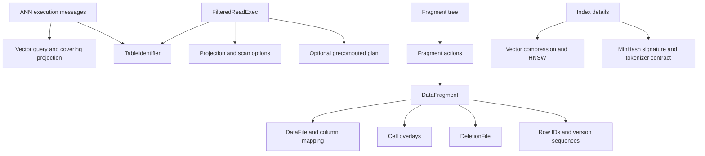

> Historical orientation before M1 synthesis; current entry is [L0](../../L0-orientation.md).

> **V2.1 navigation and contract layer.** Source reading is permitted. Production contracts retained from iteration 85 remain valid at the recorded snapshot. Historical line-count/test-coverage statements are provenance, not completeness requirements. Use [V2.1 protocol](../../V21-PROTOCOL.md) and CORE-MANIFEST.json for current scope.

# Orientation

**M1 orientation synthesis pending.** The retained material supplies established contracts and terminology. Complete architecture and ordered read/write/compact/index traces are the remaining orientation deliverables.

[Entry](../../README.md) · [Protobuf module](../../L1-modules/protos.md) · [Symbols](../../L3-symbols/symbol-index.md) · [Scenarios](../../L4-crosscutting/scenarios.md)

## Contract relationships established so far

Fragments collect files for the same logical rows; missing schema columns are null, deletion metadata removes physical offsets, and overlays replace selected cell values. Row identity and creation/update versions can be encoded inline or represented through gated hidden-column markers. (protos/fragment_metadata.proto:8-87; protos/fragment_metadata.proto:185-305)

The following diagram represents schema references and documented relationships, not a verified runtime call graph. (protos/ann.proto:43-98; protos/filtered_read.proto:15-116; protos/fragment_metadata.proto:8-455; protos/index.proto:190-311)

## Initial glossary

| Term | Meaning established by the schema | Detailed evidence |
|---|---|---|
| Fragment | Dataset-unique group of files storing different columns for the same rows | [DataFragment](../../L2-files/protos/fragment_metadata.proto.md), protos/fragment_metadata.proto:8-17 |
| DataFile | Relative path, field IDs, physical-column mapping, version, optional base, and size hint | protos/fragment_metadata.proto:90-183 |
| Overlay | New values for selected physical-offset/field cells; rank in a coverage bitmap locates the value | protos/fragment_metadata.proto:185-249 |
| Physical rows | Original row count including tombstoned rows | protos/fragment_metadata.proto:83-87 |
| Deletion file | Stored deleted physical offsets, in Arrow IPC or Roaring representation | protos/fragment_metadata.proto:251-286 |
| Row lineage | Row identity and per-row creation/update versions, inline or in hidden non-null uint64 columns | protos/fragment_metadata.proto:34-81; protos/fragment_metadata.proto:288-305 |
| Fragment tree | Root state plus unapplied mutations and subtree routing/aggregate metadata | protos/fragment_metadata.proto:317-405 |
| Covering projection | Presence-sensitive selection of included index field IDs | [ANN contract](../../L2-files/protos/ann.proto.md), protos/ann.proto:28-41 |
| Table identifier | URI, version, optional ETag/manifest, storage options used for remote reconstruction | protos/table_identifier.proto:8-20 |
| IVF | Partition-centroid metadata with offsets and lengths | protos/index.proto:57-76 |
| PQ | Vector quantization metadata for bits, subvectors, dimension, and codebook | protos/index.proto:78-94 |
| Zone map seeds | Per-fragment buffers supporting incremental index updates without full column scans when enabled | protos/index_old.proto:29-45 |
| FTS document granularity | Row or list-element boundary for full-text documents | protos/index_old.proto:55-58; protos/index_old.proto:110-113 |
| MinHash signature version | Independent version for all steps affecting signature comparability | protos/index.proto:303-310 |

Unknown or not-yet-reviewed terms are not silently filled from external knowledge. This glossary will expand with implementation coverage.

## Core terminology

| Term | Local implementation meaning | Evidence |
|---|---|---|
| RowAddress | Physical u64 address with high32 fragment and low32 row offset, distinct from logical stable row ID | rust/lance-core/src/utils/address.rs:6-79 |
| System column | One of five exact row metadata names recognized by the core helper | rust/lance-core/src/lib.rs:22-98 |
| SIMD tier | Cached supported-dispatch selection, distinct from the diagnostic list of raw host features | rust/lance-core/src/utils/cpu.rs:7-96; rust/lance-core/src/utils/cpu.rs:164-225 |
| CPU pool | Lazily created process-global Tokio runtime whose blocking-worker limit is computed from CPU/environment settings | rust/lance-core/src/utils/tokio.rs:12-118 |
| Shared stream | Two consumers replaying one upstream; the faster side causes cloned items to queue for the slower side | rust/lance-core/src/utils/futures.rs:15-80; rust/lance-core/src/utils/futures.rs:127-275 |
| Backpressure capacity | Semaphore permit limit on outstanding shared-stream clones; measured in items, not bytes | rust/lance-core/src/utils/futures.rs:47-80; rust/lance-core/src/utils/futures.rs:127-224 |
| EOF callback | FinallyStream callback on first observed None; early wrapper drop does not invoke it | rust/lance-core/src/utils/futures.rs:277-322 |
| Drop callback | OnDropStream callback at wrapper destruction, even if never polled | rust/lance-core/src/utils/futures.rs:324-370 |

These utilities support other crates, but listing them does not complete dataset execution traces. See [lance-core](../../L1-modules/rust-lance-core.md) for public signatures and [runtime contracts](../../L3-symbols/behavior-contracts.md) for state transitions.

## Datatype terminology

| Term | Reviewed meaning | Evidence |
|---|---|---|
| LogicalType | Private String wrapper with public unchecked From<&str>; encodes Arrow type identity partly in strings, with Field children carrying nested schema | rust/lance-core/src/datatypes.rs:244-285; rust/lance-core/src/datatypes/field.rs:170-195 |
| Field | Mutable tree of identity, logical type, metadata, encoding, nullability, children, optional dictionary and key positions | rust/lance-core/src/datatypes/field.rs:134-161 |
| Logical / prepared / descriptor blob | Input value shape, encoder input shape and stored location shape, with distinct children and nullability | rust/lance-core/src/datatypes.rs:51-188 |
| BlobKind | Byte code selecting Inline0, Packed1, Dedicated2 or External3; describes storage location semantics | rust/lance-core/src/datatypes.rs:595-629 |
| Synthetic descriptor child | Canonical projected child with ID -1; atomic parent projection retains it | rust/lance-core/src/datatypes/field.rs:274-310; rust/lance-core/src/datatypes/field.rs:2182-2220 |
| OneWay nullability | Nullable expected accepts either actual; non-null expected rejects nullable actual | rust/lance-core/src/datatypes/field.rs:411-421 |
| Loaded dictionary | Dictionary has values Some(ArrayRef), so equality uses values instead of offset/length | rust/lance-core/src/datatypes.rs:561-593 |

See the [datatype supplement](../../L1-modules/rust-lance-core-datatypes.md) for exact API contracts. These terms establish local type behavior, not an executable dataset write/read trace.

## Schema selection terminology

Schema holds Field roots and metadata; its equality ignores schema metadata, while configurable comparison can include it. Projectable exposes a borrowed Schema, and Projection selects field IDs plus four metadata-column flags and a blob policy. These are in-memory schemas/selections, not executed read plans. (rust/lance-core/src/datatypes/schema.rs:24-31; rust/lance-core/src/datatypes/schema.rs:174-177; rust/lance-core/src/datatypes/schema.rs:874-878; rust/lance-core/src/datatypes/schema.rs:1099-1108; rust/lance-core/src/datatypes/schema.rs:1191-1204)

Field paths use backticks/doubled backticks; minimal path formatting quotes literal dots/backticks, while expression-oriented formatting quotes other punctuation too. See the [schema API supplement](../../L1-modules/rust-lance-core-schema.md) for edge cases, validation and exact signatures. (rust/lance-core/src/datatypes/schema.rs:1567-1735)
## Core containers, memory and small utilities

| Term | Local meaning | Evidence |
|---|---|---|
| ExpLinkedList | Linked Vec blocks with doubled/capped new block capacity, separately stored element count | rust/lance-core/src/container/list.rs:8-75 |
| DeepSizeOf | Inline size plus estimated descendant allocation; shared Context deduplicates selected pointers | rust/lance-core/src/deepsize.rs:15-44 |
| Context seen identity | usize key, usually exact data-buffer/pointee start address; not general backing-allocation identity | rust/lance-core/src/deepsize.rs:33-35; rust/lance-core/src/deepsize.rs:89-98; rust/lance-core/src/deepsize.rs:182-190 |
| Physical IO recorder | Debug+Send+Sync trait receiving submitted range slices; concrete request timing/counters pending | rust/lance-core/src/utils/io_stats.rs:6-30 |
| Slotted backoff | Random integer slot times unit, with exponentially growing capped slot count | rust/lance-core/src/utils/backoff.rs:79-160 |
| Instrumented stream | Wrapper entering a saved span during each inner poll | rust/lance-core/src/utils/tracing.rs:7-26 |
| Temporary leaf path | A retained unique parent directory and fixed some_file leaf, without opening the leaf | rust/lance-core/src/utils/tempfile.rs:270-343 |

See [the supplement](../../L1-modules/rust-lance-core-storage.md) for the complete local API and distinctions between intended abstractions and actual edge behavior.
## Deletion vectors and single-rewrite mapping

| Term | Local meaning | Evidence |
|---|---|---|
| DeletionVector | Set of deleted u32 offsets within one fragment; three in-memory representations | rust/lance-core/src/utils/deletion.rs:14-21 |
| Visible ordinal | Position among nondeleted rows, mapped by OffsetMapper to a physical local offset | rust/lance-core/src/utils/deletion.rs:125-183 |
| MappingReader | One rewrite's physical-address mapping with position-preserving optional results | rust/lance-core/src/utils/fragment_reuse.rs:14-33 |
| OrderedCompactionMapping | Adapter around one RowAddrRemap, not the FRI graph reader | rust/lance-core/src/utils/fragment_reuse.rs:34-73 |

[Detailed API supplement](../../L1-modules/rust-lance-core-deletion-mapping.md).
## Ordered and stable-partition row mapping

| Term | Local meaning | Evidence |
|---|---|---|
| RowAddrRemap | Ordered compact/direct physical-address lookup with unaffected/deleted/mapped states | rust/lance-core/src/utils/row_addr_remap.rs:57-138 |
| Retained rank | Zero-based position of a surviving offset within its old fragment | rust/lance-core/src/utils/row_addr_remap.rs:258-266 |
| Stable partition | Each destination retains relative source order while rows may interleave between labels | rust/lance-core/src/utils/stable_partition.rs:4-32 |
| Destination label | Nullable u16 index into a destination list; NULL deletes a source physical row | rust/lance-core/src/utils/stable_partition.rs:8-17 |
| CountsMatrix | Dense per-destination cumulative counts through each physical block end | rust/lance-core/src/utils/stable_partition.rs:88-104 |
| SweepTranslator | Sequential per-label counters seeded at a physical block boundary | rust/lance-core/src/utils/stable_partition.rs:446-482 |

[Detailed contracts and exact APIs](../../L1-modules/rust-lance-core-row-mapping.md).
## AIMD control and object-store test instrumentation

| Term | Meaning | Evidence |
|---|---|---|
| AIMD | Additive increase for successful windows, multiplicative decrease only above throttle ratio threshold | rust/lance-core/src/utils/aimd.rs:4-13; rust/lance-core/src/utils/aimd.rs:253-284 |
| RequestOutcome | Capacity signal; Success includes documented non-throttle errors | rust/lance-core/src/utils/aimd.rs:187-195 |
| ProxyObjectStorePolicy | Named path-error and metadata-transform callbacks shared with tests | rust/lance-core/src/utils/testing.rs:49-87 |
| CountingObjectStore | Wrapper counting list attempts through a shared atomic | rust/lance-core/src/utils/testing.rs:129-157; rust/lance-core/src/utils/testing.rs:287-295 |

[Detailed API and limits](../../L1-modules/rust-lance-core-control-testing.md).
## Generic split-block Bloom filters

| Term | Local meaning | Evidence |
|---|---|---|
| SBBF | Split-block Bloom filter: one selected256-bit block, one bit in each of eight32-bit lanes | rust/lance-core/src/utils/bloomfilter/sbbf.rs:76-151; rust/lance-core/src/utils/bloomfilter/sbbf.rs:290-317 |
| AsBytes | Local generic value-to-canonical-byte input trait | rust/lance-core/src/utils/bloomfilter/as_bytes.rs:9-92 |
| NDV | Expected number of distinct inserted values used for sizing | rust/lance-core/src/utils/bloomfilter/sbbf.rs:281-287; rust/lance-core/src/utils/bloomfilter/sbbf.rs:444-447 |
| FPP | False-positive-probability target supplied to analytical sizing, subject to clamp/approximation | rust/lance-core/src/utils/bloomfilter/sbbf.rs:170-287 |

[Exact APIs and limits](../../L1-modules/rust-lance-core-bloom.md).

## Cache terminology

| Term | Established local meaning | Evidence |
|---|---|---|
| Cache namespace | Deterministic32-byte hierarchical keyed-hash scope | rust/lance-core/src/cache/key.rs:120-138 |
| Cache schema | Author-assigned static id and u32 version for logical fields | rust/lance-core/src/cache/key.rs:56-84 |
| Internal cache key | Canonical16-byte truncated digest, no retained readable prefix | rust/lance-core/src/cache/key.rs:86-108; rust/lance-core/src/cache/key.rs:288-295 |
| Backend kind | Lowercase validated scheme name resolving to a synchronous constructor | rust/lance-core/src/cache/registry.rs:52-89; rust/lance-core/src/cache/registry.rs:153-171 |

See [the cache supplement](../../L1-modules/rust-lance-core-cache.md). These primitives do not establish dataset cache usage or full runtime backend behavior.

## Cache serialization vocabulary

LCE1 envelope carries a type identity and body version; CacheDecode distinguishes Hit from a reasoned Miss. CacheEntryWriter/Reader manage typed-body sections and absolute offsets, independently of the16-byte key digest. See [cache module](../../L1-modules/rust-lance-core-cache.md) and [format reconstruction](../../L3-symbols/format-spec.md). (rust/lance-core/src/cache/codec.rs:144-228; rust/lance-core/src/cache/entry_io.rs:28-38; rust/lance-core/src/cache/entry_io.rs:117-126)

## Weighted cache budgets

Moka and Quick are in-memory CacheBackend implementations. Their eviction weights include fixed key cost plus declared entry size; shared-buffer-aware deep traversal is a separate callback-based metric. Quick can partition a budget among shards or use a single shard, so fitting the total cache does not imply admission to one shard. (rust/lance-core/src/cache/moka.rs:25-47; rust/lance-core/src/cache/moka.rs:186-199; rust/lance-core/src/cache/quick.rs:40-50; rust/lance-core/src/cache/quick.rs:101-106; rust/lance-core/src/cache/quick.rs:216-229)

## Typed cache handles

LanceCache clones and child namespaces share backend, counters and type-aware memory callbacks. WeakLanceCache preserves namespace without a strong state reference and can compute a sized value after expiry without caching it. CacheStats counts successful coalesced loads as hits and excludes loader errors; these semantics differ from a raw request success/failure counter. [Full cache surface](../../L1-modules/rust-lance-core-cache.md). (rust/lance-core/src/cache/mod.rs:212-263; rust/lance-core/src/cache/mod.rs:314-358; rust/lance-core/src/cache/mod.rs:420-471; rust/lance-core/src/cache/mod.rs:570-659)

## Core analysis checkpoint

All48 inventoried lance-core files now have complete line annotations and important-symbol records, including its comparison benchmark and allocation test. This is source-analysis coverage, not a claim that tests passed, performance improved, or all dependent crates/callers are understood. The local benchmark compares full wrappers; the allocation fixture measures only warmed key construction. (rust/lance-core/benches/cache_keys.rs:209-365; rust/lance-core/tests/cache_key_allocations.rs:125-166)

## Table capability terminology

The [table module](../../L1-modules/rust-lance-table.md) now documents entry-point routing and capability checks. These are local implementation facts; transaction row-version helpers are covered below, while complete table IO and transaction orchestration remain pending.

| Term | Local meaning | Evidence |
|---|---|---|
| Required feature word | Reader/writer u64 tested against identical build-dependent support mask | rust/lance-table/src/feature_flags.rs:263-307 |
| Sticky paired capability | Exactly mixed-file bit8 or tagged-FRI bit10, preserved after source pairing validation | rust/lance-table/src/feature_flags.rs:114-115; rust/lance-table/src/feature_flags.rs:217-232; rust/lance-table/src/feature_flags.rs:347-378 |
| Experimental opt-in | Environment presence (any value) OR debug_assertions for overlays/spilled lineage; stable-ID FRI only debug_assertions | rust/lance-table/src/feature_flags.rs:117-125; rust/lance-table/src/feature_flags.rs:234-252 |
| Manifest footer identifiers | Table-level0.1 and LANC constants, separate from exact data-file version mappings; complete writer dispatch remains pending | rust/lance-table/src/format.rs:52-55; rust/lance-file/src/version.rs:167-262 |
| System-index recognition | Exact name equality with FRI or MemWAL name constants, without payload checks | rust/lance-table/src/system_index.rs:21-24 |
| Tagged exact iterator size | Caller-supplied remaining count trusted by Iterator/ExactSizeIterator | rust/lance-table/src/utils.rs:6-49 |

## Encoded row identity and operation disposition

InlineRowIds keeps byte content and a shared lazy digest memo together so clones reuse both and replacing the wrapper does not carry an old digest into new bytes. Its digest identifies encoded content, not decoded-row equivalence. RowIdMeta chooses inline bytes or hidden-column storage. (rust/lance-table/src/format/row_ids.rs:27-98; rust/lance-table/src/format/row_ids.rs:141-166)

The format-layer Transaction is a public protobuf wrapper; its schema-change classification is a conservative operation disposition used to decide where validation may be needed, not validation itself. It has no commit lifecycle in its local body. (rust/lance-table/src/format/transaction.rs:16-82)

## Three version domains and manifest ownership

Dataset version is Manifest.version (with bit63 identifying a detached version), writer version is library-specific semver metadata, and data storage version is an exact ConcreteFileVersion. Treat these as separate domains. A Manifest is an in-memory snapshot with shared fragments and private cached logical offsets; its protobuf serialization is not a complete file or a commit. (rust/lance-table/src/format/manifest.rs:39-128; rust/lance-table/src/format/manifest.rs:542-552; rust/lance-table/src/format/manifest.rs:678-724)

Fragment metadata ties columns of the same physical rows to base DataFiles, ordered overlays, optional deletion and inline/column lineage. Every-file operations must account for overlays; lineage lookup intentionally uses base files only. These metadata rules now connect the flag policy to manifest decoding and shallow cloning; dataset IO and transaction publication are still untraced. (rust/lance-table/src/format/fragment.rs:519-558; rust/lance-table/src/format/fragment.rs:589-725; rust/lance-table/src/format/manifest.rs:237-308; rust/lance-table/src/format/manifest.rs:987-1021)

## Three distinct coverage domains

Index fragment_bitmap tracks fragment IDs; overlay bitmaps track physical offsets within a fragment; key-existence Bloom data tracks encoded join keys for conflict detection. They cannot substitute for one another. Unknown index coverage is None, sparse overlay coverage is positional per field, and a Bloom overlap is only a possible key conflict. (rust/lance-table/src/format/index.rs:62-67; rust/lance-table/src/format/overlay.rs:4-34; rust/lance-table/src/format/overlay.rs:65-74; rust/lance-table/src/format/key_existence.rs:175-212)

Covered index fields are dependencies whose values are carried with results; keyed fields decide which search the index can answer. Physical metadata currently validates a suffix representation. The protobuf's future independent-covering feature must not be assumed implemented by that validator. (rust/lance-table/src/format/index.rs:36-51; rust/lance-table/src/format/index.rs:156-243; rust/lance-table/src/feature_flags.rs:86-97)

## File-version request, identity and footer

Caller Stable/Next selectors resolve to exact2.2/2.3 in this snapshot. Persisted identities have no ordering; use explicit capabilities instead of comparing release numbers. V2.0 standard footer is(0,3), embedded footer and DataFile metadata are(2,0), while manifest string is2.0. These spellings describe the same exact identity. Footer-only detection reads8 bytes and does not certify a valid complete file. (rust/lance-file/src/version.rs:19-27; rust/lance-file/src/version.rs:128-262; rust/lance-file/src/lib.rs:25-60)

Overlay staleness is a metadata-derived conservative exclusion set: union newer changes to indexed dependency fields or their ancestors/descendants, then consumers must re-evaluate affected rows. This differs from resolving the newest value and from deleting rows; the helper only returns/accumulates physical offset sets. (rust/lance-table/src/format/overlay/staleness.rs:4-13; rust/lance-table/src/format/overlay/staleness.rs:35-158)

## Positional lineage glossary

- **RowDatasetVersionRun / Sequence:** one dataset version per positional span, stored as runs aligned with row-ID order. Numeric span coordinates are not stable row IDs; consumers use cumulative lengths. [Version module](../../L1-modules/rust-lance-table.md). (rust/lance-table/src/rowids/version.rs:44-80; rust/lance-table/src/rowids/version.rs:272-311)
- **SpilledRowLineage:** preloaded row IDs/creation/update sequences keyed by fragment ID, allowing synchronous manifest preparation to preserve column-stored lineage. Loading itself remains a caller responsibility. (rust/lance-table/src/rowids/version.rs:25-42; rust/lance-table/src/rowids/version.rs:750-769)
- **HoleRuns:** maximal missing-offset runs plus present-count prefixes, supporting offset-to-ordinal rank and inverse selection. It represents holes in a row-ID segment, not dataset-version runs or deletion-file IO. (rust/lance-table/src/rowids/runs.rs:4-34; rust/lance-table/src/rowids/runs.rs:132-190)

## Row-ID representation terms

- **Bitmap:** internal presence bits indexed LSB first within each byte; logical length is separate from byte capacity. Constructors normalize padding, raw construction does not. The schema comment disagrees on bit order. (rust/lance-table/src/rowids/bitmap.rs:7-105; protos/rowids.proto:51-58)
- **EncodedU64Array:** owned U16/U32 relative offsets plus a base or plain U64 values; compressed does not imply sorted. Wire packed integers are little-endian. (rust/lance-table/src/rowids/encoded_array.rs:8-26; rust/lance-table/src/rowids/serde.rs:174-230)
- **Range folding:** decoder merges adjacency and groups ascending separated ranges through the segment helper; sequence writer expands the compact Ranges form back into plain wire Range arms. This changes in-memory representation without adding a protobuf arm. [Codec overview](../../L1-modules/rust-lance-table.md). (rust/lance-table/src/rowids/serde.rs:60-96; rust/lance-table/src/rowids/serde.rs:232-255; rust/lance-table/src/rowids/serde.rs:376-398)

## Segment coordinates and scan state

- **U64Segment:** one of six in-memory representations of an intended distinct u64 sequence. Numeric values, present ordinals and enclosing numeric bounds are separate coordinates. Selection chooses five forms; compact Ranges comes from explicit range grouping/bitmap conversion. [Module](../../L1-modules/rust-lance-table.md). (rust/lance-table/src/rowids/segment.rs:16-82; rust/lance-table/src/rowids/segment.rs:196-299)
- **SegmentCursor / SegmentCursorState:** a public borrowed segment reader and its crate-visible bitmap byte/rank state. The wrapper fixes the source; reusable state alone does not. Dense expansion batches contiguous set-bit runs, while selection indices count present values. (rust/lance-table/src/rowids/segment.rs:749-954)

## Row-ID sequences and ordinal selection

RowIdSequence preserves fragment row order across segments. Stable numeric IDs, ordinal positions and tree-map set membership are distinct: set conversion discards order, while masks translate selected IDs back into ordinal ranges. Public checked construction rejects duplicates within one input; raw range/slice conversions and extend do not enforce table-wide uniqueness. [Sequence analysis](../../L2-files/rust/lance-table/src/rowids.rs.md). (rust/lance-table/src/rowids.rs:39-52; rust/lance-table/src/rowids.rs:209-265; rust/lance-table/src/rowids.rs:302-319; rust/lance-table/src/rowids.rs:609-797; rust/lance-table/src/rowids.rs:865-905)

RowIdSeqSlice is a borrowed positional view. RowIdSequenceCursor instead owns scan counters without a source lifetime: it rewinds for decreasing requests and resets segment state at boundaries, but callers must keep its sequence stable across calls. Internal selection clips at EOF; the public ReadBatchParams adapter has separate bounds/error behavior. (rust/lance-table/src/rowids.rs:54-170; rust/lance-table/src/rowids.rs:456-494; rust/lance-table/src/rowids.rs:559-592; rust/lance-table/src/rowids.rs:908-943; rust/lance-table/src/rowids.rs:1055-1127)

## Creation lineage during transaction preparation

Creation version records first appearance; last-update version records the commit changing values. The reviewed transaction helper resolves stable IDs back to source physical offsets, preserves known creation versions, falls back to1 for unavailable creation of a found source, and stamps new IDs with the supplied commit version. Writer-placed lineage means row-ID Column or creation-version Column; it is a metadata predicate, not a provenance check. [Table details](../../L1-modules/rust-lance-table.md) and [local scenario](../../L4-crosscutting/scenarios.md) separate these synchronous metadata mutations from unreviewed IO/atomic publication. (rust/lance-table/src/transaction/row_version.rs:21-79; rust/lance-table/src/transaction/row_version.rs:258-295)

## Transaction intent and one-attempt preparation

A Transaction stores read_version,UUID,Operation,optional tag and shared string properties. An Operation names one of16 change kinds with typed payloads. PreparedIndices separately carries current-attempt original/prepared index metadata and fragment-reuse intent; it is not persisted by these containers. Full retry/conflict/publication behavior remains pending. [Transaction API](../../L1-modules/rust-lance-table-transactions.md). (rust/lance-table/src/transaction/builder.rs:12-25; rust/lance-table/src/transaction/operation.rs:37-248; rust/lance-table/src/transaction/prepare.rs:4-18; rust/lance-table/src/transaction/prepare.rs:44-100)

CoverageIdentity means UUID plus optional fragment bitmap, with other index metadata excluded from equality. ReadVersionState means borrowed manifest/index evidence from a transaction's fixed read version; it carries no runtime check that the pair matches. UpdatedFragmentOffsets means per-fragment physical offset bitmaps for partial column-update lineage. (rust/lance-table/src/transaction.rs:62-102; rust/lance-table/src/transaction/operation.rs:263-268)

## Equality versus conflict compatibility

Operation equality compares represented intent; different operation kinds always differ. Separate metadata predicates compare config upserts/deletes or table/schema/field metadata scopes. Their bool results are consumed by the commit conflict resolver, whose complete matrix remains pending. Durable commit-outcome identity uses protobuf forms in the inspected path, not these in-memory payload comparisons. (rust/lance-table/src/transaction/conflicts.rs:18-29; rust/lance-table/src/transaction/conflicts.rs:863-989; rust/lance/src/io/commit/conflict_resolver.rs:2039-2052; rust/lance/src/io/commit.rs:246-283)

## Operation pre-validation

Pre-validation checks operation shape against an optional current manifest. It is synchronous metadata inspection with no storage IO; its success does not certify physical files, schema completeness in modern formats or transaction compatibility. Merge field-binding protection and a separate base-file rewrite detector serve different purposes: binding safety versus latest-version stamping. (rust/lance-table/src/transaction/validate.rs:18-200; rust/lance-table/src/transaction/validate.rs:257-416; rust/lance-table/src/transaction/manifest_build.rs:1183-1213)

## Durable transaction representation

Operation intent converts to a generated protobuf transaction before storage. Rust optional-empty states and transient rewrite metadata may disappear; unknown update-mode values decode as row rewrite, and empty rewrite groups take a legacy fallback. Therefore in-memory equality, decoded operation equality and persisted protobuf identity are distinct contracts. Complete byte storage/outcome recovery remains pending. (rust/lance-table/src/transaction/proto.rs:151-184; rust/lance-table/src/transaction/proto.rs:244-283; rust/lance-table/src/transaction/proto.rs:410-424; rust/lance-table/src/transaction/proto.rs:555-569; rust/lance/src/io/commit.rs:246-283)

## Stored index provenance versus live coverage

An index segment's stored fragment bitmap can name retired source fragments, while history maps their rows to later destinations. Unknown coverage (None), known empty coverage and known retired provenance have different retention behavior. TaggedLineage separates stored coverage membership from whether history is walkable; known-empty destination lists differ from unknown lineage. These distinctions drive invalidation and retention, with full reader integration still pending. (rust/lance-table/src/transaction/index_maintenance.rs:219-348; rust/lance-table/src/transaction/index_maintenance.rs:517-625; rust/lance-table/src/system_index/frag_reuse/lineage.rs:23-140)

## Tagged format state and operation admission

A sticky manifest reader flag can keep the tagged format contract active after the entry is removed. Entry recognition, format recognition, paired-flag validation and operation admission are separate predicates: an Untagged admission does not imply the sticky bit is absent. MovesNoRows is also a reason name, while its admitted operations include in-place column rewrites. Use the exact gate branches for development decisions. (rust/lance-table/src/system_index/frag_reuse/metadata.rs:15-49; rust/lance-table/src/system_index/frag_reuse/gate.rs:77-224)

## Ledger, transition and mapping

A FragReuseLedger contains validated supported whole-fragment transitions ordered so producers precede consumers. Each transition owns source/destination digests and either an ordered bitmap/rank remap or an unopened stable-partition reference. Its fingerprint hashes the encoded known transition, independent of legacy dataset-version labels. Unsupported outer transition fields create an explicitly incomplete ledger; it is not safe to infer missing lineage from its lookup maps alone. (rust/lance-table/src/system_index/frag_reuse/ledger.rs:47-95; rust/lance-table/src/system_index/frag_reuse/ledger.rs:173-291; rust/lance-table/src/system_index/frag_reuse/ledger.rs:386-515)

## MemWAL vocabulary

- **SSTable**: immutable flushed MemTable result stored as a Lance dataset, identified by generation/path. Optional payload/row/key measurements describe writer accounting; missing means unmeasured, and payload bytes exclude reader array overhead. (rust/lance-table/src/system_index/mem_wal.rs:31-68)
- **CompactedSsTable**: shard UUID plus latest compacted generation marker. **IndexCatchupProgress** tracks generation per index/shard; absent lookup is documented as fully caught up, not generation zero. (rust/lance-table/src/system_index/mem_wal.rs:94-165)
- **ShardManifest**: shard identity/spec/values, fencing epoch, version, WAL positions, SSTables and lifecycle state. Sealed is the reversible drop-table in-doubt state; enforcement and recovery are external. (rust/lance-table/src/system_index/mem_wal.rs:194-267)
- **MemWalIndexDetails**: configuration, snapshots, compacted markers, index catchup and writer defaults stored in system-index Any metadata. Ordinary mutation here is synchronous; it does not itself write WAL or publish a commit. (rust/lance-table/src/system_index/mem_wal.rs:391-618)

## Manifest assembly vocabulary

- **Candidate manifest**: owned metadata produced by Transaction::build_manifest_prepared before dataset IO migration, final storage checks and write_manifest_file. This is not yet a durable commit. (rust/lance-table/src/transaction/manifest_build.rs:585-611; rust/lance-table/src/transaction/manifest_build.rs:1904-1919; rust/lance/src/io/commit.rs:1741-1782)
- **Read-version proof**: for MemWAL accounting, every segment bitmap of one logical name must be known and their union must cover a nonempty read-manifest fragment set; new credit is capped by both read/current compaction. **Carried credit** additionally requires unchanged UUID/bitmap identities. (rust/lance-table/src/transaction/manifest_build.rs:207-415)
- **Lineage carrier**: V2 base file containing reserved row-ID/version fields required by Column metadata, retained even after all visible fields are projected or replaced. Final candidate validation checks its metadata presence/type. (rust/lance-table/src/transaction/manifest_build.rs:1223-1244; rust/lance-table/src/transaction/manifest_build.rs:1374-1414; rust/lance-table/src/transaction/manifest_build.rs:1571-1597)
- **Range-segment opt-in**: persisted lance.row_ids.range_segments controls compact range conversion of inline row-ID sequences after config updates, with current shared-buffer skip. It does not change Column lineage or retroactively reverse existing ranges when disabled. (rust/lance-table/src/transaction/manifest_build.rs:59-124; rust/lance-table/src/transaction/manifest_build.rs:1868-1871)

## Metadata IO vocabulary

- **Manifest tail prefetch** reads the last64KiB, discovers a length-prefixed manifest body from footer offset, then fetches missing leading chunks when necessary. It is not a data-file read or feature capability check. (rust/lance-table/src/io/manifest.rs:32-128)
- **Manifest section offset** points to separately length-prefixed index or inline-transaction metadata earlier in the same file; unwritten sections must clear inherited offsets. (rust/lance-table/src/io/manifest.rs:129-210)
- **Deletion object** stores physical u32 row offsets in one Arrow IPC batch or Roaring bitmap; the field name row_id does not imply stable u64 identity. Path uses fragment/read-version/random-id and external base resolution belongs to caller. (rust/lance-table/src/io/deletion.rs:25-134; rust/lance/src/io/deletion.rs:11-43)

## Manifest publication vocabulary

- ManifestNamingScheme: decimal V1 or inverted/padded V2 naming under _versions; independent of data-file encoding version. Detached names carry a d prefix. (rust/lance-table/src/io/commit.rs:70-164)
- VersionHint: best-effort JSON version used by nonlexical listings; verified through HEAD probes under contiguous-history assumptions. (rust/lance-table/src/io/commit.rs:315-571)
- ManifestLocation: version/path/optional size, physical ETag and distinct optional external record identity. A returned fallback path can be unverified. (rust/lance-table/src/io/commit.rs:232-287; rust/lance-table/src/io/commit.rs:1057-1102)
- CommitLock / CommitLease / LeaseGuard: external lock seam, async release contract and cancellation guard; the guard does not implement fencing or TTL. (rust/lance-table/src/io/commit.rs:1359-1502)
- PredecessorIdentity: version plus external incarnation token used by optional reservation-conditioned publication; defaults do not support it. (rust/lance-table/src/io/commit.rs:994-1049; rust/lance-table/src/io/commit.rs:1724-1731)

See [commit supplement](../../L1-modules/rust-lance-table-commit.md) for complete local APIs and failure ordering. Whole-dataset retry/conflict and external authority remain pending.

## External manifest authority

An external manifest store coordinates a version record separately from object bytes. Generic publication selects unique staging bytes then copies to a canonical path; predecessor-conditioned publication instead makes the unique path final through an identity-bearing record. Record identity protects a particular incarnation and is distinct from physical ETag. See [external commit](../../L1-modules/rust-lance-table-external-commit.md). (rust/lance-table/src/io/commit/external_manifest.rs:117-161; rust/lance-table/src/io/commit/external_manifest.rs:286-335; rust/lance-table/src/io/commit/external_manifest.rs:1049-1121)

**Helping finalizer**: a reader that materializes selected staging bytes and repairs the generic external index. **Reservation**: Reserved with a minted identity, Taken, or PredecessorChanged for conditioned publication. **Authoritative external history**: Some(Vec) of identified final locations, including unique filenames excluded by ordinary manifest parsing. (rust/lance-table/src/io/commit/external_manifest.rs:104-115; rust/lance-table/src/io/commit/external_manifest.rs:623-705; rust/lance-table/src/io/commit/external_manifest.rs:907-961)

## Row-ID address lookup and DynamoDB authority

RowIdIndex maps stable IDs to surviving physical addresses through either merged ID/address segments or bounded-overlap fragment probing. It incorporates the supplied deletion vectors; physical row IDs and addresses remain different coordinate systems. [Row-ID index](../../L1-modules/rust-lance-table-row-index.md). (rust/lance-table/src/rowids/index.rs:29-79; rust/lance-table/src/rowids/index.rs:391-419)

DynamoDBExternalManifestStore is a concrete generic external coordinator with strong GetItem/Query reads and conditional target-row PutItem. It does not implement predecessor record identities. [DynamoDB](../../L1-modules/rust-lance-table-dynamodb.md). (rust/lance-table/src/io/commit/dynamodb.rs:244-513)

**Bitmap rank directory**: cumulative set-bit counts every256 bitmap bytes, allowing local prefix counting for ID-to-position lookup. **Fragment envelope**: inclusive minimum/maximum ID bounds that can cover holes and do not imply live ownership throughout. (rust/lance-table/src/rowids/index.rs:253-338; rust/lance-table/src/rowids/index.rs:352-435)

## Task-stream and system-column boundary

ReadBatchTask combines a future batch and its declared pre-deletion row count. MergeStream aligns different per-file batch boundaries; system-column wrapping then assigns selection offsets before concurrent future completion. Read-ahead targets 65,536 IDs, while downstream retained batches can keep older buffers alive. A system column is a requested ID/address/version array appended to payload; null-deletion mode nulls only ID/address fields. See the [stream supplement](../../L1-modules/rust-lance-table-stream.md). (rust/lance-table/src/utils/stream.rs:30-40; rust/lance-table/src/utils/stream.rs:126-216; rust/lance-table/src/utils/stream.rs:218-264; rust/lance-table/src/utils/stream.rs:648-848)

## File runtime vocabulary and boundaries

- **Fields / FieldsWithMeta**: public flat protobuf wrappers used to reconstruct core schema trees, with optional schema metadata; parents precede children and historical duplicate-ID parents use first pre-order match. (rust/lance-file/src/datatypes.rs:95-314)
- **LanceEncodingsIo**: single-file range adapter preserving one result per request through splitting, empty placeholders and reassembly. **Read chunk size** is a balancing target, not a strict last-chunk cap. (rust/lance-file/src/io.rs:12-148)
- **OpenedFileReader**: dispatch result with either raw legacy footer numbers or a current FileReader. **FileWriter**: runtime enum over four boxed exact V2 writers. (rust/lance-file/src/versions/mod.rs:50-61; rust/lance-file/src/writer.rs:67-77)
- **ExpectedTypes / FieldTypeMismatch**: cached schema/type gate and public diagnostic; missing-column, nullability and actual encoding checks are separate responsibilities. (rust/lance-file/src/writer/field_types.rs:21-193)

See [file runtime boundaries](../../L1-modules/rust-lance-file-runtime.md). These contracts fill local schema/IO/write-interface gaps; the complete data-file runtime and Dataset trace remain pending.

## Current file mechanism vocabulary

**Header-inclusive columns** (V2_0) assign a physical slot to ordinary containers as well as descendants. **Leaf columns** (V2_1+) omit ordinary parent headers while treating Blob/packed and empty-child fields as one column. Field IDs and physical indices are separate identities; duplicate IDs can collapse in a map. (rust/lance-file/src/versions/v2_0/mod.rs:38-82; rust/lance-file/src/reader/structural.rs:173-224)

**Composition** selects exact ordered field/page/compression mechanisms. **Prepared projection** couples decoded column metadata with schema and decoder indices; indexed preparation renumbers loaded columns locally. **Normalized length** can use sparse structural slots instead of raw page row counts. See [composition](../../L1-modules/rust-lance-file-composition.md). (rust/lance-file/src/versions/v2_3/mod.rs:129-139; rust/lance-file/src/reader/structural.rs:393-431; rust/lance-file/src/reader.rs:539-561)

## Reader grammar versus emitted policy

An exact reader checks a version-specific metadata grammar before byte decoding. V2_1 requires small miniblock chunks; V2_2/3 require large (u32) chunks. V2_1 admits only all-null ConstantLayout, V2_2/3 validate optional compressed levels, and V2_3 recursively admits RLE child trees plus selective sparse structure. These checks do not validate every numeric attribute or payload byte. [Reader detail](../../L1-modules/rust-lance-file-readers.md). (rust/lance-file/src/versions/v2_1/reader.rs:26-159; rust/lance-file/src/versions/v2_2/reader.rs:26-161; rust/lance-file/src/versions/v2_3/reader.rs:26-199)

## Structural writer execution boundary

The exact V2_1/V2_2/V2_3 Writer chooses grammar, then EncodingPipeline runs field encoders and StructuralFileSink writes buffers/metadata. Finish consumes encoders, writes descriptor and two offset tables, appends a 40-byte exact footer, then awaits object shutdown. These local steps precede any Dataset publication; backend durability and complete compaction remain pending. (rust/lance-file/src/versions/v2_1/writer.rs:78-84; rust/lance-file/src/versions/v2_1/writer.rs:152-186; rust/lance-file/src/versions/v2_2/writer.rs:152-186; rust/lance-file/src/versions/v2_3/writer.rs:152-186) [Writer lifecycle](../../L1-modules/rust-lance-file-structural-writer.md).

PageMetadataSpill is a temporary sidecar of length-delimited protobuf Page metadata with per-column chunk lists; finalization reconstructs a full column's pages. OutOfLineBuffers reserves physical positions using alignment but stores original payloads without adding padding. Neither term implies bounded whole-operation memory or automatic cleanup. (rust/lance-file/src/writer/structural.rs:47-129; rust/lance-file/src/writer/structural.rs:312-340; rust/lance-encoding/src/encoder.rs:130-159)

## V2_0 output and compatibility provenance

The [V2_0 writer/compatibility supplement](../../L1-modules/rust-lance-file-v20-compatibility.md) traces the separate array writer and the pinned baseline test harness. Standard V2_0 files emit footer(0,3), embedded forms emit(2,0); both resolve to the same exact identity. Stable fixtures enforce byte reproduction and current reading, while V2_3 has only current-revision determinism. This does not complete binary payload or encoder algorithm coverage. (rust/lance-file/src/versions/v2_0/writer.rs:812-828; rust/lance-file/src/versions/v2_0/writer.rs:928-952; rust/lance-file/src/compatibility_tests.rs:379-524)

## Writer test evidence

The [writer-test catalog](../../L1-modules/archive/rust-lance-file-writer-tests.md) separates metadata/success-only assertions from actual value, size and pointer-identity oracles across27 named tests. Unequal projected root lengths reject even a common-prefix range; V2_0 null-struct validation depends on logical parent selection. These are source-derived test contracts, not executed results. (rust/lance-file/src/writer_tests.rs:297-448; rust/lance-file/src/writer_tests.rs:817-1083)

## Shared reader: metadata index and prepared reads

A **metadata index** retains schema, file row count, GBO and CMO descriptors without decoded column protobufs. **Prepared projection** combines loaded normalized columns and decoder-facing indices; indexed preparation compacts indices while retaining requested order. **Retained globals** are copied user buffers fully captured by the initial tail, excluding schema. The [shared reader guide](../../L1-modules/rust-lance-file-shared-reader.md) maps these lifetimes and distinguishes file rows, raw column rows and normalized selected length. (rust/lance-file/src/reader.rs:120-238; rust/lance-file/src/reader.rs:392-425; rust/lance-file/src/reader.rs:718-738; rust/lance-file/src/reader/structural.rs:393-431)

## Encoded concatenation and runtime parts

Encoded-file concatenation copies page buffers and relocates metadata in caller order; it is separate from Dataset compaction/transaction publication. DataFilePart is a validated runtime complete file with optional Blob lease and opaque target ID. Ordinary concatenation can reuse one compatible input; part concatenation always writes a new output. Unsupported compatibility is a structured outcome for caller-owned fallback. (rust/lance-file/src/concat.rs:4-8; rust/lance-file/src/concat.rs:93-127; rust/lance-file/src/concat.rs:663-671; rust/lance-file/src/concat.rs:916-955; rust/lance-file/src/concat.rs:1172-1180) [Module](../../L1-modules/rust-lance-file-concat.md).

## Frozen V1 foundation terms

A V1 physical column slot includes ordinary parent fields as well as leaves; Blob and packed structs stop descendant traversal. A V1 batch-offset vector is a signed cumulative sentinel vector, while a V1 page table maps(field ID,batch ID)to(position,logical length) and persists a dense pair matrix with0/0 holes. Schema dictionaries store offset/length separately from hydrated values. These are legacy contracts; current encoding development uses the current paths. (rust/lance-file/src/versions/v1/mod.rs:72-116) (rust/lance-file/src/versions/v1/format/metadata.rs:85-123) (rust/lance-file/src/versions/v1/page_table.rs:36-145) (rust/lance-file/src/versions/v1/encoding.rs:92-192) See the [V1 foundation supplement](../../L1-modules/rust-lance-file-v1-foundation.md).

## Frozen V1 codec terms

- **Absolute binary position table**: N+1 Int64 file offsets written after N rows' payload; PageInfo points to that table. Equal adjacent positions become null only when the decoder's nullable flag is true. (rust/lance-file/src/versions/v1/encoding/binary.rs:48-105; rust/lance-file/src/versions/v1/encoding/binary.rs:165-232)
- **Plain validity loss**: fixed-stride values persist without a validity buffer; Boolean None becomes false and decoded primitive rows are all valid. This is a historical V1 constraint. (rust/lance-file/src/versions/v1/encoding/plain.rs:73-115; rust/lance-file/src/versions/v1/encoding/plain.rs:202-208)
- **Shared dictionary values**: V1 key pages contain plain integer keys, while a supplied ArrayRef provides the values and is shared by decoded dictionary arrays. (rust/lance-file/src/versions/v1/encoding/dictionary.rs:37-55; rust/lance-file/src/versions/v1/encoding/dictionary.rs:151-159)

[Concrete codec contracts](../../L1-modules/rust-lance-file-v1-codecs.md) explain range/take IO and test limits. V2.1 milestone acceptance remains pending; exhaustive repository analysis is cancelled.

## Frozen V1 reader: supplied state and reconstruction

The historical reader owns a caller-supplied Schema and shared Reader/metadata/tables. Ordinary construction does not discover schema or dictionary values; table-layer SelfDescribingFileReader supplies that separate hydration step. Per-call projection determines output, and fragment_id here is diagnostic rather than a generated row-ID column. [Complete reader supplement](../../L1-modules/rust-lance-file-v1-reader.md). (rust/lance-file/src/versions/v1/reader.rs:41-66; rust/lance-file/src/versions/v1/reader.rs:139-208; rust/lance-file/src/versions/v1/reader.rs:324-335; rust/lance-table/src/format/manifest.rs:1156-1182)

V1 reader terminology: a string cache key is a typed path component with stable previous-format identifiers; page statistics use a separately cached optional table with one batch; a list position array contains the terminal endpoint needed to select child rows. These are local V1 mechanisms, not current-format registrations or complete Dataset semantics. (rust/lance-file/src/versions/v1/reader.rs:68-123; rust/lance-file/src/versions/v1/reader.rs:239-267; rust/lance-file/src/versions/v1/reader.rs:741-807)

## Frozen V1 writer lifecycle

The [V1 writer supplement](../../L1-modules/rust-lance-file-v1-writer.md) closes the local historical write path: validate all supplied batches, collect per-call statistics, write recursive pages sequentially, append cumulative row count, flush, then advance batch ID. Finalization writes data/statistics tables, dictionary values, an optional schema manifest, framed metadata and the 0.2 LANC footer before shutdown returns authoritative size. Failures have no local rollback/abort guard; this is not a complete Dataset write/compaction or backend durability account. Preserve frozen compatibility rather than extending this path for new features. (rust/lance-file/src/versions/v1/writer/mod.rs:166-270; rust/lance-file/src/versions/v1/writer/mod.rs:588-651; AGENTS.md:13-18)

## V1 statistics bounds

The [statistics supplement](../../L1-modules/rust-lance-file-v1-statistics.md) completes the local historical min/max collector. A statistics row reduces all arrays in one writer call; numeric empty bounds can be present sentinels while strings/binary use absent bounds. A64-byte prefix is a conservative bound, not necessarily an observed value. Automatic collection is narrower than low-level dispatch; dictionary reduction inspects full values arrays. These contracts are frozen compatibility context, not a modern feature extension seam. (rust/lance-file/src/versions/v1/writer/statistics.rs:33-174) (rust/lance-file/src/versions/v1/writer/statistics.rs:241-609) (rust/lance-file/src/versions/v1/writer/mod.rs:189-199; AGENTS.md:13-18)

## Reading benchmark results

The [file benchmark guide](../../L1-modules/archive/rust-lance-file-benchmarks.md) distinguishes input-memory bytes, selected-row elements and flat schema-entry throughput. A decode label can include opening and result consumption; a nocache label is only platform-dependent page-cache advice. No measured result is supplied by this KB. (rust/lance-file/benches/reader.rs:60-124) (rust/lance-file/benches/reader.rs:128-149) (rust/lance-file/benches/reader.rs:384-454) (rust/lance-file/benches/schema.rs:54-69)

## Binary evidence and the pinned V1 fixture

A binary fixture has byte coordinates, not physical text lines. The [V1 byte map](../../L1-modules/archive/rust-lance-file-binary-fixtures.md) traces all387,133 bytes: five row batches, a field-major page table, dictionary values, metadata and footer. The schema is external. Stored offsets distinguish nullable names, but list/child/dictionary validity is lost by the frozen V1 representation; current compatibility expectations account for that loss. This static interpretation does not establish a passing runtime test. (rust/lance-file/test_data/exact_versions/v1.lance@bytes:0-387133; rust/lance-file/test_data/exact_versions/datagen.rs:25-100; rust/lance-file/src/compatibility_tests.rs:100-135; rust/lance-file/src/compatibility_tests.rs:467-524)

## Embedded V2_0: mini versus self-described

Both [embedded fixtures](../../L1-modules/archive/rust-lance-file-embedded-fixtures.md) contain the same 257 id/name rows, 17 integer pages and 129 string pages. Mini requires an external schema; self-described inserts a100-byte descriptor and16-byte GBO entry. Their footer alias is(2,0), whereas the standard V2_0 writer emits(0,3). These are representations of the same exact version. String nulls use an explicit page-local offset adjustment, and the embedded page-buffer path inserts no alignment padding. (rust/lance-file/src/version.rs:200-262; rust/lance-file/src/versions/v2_0/writer.rs:852-951; rust/lance-file/test_data/exact_versions/v2_0_mini.lance@bytes:0-22961; rust/lance-file/test_data/exact_versions/v2_0_self_described.lance@bytes:0-23077)

## Standard V2_0 fixture: five fields across six columns

The [standard V2_0 byte map](../../L1-modules/archive/rust-lance-file-standard-v20-fixture.md) covers4097 rows and976 pages. A nullable list consumes separate parent-offset and child-value columns; strings, lists, child integers and dictionary keys represent nulls differently. Blob payloads are written out-of-line before each batch's pages and selected by packed(position,size) descriptions. This standard writer pads every buffer to64 bytes with0x48 and emits footer(0,3), distinct from the unpadded embedded(2,0) representation. These local artifacts do not establish complete Dataset or encoding-crate behavior. (rust/lance-file/test_data/exact_versions/datagen.rs:37-131; rust/lance-file/src/versions/v2_0/writer.rs:451-506; rust/lance-file/test_data/exact_versions/v2_0.lance@bytes:0-706157)

## Standard V2_1: structural levels inside one list column

The [complete V2_1 artifact](../../L1-modules/archive/rust-lance-file-standard-v21-fixture.md) maps five fields to five physical columns and 25 pages. List offsets become repetition/definition levels beside the leaf data: 4,097 rows produce 11,172 child slots and 11,545 level entries because null lists add markers without child values. Compression acts on mini-blocks with separate level/value streams; blobs retain out-of-line payloads and page-level description wrapping. Complete decoding covers all 501,167 bytes; it does not establish full Dataset behavior. (rust/lance-encoding/src/repdef.rs:425-644; rust/lance-encoding/src/encodings/logical/primitive.rs:6396-6465; rust/lance-file/test_data/exact_versions/v2_1.lance@bytes:0-501167)

## Standard V2_2 and complete local lance-file coverage

All56 lance-file inventory entries now have full local file coverage, including six preserved/interpreted binary fixtures. The [V2_2 artifact](../../L1-modules/archive/rust-lance-file-standard-v22-fixture.md) has23 mini-block pages and two constant pages: one inline integer and one framed Utf8 scalar. Large mini-block framing widens metadata and value-buffer sizes to32 bits while retaining16-bit level counts/sizes. Full encoding/IO and Dataset behavior still require later analysis. (rust/lance-file/src/versions/v2_2/mod.rs:119-131; rust/lance-encoding/src/encodings/logical/primitive.rs:5751-5910; rust/lance-file/test_data/exact_versions/v2_2.lance@bytes:0-500987)

## Encoding facade: separate IO, metadata and version validation

The [encoding module](../../L1-modules/rust-lance-encoding.md) now covers its facade and metadata helpers. EncodingsIo is the single-file scheduling seam, BufferScheduler serves an already-owned byte buffer, and format helpers construct protobuf trees. These are distinct from physical compression and exact-version reader validation. The crate has a compile-time little-endian requirement. The initial facade slice covered 7 files; current coverage is 32 of 74; complete encoding and IO lifecycles remain pending. (rust/lance-encoding/src/lib.rs:11-134; rust/lance-encoding/src/format.rs:50-773; rust/lance-file/src/versions/v2_1/reader.rs:93-110; rust/lance-file/src/versions/v2_2/reader.rs:93-118)

Terminology additions: **EncodingsIo** is a Debug + Send + Sync single-file IO interface; **BufferScheduler** is its in-memory Bytes implementation; **CompressiveEncoding** is a structural compression-description tree; **PageLayout** selects structural page organization; **ProtobufUtils21** constructs members of the shared V2.1-and-newer grammar, not a guarantee of exact V2.1 legality. (rust/lance-encoding/src/lib.rs:33-134; rust/lance-encoding/src/format.rs:19-33; rust/lance-encoding/src/format.rs:307-773)

## Encoding configuration and payload transformations

The [encoding module](../../L1-modules/rust-lance-encoding.md) now has 32 of 74 files covered. **CompressionParams** overlays type and column settings; **AccumulationQueue** groups arrays and tracks supplied top-level row counts; **BytepackedIntegerEncoder** writes externally framed LE integers or omits an index; **BufferCompressor** appends one codec result; **GeneralBlockDecompressor** unwraps outer compression then invokes an inner decoder. None publishes a dataset or chooses a file version itself. (rust/lance-encoding/src/compression_config.rs:45-141; rust/lance-encoding/src/utils/accumulation.rs:24-105; rust/lance-encoding/src/utils/bytepack.rs:73-224; rust/lance-encoding/src/encodings/physical/block.rs:141-145; rust/lance-encoding/src/encodings/physical/block.rs:433-675)

## Buffer and structural chunk vocabulary

**LanceBuffer** is an owned Arrow byte-buffer wrapper; **ScalarBuffer typed borrow** is an owning shared-or-copied handle, while **Cow typed view** can borrow directly. **PerValueDataBlock** carries independently decodable full-zip values as fixed or variable buffers. **MiniBlockCompressed** stores parallel buffers and per-chunk sizes/counts; **log_num_values=0** denotes the residual final count. **General mini-block compression** wraps only the first buffer in each chunk and keeps the wrapper only for aggregate savings. [Full contracts and declarations](../../L1-modules/rust-lance-encoding.md). (rust/lance-encoding/src/buffer.rs:12-22; rust/lance-encoding/src/buffer.rs:144-203; rust/lance-encoding/src/encodings/logical/primitive/fullzip.rs:20-54; rust/lance-encoding/src/encodings/logical/primitive/miniblock.rs:45-144; rust/lance-encoding/src/encodings/physical/general.rs:39-115)

## Raw-list and bitpacking vocabulary

**Raw ValueEncoder** stores leaf bytes and represents nested FSL validity either in parallel mini-block buffers or interleaved per-value row bytes. **Inline bitpacking** stores a width word beside each1024-value chunk. **Out-of-line bitpacking** stores one width in metadata and distinguishes its residual raw/padded representation by payload length. **FastLanes** transposes values into native-word lanes; it is not simple adjacent-value bit concatenation. [Encoding contracts](../../L1-modules/rust-lance-encoding.md), [wire details](../../L3-symbols/format-spec.md). (rust/lance-encoding/src/encodings/physical/value.rs:141-465; rust/lance-encoding/src/encodings/physical/bitpacking.rs:75-166; rust/lance-encoding/src/encodings/physical/bitpacking.rs:389-650; rust/compression/bitpacking/src/lib.rs:1-174)

## Variable-offset, FSST and BSS vocabulary

**Variable mini-block** embeds a chunk-relative offset table before payload; **Variable block** adds a width/data-start header; **Variable per-value** retains separate offset/value buffers. **FSST** replaces byte strings using a per-page symbol table and can bypass compression for small input. **BSS (byte-stream split)** transposes bytes by position within a chunk before separate compression. [Codec contracts](../../L1-modules/rust-lance-encoding.md), [byte layouts](../../L3-symbols/format-spec.md). (rust/lance-encoding/src/encodings/physical/binary.rs:58-152; rust/lance-encoding/src/encodings/physical/binary.rs:454-557; rust/lance-encoding/src/encodings/physical/fsst.rs:147-194; rust/lance-encoding/src/encodings/physical/byte_stream_split.rs:109-193; rust/compression/fsst/src/fsst.rs:1115-1218)

## Packed rows and codec statistics

**Packed struct** interleaves child payloads row by row. **Variable packed struct** adds a length prefix for each variable compressed child and a separate outer row-offset table. **Empty packed row** supplies per-child placeholders; structural validity is handled outside this codec. **BlockInfo** is a shared cache of Arrow arrays, **BitWidth** uses1024-value physical chunks, **BytePositionEntropy** samples up to64 leading values, and **Cardinality** is an approximate HLL estimate. [Module and contracts](../../L1-modules/rust-lance-encoding.md), [wire layout](../../L3-symbols/format-spec.md), [development recipes](../../L4-crosscutting/cookbook.md). (rust/lance-encoding/src/encodings/physical/packed.rs:327-417; rust/lance-encoding/src/encodings/physical/packed.rs:587-866; rust/lance-encoding/src/data.rs:63-85; rust/lance-encoding/src/statistics.rs:232-549)

## Compression strategy vocabulary

A **compression strategy** chooses a codec for one structural interface using a field and data statistics; a **decompression strategy** reconstructs a reader from persisted descriptors. **Count-dependent RLE child** means a child such as out-of-line bitpacking needs the number of runs supplied before decoding; both children cannot have that dependency. A **metadata-only block** has no payload at all, distinct from an empty present buffer. These contracts do not select the file version or perform IO. [Detailed contracts](../../L1-modules/rust-lance-encoding.md). (rust/lance-encoding/src/compression.rs:86-152; rust/lance-encoding/src/compression.rs:934-987; rust/lance-encoding/src/compression.rs:1238-1389)

## RLE run vocabulary

A **physical run** is one value/count entry, possibly split by length width or mini boundaries. A **coalesced run** groups adjacent equal physical values without changing logical coverage. A **literal run length** stores the actual positive repeat count. A **strict lazy RLE view** validates complete coverage while retaining values/lengths unexpanded; ownership measurements distinguish visible bytes from retained capacity. [Encoding details](../../L1-modules/rust-lance-encoding.md). (rust/lance-encoding/src/encodings/physical/rle.rs:693-725; rust/lance-encoding/src/encodings/physical/rle.rs:1779-1944)

## Physical block vocabulary

A **DataBlock** is a codec-oriented in-memory representation of values and buffers. **BlockInfo** is its shared statistics map. A **normalized offset buffer** rebases selected variable data to zero, while the checked Arrow reconstruction path can accept a bounded nonzero base. **Dictionary null normalization** represents null rows as keys to a null item. These representations must not be mistaken for complete file framing or generic Arrow serialization. [Encoding module](../../L1-modules/rust-lance-encoding.md). (rust/lance-encoding/src/data.rs:4-16; rust/lance-encoding/src/data.rs:61-86; rust/lance-encoding/src/data.rs:797-956; rust/lance-encoding/src/data.rs:1211-1227; rust/lance-encoding/src/data.rs:1504-1597; rust/lance-encoding/src/data.rs:1685-1778)

## Structural glossary refinement

A dense structural entry is a leaf slot or an invisible null/empty list. Repetition marks list starts with outer levels higher; definition0 is valid. Leaf-first DefinitionInterpretation distinguishes null versus empty. A control word packs levels into0/1/2/4 little-endian bytes and reports row-start, visibility and validity separately. FSL validity is broadcast on write and decimated on read. [Encoding module](../../L1-modules/rust-lance-encoding.md). (rust/lance-encoding/src/repdef.rs:4-107; rust/lance-encoding/src/repdef.rs:426-451; rust/lance-encoding/src/repdef.rs:593-645; rust/lance-encoding/src/repdef.rs:2334-2340; rust/lance-encoding/src/repdef.rs:2412-2548)

## Encoder orchestration glossary

A field encoder buffers a logical Arrow field and may emit several physical columns. A field strategy selects it before data; an array strategy selects a page encoder. EncodeTask produces one page asynchronously. OutOfLineBuffers reserves absolute padded positions but retains unpadded payloads; actual writers must implement the reservation. FieldEncodingContext carries the complete recursive strategy and root metadata. The in-memory encode_batch helper is a separate test/IPC path with sequential polling and unpadded appends. [Encoding module](../../L1-modules/rust-lance-encoding.md). (rust/lance-encoding/src/encoder.rs:56-73; rust/lance-encoding/src/encoder.rs:117-233; rust/lance-encoding/src/encoder.rs:288-322; rust/lance-encoding/src/encoder.rs:398-501)

## Decoder facade glossary

Scheduling selects byte ranges and produces page messages; decoding materializes Arrow arrays through tasks. Array and structural message grammars are distinct. A ReadBatchTask carries a future plus expected row count. Structural byte targets adapt using reported decoded size and can overshoot; array i32-offset limits are a separate mechanism. RequestBatch aggregates I/O calls while preserving each caller's buffer order. [Module contracts](../../L1-modules/rust-lance-encoding.md). (rust/lance-encoding/src/decoder.rs:1542-1558; rust/lance-encoding/src/decoder.rs:1636-1734; rust/lance-encoding/src/decoder.rs:2089-2199; rust/lance-encoding/src/decoder.rs:2863-3064)

## Primitive index and value terms

A mini-block has distinct byte, top-level-row and leaf-value coordinates. A trailer begins a row continued in the next block; that next block has a preamble. Constant pages retain one scalar plus repetition/definition levels, then materialize selected leaf positions. Dictionary normalization moves null dictionary entries into key validity before encoding; physical null-key repair prevents invalid hidden indices when validity is removed. [Helper contracts](../../L1-modules/rust-lance-encoding.md). (rust/lance-encoding/src/encodings/logical/primitive/chunk_index.rs:185-343; rust/lance-encoding/src/encodings/logical/primitive/constant.rs:341-492; rust/lance-encoding/src/encodings/logical/primitive/dict.rs:30-170)

## Blob decode view and representation

Original BlobLayout stores position/size descriptions plus same-file payload buffers; descriptor-only reads and binary materialization use separate cache views. Blob-v2 prepared records become kind/position/size/blob_id/blob_uri descriptors, with sidecar/URI handling outside this encoder. A payload shard is a byte-targeted group of original Blob reads, distinct from dataset fragments or MemWAL shards;32MiB is a target that can be exceeded. [Blob contracts](../../L1-modules/rust-lance-encoding.md). (rust/lance-encoding/src/encodings/logical/blob.rs:31-437; rust/lance-encoding/src/encodings/logical/primitive/blob.rs:262-432; rust/lance-encoding/src/encodings/logical/primitive.rs:4708-4725)

## Fixed slots and map entries

A fixed-size-list dimension gives the number of child slots per outer row. Null outer rows still reserve those slots; variable-size descendants under them can be cleared with a garbage mask. Map entries are Struct key/value rows whose offsets and parent validity are reconstructed through rep/def layers. The current complex FSL path requires immediate Struct children, while Map requires unsorted entries and a nonnullable key. [Nested wrapper contracts](../../L1-modules/rust-lance-encoding.md). (rust/lance-encoding/src/encodings/logical/fixed_size_list.rs:48-91; rust/lance-encoding/src/encodings/logical/fixed_size_list.rs:328-350; rust/lance-encoding/src/encodings/logical/map.rs:191-238; rust/lance-encoding/src/encoder/structural.rs:189-258)
